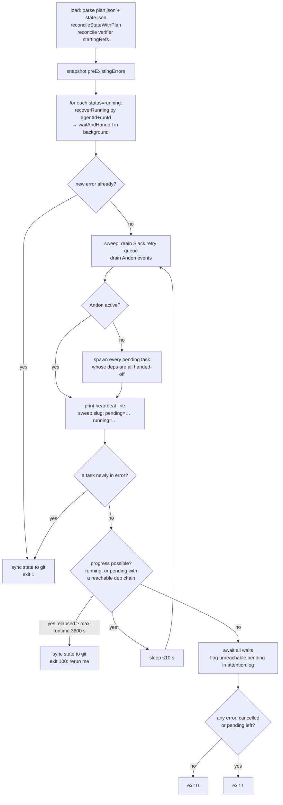

# orchestrate: the reconcile loop and its liveness design

**Source workflow:** Poteto (Cursor `orchestrate` plugin, added by Sam Sokolin, co-maintained by poteto; compared with pstack's Orchestrate playbook, `swarm`, and noodle)  **Stages:** Dispatch/Isolate, Build, Verify, Operate/Monitor, Human gates, Liveness, Cost
**Primary sources:**
- `~/code/plugins/orchestrate/README.md`, `skills/orchestrate/SKILL.md`, `references/{dispatcher,planner,spawning,handoffs}.md`, `prompts/*.md` (all ten)
- `skills/orchestrate/scripts/core/loop.ts`, `core/agent-manager.ts` (2,113 lines, read in full), `core/failure-handoff.ts`, `core/andon.ts`, `core/handoff.ts`, `measurements.ts`, `schemas.ts`, `cli/{index,task,inspect,andon,forensics,util}.ts`, `tools/nudge-root.ts`, and the test names under `scripts/__tests__/`
- `git log -- orchestrate` in `~/code/plugins`
- `~/.claude/plugins/cache/cursor-plugins/pstack/0.15.28/skills/poteto-mode/playbooks/orchestrate.md`, `poteto-mode/scripts/orch/{orch.ts,store.ts}`, `skills/swarm/SKILL.md`, `docs/harness/claude-code.md`
- Port target: `adws/adw_triggers/trigger_cron.py`, `adws/adw_modules/{agent.py,child_run.py,progress.py}`, `adws/pipelines/factory.py`, `CONTEXT.md`, `../../workflows/adw/overview.md` §3.12–3.14 and §5
- Prior research (skimmed, extended here): `../../workflows/poteto/cursor-native-pieces.md` §4, `../../workflows/poteto/pstack-mechanics.md` §3.8, `../../workflows/poteto/repos-and-evolution.md` (noodle liveness), `../../workflow-map.md`

I read code only. I ran nothing except `git log`, `grep` and `sed`.

---

## 1. What it is

A Bun/TypeScript CLI that drives a tree of Cursor cloud agents from three files: `plan.json` (written by a planner agent), `state.json` (written only by the script), and `handoffs/` (each worker's final message, saved verbatim by the script). The core is `run`. It is a **reconcile loop**: it reads the files, reattaches to agents still running, spawns every task whose dependencies have handed off, waits, writes handoffs, and repeats. It exits with a code that tells the calling planner what to do next. The problem it removes is the one the skill opens with: "Long-running agent loops drift; a script with a JSON state file keeps its footing" (`SKILL.md:9`). Liveness (reattaching, watchdogs, postmortems for silent deaths, checkpoints) lives in deterministic code. Judgment (retry, split, abandon) lives in the planner, which never holds a diff, only handoffs. The split is stated in one line: "Script handles mechanical liveness. Planner handles meaning" (`references/planner.md:121`).

Provenance (`git log -- orchestrate`): Sam Sokolin added it (`03192a5`, 2026-05-06). poteto's substantive commit is `e9f63ab` (2026-06-05), "stuck-escalation badge + per-viewer start time, opus 4.8, @cursor/sdk 1.0.12" (69 lines changed in `agent-manager.ts`), followed by a lint fix and the 1.1.0 bump. Mubashir R fixed kickoff dedupe to match on exact name (`91f6c6c`).

## 2. Where it lives

| File | Role |
|---|---|
| `SKILL.md` | Six core principles, node types (planner, subplanner, worker, verifier, git), role routing. `disable-model-invocation: true`, so only `/orchestrate <goal>` loads it. |
| `references/dispatcher.md` | The local, one-shot role: `kickoff` spawns a cloud root planner and returns its URL. "Minimal-goal discipline." |
| `references/planner.md` | Phase 1 (write `plan.json`), Phase 2 (drive with `run`), failure recovery, Andon, lineage. |
| `references/handoffs.md` | Handoff format, synthetic failure handoffs, the failure classifier, retry-by-mode, verification ladder, "merges are tasks". |
| `references/spawning.md` | Branch placeholders, `startingRef` + `dependsOn`, prompt contract, persistence of `agentId/runId` for reattach. |
| `prompts/loop-hygiene.md` | Pasted into every planner prompt. The exit-code contract and the retry table, written for the LLM. |
| `prompts/{root,subplanner,worker,verifier}.md` | Spawn templates. Each ends with the exact handoff structure. |
| `prompts/{failure-handoff,finished-no-handoff,empty-error-handoff}.md` | Templates for the postmortems the script writes. |
| `scripts/core/loop.ts` (299 lines) | `runOrchestrateLoop`: the sweep, exit codes 0/1/100, unreachable-task flagging. |
| `scripts/core/agent-manager.ts` | Spawn (with transient retry), `recoverRunning`, `waitAndHandoff` with the watchdog, respawn/cancel/kill, state persistence, git sync, Slack mirror. |
| `scripts/core/failure-handoff.ts` | `classifyFailureMode`, failure and finished-no-handoff sidecar writers. |
| `scripts/measurements.ts` | Re-runs declared measurement commands on the worker's branch in a scrubbed environment and compares them to the worker's claims. |
| `scripts/core/andon.ts`, `cli/andon.ts` | Andon poller (Slack reaction at the root, git-cached state in children); `andon raise/clear`. |
| `scripts/schemas.ts` → `schemas/*.json` | Zod schemas for plan and state (statuses, failure modes, verification enum, cycle check on `dependsOn`). |
| `scripts/cli/inspect.ts`, `cli/forensics.ts`, `tools/nudge-root.ts` | Operator surface: `tree`, `list`, `status`, `inspect` (sample a live stream), `crawl` and `kill-tree` across subplanner branches, and nudging a running agent. |

The workspace is `.orchestrate/<rootSlug>/` inside the repo clone of whichever planner runs the loop: `plan.json`, `state.json`, `handoffs/`, `attention.log`, `comment-retry-queue.json` (`references/planner.md:33-41`).

## 3. How it works, step by step

### 3.1 The tree

1. **Dispatch.** A local chat runs `bun cli.ts kickoff "<goal>"`. Before spawning, it looks for a cloud agent named `<rootSlug>-root` created less than 30 minutes ago (`MAX_BOOT_MS`, `cli/task.ts:31`) with a run still `pending` or `running`. If one exists, it adopts it instead of spawning a duplicate (`cli/task.ts:153-168`; exact-name match from `91f6c6c`). Otherwise it calls `Agent.create({cloud:{repos:[{url,startingRef}]}})`, sends `prompts/root.md`, prints `{agentId, runId, status, url}` and exits. The dispatcher is done.
2. **Root planner (cloud).** It reads the skill and writes `plan.json`. Each task has `name`, `type` (worker | subplanner | verifier), `scopedGoal`, optional `pathsAllowed/pathsForbidden`, `acceptance`, `verify`, `dependsOn`, `startingRef`, `model`, `maxAttempts`, `openPR`, `measurements[]` (`schemas.ts` `planTaskBaseShape`). Plan validation rejects duplicate names, unknown deps, self-deps, verifiers of unknown or self targets, and dependency cycles (`schemas.ts` `PlanSchema.superRefine`). Then it runs `bun cli.ts run --root <workspace>` **in the foreground**.
3. **Subplanners** are tasks whose prompt starts with `/orchestrate`, so the skill loads. Each one owns a slice, writes its own `.orchestrate/<name>/plan.json` on its own branch, runs its own loop, and hands an aggregated handoff up (`prompts/subplanner.md`). There is no depth limit. A subplanner's plan carries `andonStateRef/andonStatePath`, and their presence is how the script tells a child planner from the root (`planIsRootPlanner`, `agent-manager.ts:1696-1698`).
4. **Workers and verifiers** run once, push a branch and end with a structured final message. They cannot ask questions, and they cannot see siblings. When a task has handed-off upstreams in `dependsOn`, the script pastes each upstream handoff into its prompt. That is how context is relayed (`references/handoffs.md:73-84`).

### 3.2 One `run` invocation (`loop.ts:32-83`)



Constants: `SPAWN_SWEEP_INTERVAL_MS = 10_000`, `PLANNED_CHECKPOINT_EXIT_CODE = 100`, `EXIT_ON_ERROR_EXIT_CODE = 1`, `DEFAULT_MAX_RUNTIME_SEC = 3_600` (`loop.ts:8-11`). A load or validation failure exits `2` (`loadOrBail`, `cli/util.ts:574-588`).

**Exit-code contract.** The CLI enforces it, and `prompts/loop-hygiene.md` hands it to the planner in plain words:

| Code | Meaning | Planner's move |
|---|---|---|
| `0` | Drained: every task handed off. | Read handoffs, decide whether to publish more (a late handoff can reopen the plan; "No 'finished' state until the planner decides to stop publishing", `SKILL.md:26`). |
| `100` | Planned checkpoint: `--max-runtime-sec` elapsed with work still in flight. State and handoffs were committed first (`plannedCheckpointRestart`, `loop.ts:85-98`). | "Rerun the same command immediately; it resumes from committed `state.json`" (`loop-hygiene.md:3`). |
| `1` | A task moved to `error` during **this** run (errors that existed at start do not count, `loop.ts:43-47`). Every dead worker already has `handoffs/<task>-failure.md`. In-flight workers keep running in the cloud. Also returned at quiescence when anything is left `error`, `cancelled` or `pending` (`computeLoopExitCode`, `loop.ts:224-230`). | "Your turn": read the failure handoffs, edit `plan.json` and/or `respawn`, then rerun `run`. The next run reattaches running workers (`loop-hygiene.md:4`). |
| `2` | Plan or config invalid, or the API key is missing. | Fix the plan. |

The other hygiene rules: run in the foreground ("The Shell default backgrounds the loop and breaks the heartbeat when your turn ends"), call `tree` after every exit, loop again while anything is `pending` or `running`, and "Don't end your turn while this workspace has non-terminal tasks" (`loop-hygiene.md:2-6`). `--exit-on-all-done` opts back into draining to quiescence instead of returning on the first error (`cli/task.ts:69-72`).

### 3.3 Task lifecycle

```mermaid
stateDiagram-v2
    [*] --> pending: task appears in plan.json<br/>(load / reconcileStateWithPlan)<br/>or ad-hoc `spawn`
    pending --> pruned: removed from plan.json (auto on load)<br/>or `kill` / cascade prune
    pending --> error: attempts ≥ maxAttempts<br/>or spawn failed after 3 transient sub-attempts
    pending --> running: deps all handed-off, Andon clear<br/>attempts += 1; status=running BEFORE send<br/>agentId/runId persisted AFTER send
    state running {
        [*] --> waiting
        waiting --> waiting: run.wait()=error but getRun says running<br/>→ dropped stream, retry wait (no cap, 5 s backoff)
        waiting --> idle_flagged: no SSE or tool_call event for 5 min<br/>(attention.log only)
        idle_flagged --> stuck_flagged: idle ≥ 30 min<br/>(attention "; stuck" + Slack ⚠ badge, no kill)
        idle_flagged --> waiting: events resume
    }
    running --> handed_off: RunResult.status=finished<br/>handoff written BEFORE state change<br/>(no ## Status → also finished-no-handoff sidecar)
    running --> error: RunResult error confirmed by getRun<br/>or wait threw<br/>or restart found partial/missing ids<br/>→ failure sidecar + failureMode
    running --> cancelled: operator `cancel` / `kill`
    running --> error: cancel call failed (orphan on backend)
    error --> pending: `respawn` (attempts kept)
    cancelled --> pending: `respawn`
    pruned --> pending: `respawn [--cascade]`
    handed_off --> [*]: terminal. respawn refused:<br/>"add a new task to plan.json"
    note right of handed_off
        post-handoff, isolated try/catches:
        1 reconcile verifier startingRef to the real branch
        2 re-run measurements on that branch
        3 record ## Verification on the row
          (a verifier's verdict lands on its target's row)
    end note
```

Statuses: `pending | running | handed-off | error | cancelled | pruned` (`schemas.ts` `TaskStatusSchema`). Every status change goes through `touch()`, which writes `state.json` atomically (tmp + rename) and, when `syncStateToGit` is on (the default), commits `state.json`, `plan.json`, `handoffs/` and the retry queue with message `orch: <slug> <task> <prev> -> <next>` and pushes (`agent-manager.ts:1292-1315`, `1488-1521`). Remote observers and child planners read state from git. `lastUpdate` changes are not committed.



Details that matter:

- **Orphan-safe spawn order.** `spawnTask` sets `status=running, agentId=null` first, then calls `agent.send()`, then records `agentId`, `runId` and `parentAgentId` (`agent-manager.ts:645-675`). A crash between the two leaves a row that restart detects as an orphan and turns into an error with a postmortem. It does not leave a silent "running" row (`recoverRunning`, `751-787`). noodle used the same rule: stage status goes `active` before the spawn (`repos-and-evolution.md`).
- **Handoff before state.** "Writes the handoff file before touching state so downstream tasks never see status=handed-off with a missing file" (`agent-manager.ts:825-829`).
- **Body precedence.** The handoff body is `rr.result`, else the concatenated streamed assistant text, else (for error runs) a JSON dump of the result (`926-933`). The branch comes from the handoff's `## Branch` line, because "the SDK leaves `Run.git.branches[].branch` empty for worker runs" (`references/spawning.md:73`).
- **Downstream of a failure stays `pending`.** It is never auto-pruned. When the loop drains, each blocked task gets an attention line: "unreachable — blocked on X (error). Fix the upstream and rerun, or `kill X` to abandon" (`loop.ts:205-222`). `canMakeProgress` walks pending chains with a memo, so a terminal blocker hidden behind pending deps is still found (`157-197`).
- **Respawn semantics.** `respawn` resets a terminal task to `pending` and clears ids, timestamps and `failureMode`. It keeps `attempts`. A subplanner resumes "from its own branch" so its committed `state.json` and handoffs survive. Workers restart from their original `startingRef` (`708-748`). The next spawn bumps `attempts`. Once `attempts ≥ maxAttempts`, the spawn is refused, the task goes to `error` and the loop exits 1 (`611-616`).

### 3.4 Liveness mechanics

| Mechanism | Rule | Source |
|---|---|---|
| Transient spawn retry | 3 sub-attempts in one logical attempt, backoff 2 s × n. Then `error`, with the hint "run `models --check`" if the error says `invalid_model`. | `agent-manager.ts:42-43`, `627-704` |
| Reattach on restart | Each `running` row is re-opened with `Agent.getRun(runId, {agentId})`. If both ids are missing, or only one is present, or `getRun` fails, the task goes to `error` with a postmortem sidecar. | `751-822` |
| Dropped-stream recovery | When `run.wait()` returns `error`, the script probes `getRun`. If the server says `running`, the stream dropped: wait again, with no cap. A terminal status is accepted. A failed probe is accepted as an error. The cap of 3 was removed because it "truncated legitimate long recoveries (subplanners running 3h+ with repeated SSE drops)". | `887-925` |
| Watchdog | `waitRunWithWatchdog` races `run.wait()` against a 60 s `getRun` poll, so a wedged SSE stream cannot hang the loop after the server has moved to terminal. Idle signals are measured from the event stream: time since any SSE event, and time since the last `tool_call` event. | `1839-1933` |
| Idle and stuck thresholds | At 5 min of idle, one attention line ("SSE idle Nms, polled status=running; watchdog still waiting"). At 30 min (`STUCK_ESCALATION_MS`), "…; stuck", which flips the Slack task message to `⚠ stuck · no activity for Nm`. Tool-call threshold is overridable via `ORCHESTRATE_TOOL_CALL_IDLE_MS`. **The watchdog never cancels the run.** | `44-57`, `1888-1922`, `1391-1426` (badge is poteto's `e9f63ab`) |
| Heartbeat | One stdout line per sweep with counts by status and `ANDON`. It tells "still reconciling" apart from "dead" for anyone tailing the output. | `loop.ts:236-260` |
| Checkpoint | After 3600 s with work in flight: commit and push state, then exit 100. The planner reruns. | `loop.ts:68-71`, `85-98` |
| Operator probes | `inspect <task>` samples a live stream for 30 s and reports tool-call counts (total and last 5 min), the last tool call (redacted payload) and the last 500 chars of text. `tail` streams events. `nudge-root.ts` sends a follow-up to a running agent and retries on `agent_busy`. | `cli/inspect.ts:8-40`, `agent-manager.ts:1935-2002`, `tools/nudge-root.ts` |

### 3.5 Postmortems for silent deaths and the failure classes

When a run ends without a handoff of its own, the script writes `handoffs/<task>-failure.md` (`failure-handoff.ts:66-93`, template `prompts/failure-handoff.md`). It has a machine-readable HTML comment header (task, branch, agentId, runId, failureMode, terminatedAt). It records Started, Terminated, Duration, Last activity (the last SSE event time, kept aside before `touch()` overwrites `lastUpdate`, `agent-manager.ts:841-845`), Last tool call, Branch, and the SDK error (truncated to 500 chars), followed by "Suggested next steps". Writes are atomic. Every path that produces `error` writes one: a terminal-error run (`979-1000`), a `wait()` that throws (`1022-1056`), and a failed reattach (`792-822`). Sidecar writes sit in their own try/catch so a disk error "can't unwind the just-committed handed-off status".

A run that finished but whose body has no `## Status` or `## Verification` heading gets `handoffs/<task>-finished-no-handoff.md`, which includes the raw snippet (2,000 chars) (`hasStructuredHandoff`, `failure-handoff.ts:128-131`). **The task is still marked `handed-off`**, so its dependents will spawn.

**Classifier** (`classifyFailureMode`, `failure-handoff.ts:25-53`). Evaluated in this order. A `Failure mode:` line already in the body wins over the classifier (`parseHandoffFailureMode`, `agent-manager.ts:947-955`).

| Order | Class | Test |
|---|---|---|
| 1 | `oom` | stream tail or SDK error matches `out of memory\|oomkilled\|exit code 137`. "OOM wins over cap-hit." |
| 2 | `cap-hit` | run duration is between 70 and 80 min. Cloud workers are "capped around ~75 min wall time. The SDK doesn't surface the cap and the backend has drifted the exact ceiling before, so bound the window loosely." |
| 3 | `tool-error` | SDK error matches `tool[_ -]?use[_ -]?failed\|tool[_ -]?error` |
| 4 | `network-drop` | SDK error matches `network\|econn\|etimedout\|socket\|dns\|fetch failed\|disconnect` |
| 5 | `unknown` | anything else, including spawn failures and `maxAttempts` refusals |

**Retry rules.** These are written for the planner. The script does not apply them. `respawn --source` accepts a `script-auto-retry` label, but nothing in the scripts calls `respawnTask` on its own (`grep`: only `cli/task.ts:320,332`).

| Class | Default action (`references/handoffs.md:61-67`, `loop-hygiene.md:9-15`) | How the planner does it |
|---|---|---|
| `cap-hit`, `oom` | Retry with smaller scope: "split into narrower tasks, tighter `pathsAllowed`, leaner `scopedGoal`". `oom` also allows "a leaner model". | Edit or split the task in `plan.json` (the prompt is re-rendered from the plan at spawn), then `respawn` |
| `network-drop` | Retry as-is (transient) | `respawn` |
| `tool-error` | Retry with a different `model` | Edit `tasks[].model`, then `respawn` |
| `unknown` | Read `Last activity` and `SDK error`. With no signal, retry as-is once, then abandon | `respawn`, or drop from `plan.json` |
| finished-no-handoff | Read the raw snippet. Retry if it looks like a prompt misfire, else abandon | `respawn` or drop |
| any | "After 2 retries on the same task, prefer abandon (drop the task from `plan.json`, replan around it) over a 3rd attempt unless you have specific evidence the next retry will succeed." "Each retry costs another cloud-agent run; budget your decisions." | `maxAttempts` turns this into a hard cap when the planner sets it |

A worker-reported `Status: blocked` is not a failure class. It is "a single task's dead end; the planner retries, repairs, or clarifies and the tree keeps moving" (`references/handoffs.md:21`).

### 3.6 Re-running the workers' numbers (`measurements.ts`, `agent-manager.ts:472-566`)

A task can declare `measurements: [{name, command, parser?: {kind:"wc-l"} | {kind:"regex", pattern, flags?}, toleranceFraction?}]`. The worker must write a `## Measurements` section with lines like `bundle size: 2.41 MB → 2.39 MB`, using the operators `→ <= < > >= ==` with whitespace on both sides (`prompts/worker.md:43-52`). After a successful handoff the script:

1. Skips with an attention line if the worker pushed no real branch.
2. Shallow-clones `--depth 1 --branch <worker branch>` into a temp dir (10 min timeout).
3. Runs each command with `bash -c`, not `-lc`, so no profile is sourced. The environment is an **allowlist** (`PATH, LANG, LC_*, TZ, TERM, USER, LOGNAME, SHELL`) plus a fresh empty `HOME`, because "worker-pushed code … executes in the cloned checkout" and a denylist would leak `~/.npmrc`, `~/.aws/credentials` and the like (`measurements.ts:267-341`). 5 min timeout, 16 MB buffer.
4. Parses stdout (`wc-l` counts non-empty lines; `regex` takes group 1) and compares it with the claim's *after* value. Numbers must be within the tolerance (default 10%, relative to `max(|claim|,1)`) and carry the **same unit suffix** ("2.41 MB" vs "2.39 KB" fails). Non-numeric values need string equality after whitespace collapse (`compareMeasurement`, `128-193`).
5. Writes each non-match (`claim-missing`, `value-mismatch`, `command-failed`, `parse-failed`) to `attention.log` as `measurement_mismatch`. The task stays `handed-off`. "The worker still hands off and the planner decides whether to respawn" (`references/handoffs.md:9`).

### 3.7 Andon (`core/andon.ts`, `cli/andon.ts`)

- **Raise:** a human adds `:rotating_light:` to the Slack kickoff message, or anyone (agents included) runs `andon raise --reason "<why>"`, which posts `🚨 ANDON RAISED by <sender>: <reason>` in the run thread and adds the reaction (`cli/andon.ts:24-67`).
- **Clear:** `andon clear` requires **operator mode**: a file `~/.orchestrate/operator-mode` owned by the current uid with mode exactly `0600` ("workers must not clear an active Andon"; `cli/andon.ts:98-101`, `cli/util.ts:495-504`). Env vars are not trusted for this check because workers control env and argv.
- **Propagation:** each sweep, the root polls the reaction with `reactions.get` ("cheap and text-free"), scans up to 20 recent thread replies for the reason, writes `state.andon` (reason capped at 500 chars), and commits on change. Children never call Slack. Each sweep they `git fetch` the root's `andonStateRef` and read `andonStatePath` from `FETCH_HEAD`, and the fetched JSON is validated with the strict zod schema because it is "partially untrusted" (`andon.ts:37-154`).
- **Effect:** `spawnReadyPending` returns before spawning anything. In-flight agents continue (`loop.ts:138-142`). Andon needs Slack: `andon raise/clear` fail without `SLACK_BOT_TOKEN` and a `slackKickoffRef` (`cli/util.ts:551-572`).
- **When:** "only when continued spawning will produce garbage for the tree: bad upstream output, broken acceptance, or unrecoverable auth/infra. A task's own snag belongs in its handoff" (`references/planner.md:142`).

### 3.8 Verification levels

A verifier is a task with `type: "verifier", verifies: <target>`. Its `startingRef` defaults to the target's branch and it depends on the target automatically (`normalizedDependsOn`, `agent-manager.ts:1609-1625`). After the target hands off, the placeholder `orch/<slug>/<target>` is replaced with the real branch, unless the planner set `startingRef` explicitly (`reconcileVerifierStartingRefs`, `443-465`). The verifier prompt says "Run the code. Reading the diff is not verification" and "Do NOT modify target source files" (`prompts/verifier.md:22-35`). Its `## Verification` value is one of:

| Value | Meaning (`prompts/verifier.md:43-49`) | Planner response (`references/handoffs.md:132-138`) |
|---|---|---|
| `live-ui-verified` | Reproduced live (real browser, binary or CLI); the fix removes it | Trust as shipped |
| `unit-test-verified` | A targeted test exercises the changed path and passes | OK for non-UI; UI bugs want a live pass later |
| `type-check-only` | Only build or type-check passed | Weak; only for typing-only changes |
| `verifier-blocked` | Environment failure prevented the check | "Don't count as verified." Respawn the verifier when the environment is healthy |
| `verifier-failed` | Ran it, the fix did not work | Follow-up fix task, "not auto-respawn" |
| `not-verified` | Worker or subplanner self-report only | — |

The anti-laundering rule: "Don't report `type-check-only` for a check you didn't run end-to-end; that disguises an env failure as a thin verification … If you're tempted to write a verdict without running anything, set `verifier-blocked`." The script parses the value and stores it on the **target's** state row, overriding the worker's self-report (`recordHandoffVerification`, `agent-manager.ts:1103-1123`). Legacy `## Verdict pass|fail|inconclusive` maps to the most conservative value (`references/handoffs.md:142`). Subplanners aggregate "the strongest claim your subtree's evidence actually supports" and must pass `verifier-blocked` through unchanged (`prompts/subplanner.md:48-51`).

## 4. Why it works

Ranked by how much each rule carries.

1. **The loop is a script that dies and restarts, not an agent that stays awake.** Every exit is safe because `state.json` and handoffs are committed first, and every start reattaches by persisted `agentId/runId`. *Prevents:* the drift and context collapse of a long-lived coordinator, and work lost when a planner VM, laptop or shell call dies. Exit 100 makes "the loop has run long enough" a normal event instead of a crash. The bounded call length also hands the planner a turn at least hourly. The source does not state the reason for 3600 s (§10).
2. **Exit 1 on the first new error, with a postmortem already on disk.** *Prevents:* the planner learning about failures only after everything drains. With fan-out over hours, waiting for quiescence means the slowest sibling sets the reaction time. The `preExistingErrors` snapshot stops an old failure from making every rerun exit at once (`exit-on-error.test.ts`: "Pre-existing error does not trigger exit-on-error").
3. **Silence becomes a file.** Every route into `error` writes `<task>-failure.md` with a class and suggested next steps. *Prevents:* the planner staring at `status: error` with no explanation, or worse, waiting forever on a worker that died. The "Last activity" timestamp is taken before `touch()` overwrites it, so the postmortem shows when the agent went quiet, not when the script noticed.
4. **Orphan-safe ordering:** `running` before `send()`, ids after it, handoff before `handed-off`. *Prevents:* zombie rows that look alive after a crash, and downstream tasks that start against a handoff file that does not exist.
5. **Mechanical liveness and judgment are kept apart.** The script retries only what is unambiguously transient: spawn hiccups, and a dropped stream while the server still says running. Anything that needs a choice (split, switch model, abandon) goes back to the planner with a classified postmortem. *Prevents:* blind retry storms that burn hours of cloud runtime on a task that will hit the 75-minute cap again. noodle reached the same rule: "No automatic retry — the LLM decides recovery."
6. **Retry by failure type, with a two-retry budget.** *Prevents:* the common failure of retrying a too-large task unchanged. Cap-hit and OOM are scope problems, tool errors look like model problems, network drops are transient.
7. **Claims are re-measured by the script, not trusted.** *Prevents:* a worker reporting "bundle 2.41 → 2.39 MB" or "84 passing" from a stale build, a different directory, or imagination. The unit check catches the MB/KB class of hallucination. The scrubbed environment stops worker-pushed code from reading the operator's credentials during the check.
8. **A verification ladder with a "blocked" rung.** *Prevents:* environment failures being reported as thin passes, and "CI green" or "it compiles" being counted as verified. The verdict lands on the target's row, so post-run stats bucket work by evidence quality.
9. **Andon is cheap to raise and hard to clear.** Any agent can raise it, and children read it from git. Clearing needs a uid-owned `0600` file. *Prevents:* a broken upstream (a wrong schema, bad acceptance) multiplying across fifty spawns, and a worker clearing a human's stop.
10. **Downstream tasks are never auto-pruned.** *Prevents:* a transient upstream failure silently deleting half the plan. The blast radius is listed in `attention.log`, and the planner chooses between fixing the upstream and `kill`.

## 5. Edge cases and failure handling

| Situation | What happens | Assessment |
|---|---|---|
| `plan.json` missing or invalid | `load` throws `PlanValidationError` → exit 2. Child plan without `slackKickoffRef` is rejected. | Fail closed. |
| Task removed from `plan.json` while `pending` | Auto-pruned on next load with an attention line (`reconcileStateWithPlan`, `1541-1568`). Rows in `running` or a terminal status are left alone. | Abandoning a task = deleting it from the plan. |
| Abandoned task already in `error` | The row stays `error` forever. `stopTask` on a terminal row is a no-op, so `kill` cannot clear it. `computeLoopExitCode` then returns 1 at every quiescence (`loop.ts:224-230`). | **Exit 1 is overloaded.** After any abandonment a run never exits 0. The planner has to call `tree` rather than trust the code, which `loop-hygiene.md` tells it to do. |
| Script crash mid-spawn | Row is `running` with no ids → on restart, error "orphaned … likely crashed mid-spawn" + failure sidecar. The cloud agent may still exist. | Safe but can leak a running cloud agent; `kill-tree` walks lineage to find it. |
| Cloud agent already finished while the loop was down | `recoverRunning` → `getRun` → `wait()` returns at once → normal handoff or failure path (`wait-handoff-failure.test.ts`: "Recover on restart against already-terminated agent writes sidecar"). | Correct. |
| SSE stream wedged | 60 s watchdog poll returns `probe.wait()` once REST is terminal. The losing `run.wait()` leaks until exit ("acceptable"). | Correct. |
| Agent alive but making no progress | Attention line at 5 min, "stuck" badge at 30 min. **No action.** It runs until the ~75 min cloud cap kills it, then is classified `cap-hit`. The planner is blocked inside the foreground `run` and only sees this at the hourly checkpoint or the next error. | The biggest liveness gap. Stuck detection here is observability. A human (Slack badge → `cancel`) or the platform cap is the actuator. The signal is stream activity, not side effects. A model chatting in a loop looks alive. |
| Worker ends with prose, no `## Status` | Marked `handed-off` + `finished-no-handoff` sidecar. Dependents **spawn** with the prose pasted in as upstream context. | Lenient: a malformed handoff unblocks the graph. |
| Worker lies about numbers | Re-measure flags drift >10% or unit mismatch in `attention.log`. The status does not change and the `MeasurementCheck[]` result is discarded (not saved on the row). | Detection only. The planner must read `attention.log`. Nothing forces it to. |
| Worker lies about verification | A verifier overrides it, but only if the planner published one. | Verifiers are "default to" advice (`planner.md:79`), not enforced. |
| Respawned task | `verification` is **not** cleared by `respawnTask` (`708-748` resets ids, status, failureMode, timestamps). It keeps the old attempt's verdict until the new handoff overwrites it. | Stale verdict risk. pstack's ledger keyed by PR + head SHA avoids this by construction. |
| `maxAttempts` unset | No cap. Only the prose "after 2 retries, prefer abandon" limits retries. | The cap is opt-in per task. |
| Measurement clone or command fails | Attention line (`command-failed`, `parse-failed`, or clone failure), no other effect. | Same as drift. |
| Andon raised and nothing running | Spawns paused; the loop keeps sleeping in 10 s sweeps until the 3600 s checkpoint (exit 100), then the planner reruns into the same pause. | A loop that only idles. Fine for cloud, wasteful as a local daemon. |
| Slack down | Kickoff or mirror failures go to `attention.log`. Correctness unchanged. Andon cannot be raised through the CLI. | Andon depends on Slack. |
| Git push fails | `git-sync failed` attention line. Local state is still authoritative for this planner. Children polling Andon through git see stale state. | Degrades. |
| Duplicate kickoff | Adopts a live `<slug>-root` agent younger than 30 min instead of spawning (`--force` overrides). | Idempotent dispatch. |
| Root planner ends its turn early | Nothing in the script notices. The defenses are the prose rule "Don't end your turn while this workspace has non-terminal tasks" and a human running `nudge-root.ts`. | The root planner is not supervised. |
| Doc/code drift | `cancel`'s help text says it marks the task `error`; the code sets `cancelled` (`cli/task.ts:351` vs `agent-manager.ts:1146-1149`). `handoffs.md` omits `network` from the network-drop regex. | Minor. |

## 6. Conflicts with other workflows

**pstack's Orchestrate playbook** (`poteto-mode/playbooks/orchestrate.md`) carries the same ideas over to a coordinator chat with Task-tool subagents. The two differ in these places:

| Axis | orchestrate plugin | pstack playbook | When each wins |
|---|---|---|---|
| Heartbeat | A foreground script **is** the heartbeat: sweeps, waits, spawns. | No daemon. "Completions are queue events, not interrupts" (`:9`). `orch` "never spawns, waits, or wakes anything" (`:15`). Wakes come from Task-tool notifications, a frontier watcher, and a long heartbeat fallback (`:72`). | Script: many concurrent agents that outlive any chat. Playbook: the harness already delivers completion events, so a polling daemon would duplicate them. |
| Store and writers | `plan.json` (planner) / `state.json` (script) / `handoffs/` (script) / `attention.log` (script), synced to git. | `preferences.md`, `overview.md`, `units.tsv`, `frontier.json`, `ledger.tsv`, `inbox/`, `gates.md`, `decisions.tsv`, derived `status.md`. "Every file has exactly one writer. Owners publish facts, readers aggregate at read time" (`:23`). The `orch` CLI takes a pid lock and replaces it when the holder pid is dead (`store.ts:369-442`). | Same principle. pstack adds a human-gate file and a derived status page, which ADW wants for the morning report. |
| Brief | Zod requires only `name`, `type`, `scopedGoal`. `acceptance`, `verify` and `pathsAllowed` are optional. | Ten-field template (GOAL, SCOPE, CONTEXT, ACCEPTANCE, VERIFY, TIMEBOX, FORBIDDEN, REPORT, STANDING). "A field you cannot fill is a unit you have not scoped yet … Missing fields are a refuse-to-spawn condition" (`:36`, `:57`). Standing orders are pasted verbatim into every spawn and resume. Enforced as prose; `orch unit add --brief` does not validate the file. | pstack's rule is stronger; neither enforces it in code. ADW should enforce it in the schema (§7). |
| Pilot | None. The planner fans out at once. | "Push one unit through the whole path … to falsify the brief template, the verify recipe, and the unit size while that costs one agent instead of fifty" (`:63`). Collapsed for clone units. | Pilot for novel unit shapes. Skip for near-identical cheap units. |
| Liveness signal | Stream activity (SSE and tool-call events). | "Never resume an agent to check on it … Probe read-only: the ledger, `units.tsv`, `gh`, pushed branches … Transcript mtime is not liveness" (`:96`). The Autopilot-full hourly audit "probes every agent by side effects" (`pstack-mechanics.md` §3.8). | Side effects. A model streaming tokens in a loop passes the plugin's check. pstack reads like a correction of it. |
| Stuck action | Flag only. | "Replaces a stuck agent at once" (Autopilot-full audit). A zombie that returns late "reconciles against the current frontier and ledger before anything is accepted" (`:99`). | Act. Without a platform wall-clock cap (local ADW), flag-only means a stuck worker runs forever. |
| Retry table | Identical classes and rules, written for the planner (`loop-hygiene.md`). | The same table, verbatim (`:98`). Plus: "Bound your own infra retries the same way" (`:101`). | Same. |
| Andon | Slack reaction, root polls it, children read it from git. | "Write a stop line at the top of the standing orders, let in-flight work finish, fix the cause, clear it" (`:100`). It propagates because every spawn and resume carries the standing orders. | Plugin for a human on a phone. pstack when there is no Slack. ADW wants a file plus an optional GitHub label (§7). |
| Verification record | `tasks[].verification` on the target's row. Not tied to a SHA, and survives respawn. | `ledger.tsv` keyed by PR + head SHA. "A new head SHA voids the row, so re-verify after restack" (`:90`). "CI green is an input to a verdict, not a verdict." `orch ledger check` returns `NOT-VERIFIED` when the key is missing (`store.ts:1426-1440`). | Ledger. It answers "is *this* commit verified", which is the question a merge gate asks. |
| Verifier cost | "Default to verifiers" (`planner.md:79`). | "A verifier agent whose entire product would be rerunning one command is ceremony" (`:88`). The coordinator spot-checks receipts instead. Separate verifier on a different model family for expensive or high-blast-radius units. | pstack: scale verification to the unit. The plugin's measurement re-run is the cheap middle ground. |
| Numbers | Script re-runs the declared measurement commands. | `swarm`: a result missing the SHAs and method its brief named is dropped and respawned once; after a second miss it is recorded as a gap, and "A gap does not count as a pass" (`swarm/SKILL.md:39`). | Both. Re-run where a command exists; demand provenance where it doesn't. |

**noodle** (poteto's Go orchestrator, Feb–Mar 2026, `repos-and-evolution.md`) is worth borrowing from in one place: it supervised **local** processes. Each session writes `sessions/<id>/heartbeat.json` with a TTL and counts as alive while the heartbeat is newer than 2×TTL. A session idle for more than 120 s counts as stuck. On startup noodle checks each session's PID and adopts the live ones ("Loop crash loses zero work"). The orchestrate plugin reattaches by cloud run id. ADW runs `claude -p` locally, so noodle's PID adoption plus a heartbeat file is the closer model (§7). noodle also has `control.ndjson`, append-only operator commands under `flock` (`pause`, `drain`, `steer`, `set-max-concurrency`), which is a file-based Andon with more verbs.

**Other workflows** (`../../workflow-map.md` §4):
- *Ralph / Pocock `sandcastle`*: one prompt in a loop with a hard iteration cap and an empty-frontier exit. There are no task states. The loop's state is the repo and the issue tracker. It is simpler and fails more coarsely; it wins when units are small and sequential.
- *Anthropic long-running harness*: one agent, a progress file and a feature list. Liveness is a smoke test at session start. It wins for one deep task. It does not fan out.
- *StrongDM*: no human review. Digital twins make verification cheap enough to make `live-ui-verified` the default rung. That is an argument for investing in the top of the verification ladder, not for this loop.
- *ADW today*: "code checks and agents fix" (`overview.md` §1). The plugin's split agrees: the script does mechanics, the LLM does meaning. ADW would mechanize more of the retry table, because its failure classes are more deterministic (§7.3).

## 7. Porting to Claude Code and ADW

### 7.1 What maps directly, what does not

| orchestrate piece | Claude Code / ADW equivalent | Fit |
|---|---|---|
| Cloud agent (`Agent.create` + `send`) | A **detached** `claude -p` subprocess, wrapped by an existing ADW entry point (`factory.py --issue N` or `travis_sdlc.py <ticket> --worktree`), in its own worktree, branch `adw/<id>`, port slot. `agent.py` already writes stream-json JSONL to `agents/<adw_id>/`. | Direct. The subprocess outlives the driver if spawned in its own session (`start_new_session=True`). |
| `agentId/runId` reattach | `adw_id` + `pid` + `pgid` + process start time in `state.json`. Adopt if `os.kill(pid,0)` succeeds **and** the process start time matches (guards against pid reuse), as noodle did. | Direct. |
| `run.wait()` result | `ChildResult` two-signal collect (`child_run.py`): exit code = liveness, `pipeline_state.json` / `travis_state.json` = verdict. | Already built. |
| Final message = handoff | The child's final summary plus state file, rendered to `handoffs/<task>.md` by the driver. ADW pipelines already emit structured state, so the handoff can be assembled by code rather than parsed from prose. | Better than the original. |
| 75-min platform cap (the hidden backstop) | **None.** A local `claude -p` runs until it exits. `agent.py` only kills a process that wrote its result and then hung (`agent.py:636-700`). | Must add: timebox + `--max-turns` + side-effect stuck kill. |
| Claude Code subagent (`Agent` tool, `isolation: "worktree"`, background) as the worker | pstack's adapter maps `environment: "cloud"` → `isolation: "worktree"` (`docs/harness/claude-code.md:23`). | Use only for an interactive coordinator session. Subagents die with the session, have no pid to adopt, and their completion arrives as a chat event. That suits pstack's inbox model, but not an unattended driver. |
| Slack Andon | A `STOP` file in the queue dir, plus optionally a GitHub label `adw-andon` on a pinned issue, polled each sweep. | Simple. |
| `syncStateToGit` | Keep queue state in the **harness** repo under `agents/queue/<slug>/` and do not commit it to target repos, so it cannot leak into PRs (the `git add -A` leak, `overview.md` §3.9). Optional: commit to a `adw-state` branch of the harness for remote reading. | Changed on purpose. |
| Planner agent reacting to exit 1 | A deterministic `react` step for the mechanical classes, and a headless planner `claude -p` only for scope splits (§7.3). | Partly mechanized. |
| `dependsOn` = upstream handed off, start from upstream branch | ADW Blocker = upstream **closed** (merged) (`CONTEXT.md` Frontier). | Decision (§9). |

### 7.2 Design sketch: `adws/queue/adw_queue.py` (a reconcile driver over the Frontier)

**Files** (`agents/queue/<slug>/`; one writer per file):

| File | Writer | Content |
|---|---|---|
| `plan.json` | `adw_queue.py frontier` (code) or the human; the planner step may edit it | `{slug, repo, base, budget:{max_usd_night, max_parallel, max_wall_min_default}, tasks:[{name:"t-123", ticket:"owner/repo#123", route, depends_on:["t-120"], model, max_attempts:3, timebox_min, max_turns, verify, measurements[], brief_fields...}]}`. Schema validation (pydantic) **refuses** a task with an empty `acceptance`, `verify` or `timebox_min`: pstack's "missing field means not spawned", enforced in code. |
| `state.json` | **driver only** (atomic tmp+rename, `fcntl` pid lock with dead-holder takeover as in `orch`) | Per task: `status` (pending/running/handed-off/error/cancelled/pruned/parked), `adw_id`, `pid`, `pgid`, `proc_start`, `worktree`, `branch`, `attempts`, `started_at`, `finished_at`, `failure_mode`, `cost_usd`, `progress` (see stuck detection), `verification`, `head_sha`. |
| `handoffs/<task>.md`, `<task>-failure.md`, `<task>-finished-no-handoff.md` | driver | Same formats as orchestrate. The failure header adds `failure_mode`, `last_side_effect_at`, `last_tool`, `exit_code/signal`, `cost_usd`. |
| `attention.log` | driver | Append-only, one line per noteworthy event. |
| `ledger.tsv` | driver (from verifier output) | `pr  sha  verdict  evidence  verifier  ts`, keyed by PR + head SHA (pstack's ledger). |
| `gates.md` | driver / planner step | Parked human decisions with a default answer. |
| `STOP` | human | Its existence is the Andon. Its first line is the reason. |
| `agents/<adw_id>/heartbeat.json` | the child (`progress.py` already ticks every 30 s; extend it to write this file) | `{pid, ts, phase, tool_calls, last_tool, last_tool_ts}` |

**Process supervision.** Three layers, so no layer has to be trusted to stay up:

1. **launchd (macOS) or a systemd user timer** fires `adws/adw_triggers/trigger_cron.py` every 5–10 min. Rewire it (it is broken today: it calls the nonexistent `adw_plan_build_iso.py`, `trigger_cron.py:101`) to: refresh the Frontier into `plan.json` via `ticket_resolver` (Ready, Blockers closed, not In progress), then `exec` the supervisor if the queue lock is free. `trigger_webhook.py` does the same on `issues.labeled ready-for-agent`.
2. **Supervisor** (`adw_queue.py supervise`, about 30 lines) loops on the driver's exit code:
   ```
   while true:
     rc = run("adw_queue.py run <slug> --max-runtime-sec 3600")
     100 → continue                       # checkpoint, rerun me
     1   → run("adw_queue.py react <slug>")  # mechanical retries; may invoke planner
           continue unless react says "parked-only"
     3   → exit (Andon / budget pause; next cron tick re-checks)
     0   → exit (Frontier drained)
     2   → write gates.md entry, exit     # config error, needs a human
   ```
3. **Driver** (`adw_queue.py run`) is a direct port of `loop.ts`, with a 10 s sweep:
   - Recover: adopt live pids, collect finished ones, postmortem orphans.
   - Check `STOP` and the budget.
   - Spawn ready tasks up to `max_parallel`: claim the Ticket (`in-progress` label), then `Popen([... factory.py --issue N --adw-id <id> ...], start_new_session=True)`. Write `status=running, adw_id` **before** the spawn and `pid/pgid/proc_start` after it.
   - Probe liveness, print the heartbeat line, apply exit-on-new-error and the checkpoint.

**Replacing the cloud agent with a headless run.** The worker command is the existing pipeline with every cap passed in. Add `--max-turns <n>` (forwarded to `claude -p`) and the risk gate on (`ADW_RISK_GATE=1`; `factory.py` does not set it today, `overview.md` §3.10). The driver keeps the timebox itself. The child must not be trusted to stop. Verifiers are a separate task type: `dependsOn` the target, `startingRef` = the target's pushed branch, run the repo's `verify` skill headless with the guarded `verifier` agent (`.claude/hooks/verify_guard.py`) on a **different model** than the builder, and write the `.verify/<sha>/report.json` verdict into `ledger.tsv`.

**Caps** (all enforced by the driver, never by the child's own judgment):

| Cap | Default | Enforcement |
|---|---|---|
| Parallel workers | 3 (Spring), 4 (Rust), 6 (Node); see §8 | Spawn gate |
| Wall clock per task | `timebox_min` (chore 30, bug 60, feature 90) | SIGTERM the process group, 30 s grace, SIGKILL → `failure_mode=timebox` |
| Turns per agent | `max_turns` on `claude -p` | Result subtype `error_max_turns` → `failure_mode=max-turns` |
| Attempts per task | `max_attempts` 3, mandatory in the schema (orchestrate's is opt-in) | Spawn refused → `parked` + gate |
| Cost per night | `budget.max_usd_night` | Sum of `total_cost_usd` from finished runs plus a running estimate from the `usage` fields in JSONL. No new spawns over the cap, exit 3 |
| Consecutive infrastructure failures | 2 (reuse the eval runner's rule, `overview.md` §5) | Write `STOP` with reason, exit 3 |

**Stuck detection on side effects, not status text.** Every 60 s the driver computes a progress fingerprint for each running task from things that cannot be faked by narration:

1. `git -C <worktree> rev-parse HEAD` and a hash of `git diff --stat HEAD` (new commit or a changed working tree).
2. Remote branch head from `git ls-remote origin adw/<id>`. `draft_pr.commit_phase` pushes after each phase.
3. Phase transitions: keys of `phase_results` in `travis_state.json` or the gate records in `pipeline_state.json`.
4. Completed `tool_use` → `tool_result` pairs in `cc_raw_output.jsonl`, read incrementally by byte offset. A tool **result** counts. Assistant text and thinking blocks do **not**.
5. CPU time of the child's process group (`ps -o time= -g <pgid>`). This tells a long `./gradlew test` (CPU busy, no events) apart from a hung process (no CPU).

Rules:
- *Progress* = any change in (1)–(3) resets `last_side_effect_at`.
- *Idle warning*: no change in (1)–(4) for 10 min → attention line.
- *Stuck*: no change in (1)–(3) for `max(20 min, 0.4 × timebox)`, and either (4) shows no new tool results for 10 min while (5) shows no CPU growth, or (4) shows the same `(tool, input-hash)` five times in a row (a loop).
- *Action*: kill the group, write `<task>-failure.md` with `failure_mode=stuck`, the last five tool calls, and the fingerprint history. Kill outright rather than flag: locally there is no 75-minute platform cap to fall back on, which is the gap §5 found in the plugin.
- `heartbeat.json` older than 2×TTL with a live pid means the wrapper is wedged. Same action.
- Never "resume to check". The driver never `--resume`s a session to ask how it is going (pstack `:96`).

### 7.3 Failure classes and the `react` step

Classify from `exit code`/signal, the JSONL `result` message (`subtype`, `is_error`, `result` text), stderr, and the driver's own kill reason, in this order:

| Class | Detection | Mechanical reaction (code) | Escalate to |
|---|---|---|---|
| `usage-limit` | result text or stderr matches the Claude usage-limit message | Do not count the attempt. Pause spawns until the reset time, then retry as-is. | — |
| `api-transient` (≈ network-drop) | `overloaded`, `rate_limit`, `Connection error`, `ECONN*`, HTTP 5xx | Retry as-is with backoff (2 min × n). Counts as an attempt. | Planner after 2 |
| `oom` | exit 137 / SIGKILL **not** sent by the driver | Lower `max_parallel` by 1 for the night, then retry as-is once | Planner: split |
| `timebox`, `max-turns` (≈ cap-hit) | the driver's own kill, or subtype `error_max_turns` | None. A scope problem. | Planner: split the Ticket into a smaller task, or park |
| `stuck` | §7.2 rule | Retry once on the other model (sonnet ↔ opus) | Planner or gate |
| `zero-turn` / config | `is_zero_turn_failure` (`agent.py:199`), missing slash command | None. Do not retry. | Gate: fix target install |
| `policy-denied` | repeated risk-gate denials in `agents/<id>/risk.log` | None | Gate (human) |
| `finished-no-handoff` | exit 0 but state file missing or unparseable | Retry as-is once | Planner |
| `gates-failed` | pipeline ran, gates still red after the fix loop | Not a failure. Hand off with `Status: partial`, PR stays draft. | Human in the morning |
| `unknown` | anything else | Retry as-is once | Abandon → gate |

Global rule (orchestrate and pstack): after 2 retries, abandon. Here "abandon" means `parked` plus a `gates.md` entry, and the `in-progress` label is removed so the Ticket returns to the human. The **planner step** is a headless `claude -p --model opus` whose only job is to rewrite `plan.json` entries for `timebox` and `stuck` tasks (split, narrow scope). A PreToolUse guard modeled on `verify_guard.py` blocks writes outside `plan.json` and `gates.md`. It never touches code, as orchestrate's "Planners … do no coding" rule requires.

### 7.4 Re-running the workers' numbers in ADW

After a `handed-off` task, create a throwaway worktree at the pushed `head_sha` and run (a) every `adw_gates.json` fast gate and (b) the task's `measurements[]`. Use orchestrate's environment allowlist plus a scratch `HOME`, with per-stack additions (§8). Compare against the child's `pipeline_state.json` gate results and the handoff's `## Measurements`. Unlike orchestrate, a mismatch **changes state**: it records `verification=claim-mismatch` on the row, keeps the PR draft, and writes a ledger row `verifier-failed` with the diff as evidence. Detection without consequence was the plugin's weak spot.

### 7.5 Sizing

| Piece | Size |
|---|---|
| Rewire `trigger_cron.py` / `trigger_webhook.py` to `factory.py` + Frontier refresh via `ticket_resolver` | S |
| `adw_queue.py run`: state/handoff files, recover by pid, spawn, exit codes 0/1/2/3/100, attention log, STOP file | M |
| Caps (parallel, timebox kill of process group, `--max-turns`, attempts, nightly cost) | S–M |
| Side-effect stuck detector + heartbeat file in `progress.py` | M |
| Failure classifier + mechanical `react` table | S |
| Measurement/gate re-run on the pushed SHA, ledger keyed by PR+SHA | M |
| Verifier task type wired to `verify` + guarded `verifier`, cross-model | M |
| Planner step with plan-only write guard, `gates.md`, morning `status.md` | M–L |
| Stacked dependents (start from upstream branch before merge) | L, and a policy decision first |

## 8. Stack adaptation

| Concern | Java Spring Boot | Rust | Node/TS |
|---|---|---|---|
| Concurrency cap | 2–3. Gradle and Maven daemons plus a booted app per worktree take 1–3 GB each; real OOM on a laptop shows up as `oom` and should lower the cap automatically. | 3–4. `cargo` uses every core; parallel builds slow each other more than they OOM. | 5–6. Mostly I/O. Port conflicts from dev servers are the limit, so keep ADW's 15-slot port range. |
| Timebox defaults | Longer (feature 120 min): cold Gradle builds and Testcontainers start take minutes. | Longer for first build. A shared `sccache` cuts it. | Shorter (feature 60 min). |
| Stuck-detector false positives | A single `./gradlew test` tool call can run 10+ min with no tool events. The CPU signal (§7.2 item 5) must cover this. The Gradle daemon outlives the build, so kill by process group. | A shared `CARGO_TARGET_DIR` across worktrees produces "Blocking waiting for file lock on build directory". That looks stuck but is contention. Use per-worktree target dirs plus `sccache`, or count lock waits as progress. | Watch modes (`jest --watch`, `vite`, `next dev`) never exit and hang the tool call. Put "no watch modes; `CI=1`" in standing orders and set `CI=1` in the child env. |
| Measurement env allowlist (beyond orchestrate's) | `JAVA_HOME`, `GRADLE_USER_HOME` / `MAVEN_OPTS` pointing at a **read-only copy** of the dependency cache. A scratch `HOME` otherwise forces full re-downloads, or fails offline. | `CARGO_HOME` (read-only registry cache), `RUSTUP_HOME`, `RUSTUP_TOOLCHAIN`. | `PNPM_HOME` / npm cache dir read-only. Never pass `NPM_TOKEN`. |
| Measurement timeout | 15 min (orchestrate's 5 min is too short for a Spring test suite). | 15 min cold, 5 warm. | 5 min is fine. |
| Good `measurements[]` | Test count from Surefire/Gradle XML (regex), JaCoCo line %, ArchUnit violation count, app startup seconds (high tolerance). | `cargo test` passed count, `cargo clippy` warning count, release binary size (unit-checked), criterion results (tolerance 0.2+: noisy). | Bundle size (the orchestrate example), `tsc --noEmit` error count, vitest/jest pass count, LOC of a refactored file. |
| Verification rung | `live-ui-verified` → boot the app on its port slot and run HTTP probes (the repo's `verify` PROBES). Docker down → `verifier-blocked`, never `type-check-only`. | CLI binaries: run the built binary with real input (`live-ui-verified` in orchestrate's sense of "real binary"). | Playwright against the dev server for UI; HTTP probes for APIs. |
| Typical failure class | `oom`, `timebox` | `timebox` (compile time), lock contention misread as `stuck` | `stuck` (watch mode), `api-transient` |

## 9. Decisions for you

Existing items in `../../decisions-to-grill.md` this component forces:

- **#11 Which loop shape?** This is the third option made concrete: a reconcile script around ADW's existing pipelines. It keeps ADR-0001's ticket-driven phases. It replaces only "one CLI invocation per Ticket".
- **#12 What runs the loop, and where?** Local detached `claude -p` processes under launchd, not subagents. The concurrency caps in §8 answer "how many per machine" per stack.
- **#13 Liveness and stop rules.** The proposal: kill on side-effect stuck, mandatory timebox, `--max-turns`, mandatory `max_attempts`, and two consecutive infrastructure failures write `STOP`.
- **#16 Cost ceilings.** The driver is the natural place to enforce a nightly cap (exit 3).
- **#4–#6 Oracle and verdict binding.** Ledger keyed by PR + head SHA (pstack) rather than a per-task field (plugin). #6 asks SHA vs patch-id. A respawn or rebase changes the SHA either way.

Proposed new items (add to Tier 3):

17. **Who reacts to exit 1?** (a) A deterministic table only, parking everything else for the morning. (b) The table plus a headless planner allowed to rewrite `plan.json` only. (c) A full LLM planner, as orchestrate does. Start with (a). Move to (b) once parked `timebox`/`stuck` items pile up.
18. **What does `dependsOn` mean?** Upstream *merged* (today's Blocker definition: one dependency layer per night, never builds on unreviewed code) vs upstream *handed off* (orchestrate: start from the upstream branch and stack PRs, deeper nights, a review chain to unwind). This is `overview.md` §5 item 18.
19. **Stuck: kill or flag?** The plugin flags and relies on a platform cap. ADW has no such cap. Kill-and-postmortem is the proposal; the alternative is flag plus a human pager.
20. **Andon surface.** `STOP` file only, or also a GitHub label that you can set from your phone. Slack only if you already live in it. Who may clear it (orchestrate: only a uid-owned `0600` operator file)?
21. **Do measurement mismatches change state?** The plugin only logs them. The proposal is to keep the PR draft and write a `verifier-failed` ledger row.

## 10. Unknowns

- **Why 3600 s?** The source never says why the checkpoint default is one hour. Candidates: a Cursor Shell tool time limit, giving the planner a periodic turn, or bounding SSE leak growth. It matters for ADW only as a starting value. Settle by asking the maintainers, or from `checkpoint-restart.test.ts` history (`git log -p` on that file).
- **Does the 30-minute stuck badge lead to action in practice?** The code has no actuator. Whether operators cancel from Slack, or the 75-minute cap always ends it, is not recorded. Settle from a real run's `attention.log`, which the plugin does not ship.
- **Failure-class base rates.** No data on how often `cap-hit` vs `tool-error` occurs, or whether planners follow the retry table. The tests cover the script, not planner behavior. Settle by instrumenting ADW's driver from day one: count classes per night in `status.md`.
- **The real Cursor cap.** The code bounds it at 70–80 min because "the backend has drifted the exact ceiling before". Irrelevant to ADW except as a hint that time-window classifiers break when the platform changes.
- **What `tool_call` events mean for a long tool call.** If the SDK emits no event between a tool call's start and its completion, a 35-minute test run trips "stuck". Unverified. For ADW the equivalent question is whether `claude -p` stream-json emits anything during a long `Bash` call. The tool's own timeout (default 2 min, max 10 min) bounds it. Settle with one long `sleep` probe.
- **Claude Code headless flags.** `--max-turns` and the `error_max_turns` result subtype are assumed here from Claude Code's documented print mode. A budget flag (`--max-budget-usd`) may exist in newer versions. Check `claude --help` on the installed version before relying on either. Also check whether killing the `claude` process group reliably kills Bash-tool grandchildren (Gradle daemons detach, so kill them explicitly with `./gradlew --stop` in the worktree).
- **pstack `orch` and liveness.** `orch` has no command for zombies or stuck agents. That is pure playbook prose plus the Autopilot-full audit. Whether pstack ever mechanized the "stuck-after runtime recorded at spawn from past runs of its kind" (`pstack-mechanics.md` §3.8) is not visible in 0.15.28.

> **Checked 2026-10-24:** `claude --help` lists `--max-budget-usd <amount>` but no `--max-turns`. The budget cap exists; enforce the turn cap from the driver (count turns in the stream-json output) unless a hidden flag is confirmed.
