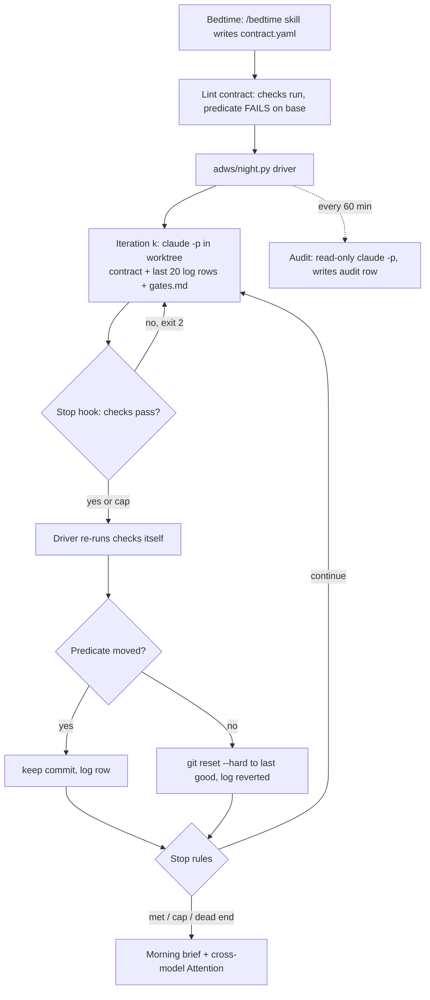

# The overnight contract

**Source workflow:** Poteto (pstack 0.15.28)  **Stages:** Human gates, Plan, Build, Verify, Liveness, Memory, Review (morning audit)
**Primary sources:** `<pstack>` = `~/.claude/plugins/cache/cursor-plugins/pstack/0.15.28/`. I read these in full:
- `docs/guide/07-overnight.md`, `docs/guide/02-poteto-mode.md`, `docs/harness/claude-code.md`
- `skills/poteto-mode/SKILL.md`
- `skills/poteto-mode/playbooks/autonomous-run.md`, `pause-safely.md`, `session-pickup.md`, `multi-phase-plan.md`, `prototype.md`, `orchestrate.md`, `autopilot-full.md` (steps 1 to 7)
- `skills/figure-it-out/SKILL.md`, `skills/show-me-your-work/SKILL.md`, `references/decision-log-template.tsv`, `scripts/log.sh`, `skills/ketchup/SKILL.md`
- The principle leaves `principle-never-block-on-the-human`, `-outcome-oriented-execution`, `-prove-it-works`, `-sequence-verifiable-units`, `-attack-the-premise` and `-guard-the-context-window`

I also read Claude Code docs on `/loop` and scheduled tasks (https://code.claude.com/docs/en/scheduled-tasks), `/goal` (https://code.claude.com/docs/en/goal) and hooks (https://code.claude.com/docs/en/hooks, the Stop and SubagentStop sections). For ADW I read `../../workflows/adw/overview.md` §3 and §5, `adw_gates.json`, and the `acceptance:` block format in `evals/tasks/*.yaml`. I ran no scripts.
**Builds on:** `../../workflows/poteto/pstack-mechanics.md` §3, `how-she-develops.md` §3 (Walkthrough B), and `../../workflow-map.md` row 3.

---

## 1. What it is

The overnight contract is a short handoff prompt plus the machinery that holds an agent to it while nobody watches. The prompt has four parts: a goal, a done condition that can pass or fail, permissions granted up front, and an escape hatch. The machinery does four things:
- It routes the work to a designed phase plan (`figure-it-out`).
- It runs an iteration loop that commits only changes that moved the done condition (`autonomous-run`).
- It replaces "ask the human" with prototypes, defaults and parked gates (`never-block-on-the-human`).
- It records every decision as one row in an append-only TSV, which a different-model reviewer audits before the morning reply (`show-me-your-work`, `ketchup`).

It removes two problems. First, an unattended agent that stops at the first question wastes the night. Second, one that never stops "creatively reinterprets" the goal and leaves work nobody can trust. The guide puts the second one this way: the escape hatch "beats eight hours of creative goal reinterpretation" (`07-overnight.md`). The contract turns review from re-reading a night of diffs into auditing a list of decisions ("You're auditing decisions, not re-reading the whole night", `07-overnight.md`).

## 2. Where it lives

| File (under `<pstack>`) | Role in the contract |
|---|---|
| `docs/guide/07-overnight.md` | The human-facing spec. It has the four trust preconditions, the canonical bedtime prompt, what each line buys, the loop diagram, the morning audit, and the pitfall "a duration is not a finish condition". |
| `docs/guide/02-poteto-mode.md` | The five parts of a good prompt (goal, done check, proof, what you know, constraints) and the "Leave it running" short form. |
| `skills/poteto-mode/SKILL.md` | The router. **Autonomy** defines "Just do it", the "Always pause" list and the session overrides ("going to bed"). **Non-negotiables** turn a question into a prototype or a default, and require a decision trail for any step-away work. **Playbooks** routes step-away work to `figure-it-out`. |
| `skills/figure-it-out/SKILL.md` | Designs the run. Phase A frames a falsifiable predicate, quantified scope and a rigor level. Phase B decomposes the work and builds the harness and baseline first. Phase C runs the hypothesis loop. Phase D keeps the trail. Phase E verifies against the predicate. |
| `skills/poteto-mode/playbooks/autonomous-run.md` | The six-step drive-to-predicate loop: wake mechanism, smallest change, commit or discard, mid-run fixes, one row per iteration, plateau means pivot. |
| `skills/principle-never-block-on-the-human/SKILL.md` | The rule "proceed, then present", with an irreversible-action carve-out. |
| `skills/principle-outcome-oriented-execution/SKILL.md` | Allows planned, scoped, reversible intermediate breakage during migrations, with full verification at the end. |
| `skills/poteto-mode/playbooks/prototype.md` | The tool that answers an empirical fork in place of a question. |
| `skills/poteto-mode/playbooks/orchestrate.md` | The origin of `gates.md` ("question, options, default on no answer"), the escalation lists, the liveness rules and the retry table. |
| `skills/poteto-mode/playbooks/autopilot-full.md` step 6, `multi-phase-plan.md` | The `/loop 1h` audit tick and its verbatim tick prompt. |
| `skills/show-me-your-work/SKILL.md`, `references/decision-log-template.tsv`, `scripts/log.sh` | The decision log: format, `start` rows, append-only rule, transcript audit and cross-model review with an **Attention** section. |
| `skills/poteto-mode/playbooks/pause-safely.md`, `session-pickup.md` | Clean stop and resume across a restart, compaction or a new chat. |
| `skills/ketchup/SKILL.md` | The read-only morning status: what changed and every call waiting on the human, each with a pick, evidence and risk. |
| `docs/harness/claude-code.md` | The Claude Code adapter. It has **no `/loop` row** and skips Cursor Automations. |

## 3. How it works, step by step

### 3.0 Precondition: earn the trust first

The contract is not the first step. `07-overnight.md` lists four conditions that must hold before a loop runs unattended:
1. "You've done the task once by hand, or watched an agent do it."
2. "The agent has the tools and signals you'd use yourself."
3. "Every stage proves its work and can stop the line."
4. "You've read a few transcripts and turned the repeated failures into tools, skills, or checks."

"Until then, run it while you watch." This is the main gate on the whole contract, and it is enforced only by the human's judgment.

### 3.1 The bedtime prompt

The canonical form (`07-overnight.md`):

```text
/poteto-mode im going to bed. migrate every caller to the new parser in a fresh worktree off <base>.
done means zero old callers, all parser fixtures pass, old api deleted.
keep a decision log. don't ask me before committing.
/loop until done. if you're truly stuck after a few hours, stop and write up why.
```

| Clause | Mechanism it triggers | Source |
|---|---|---|
| `im going to bed` | A **session override**. Autonomy lists "Don't stop" / "going to bed" / "run until done" / "be fully autonomous" as "keep going". It also prevents Pause safely from firing: "On 'keep going', 'going to bed, keep going', or 'don't stop', do not pause." It also triggers the decision trail: work the user "steps away from to review later ('going to bed', ...)" needs **show-me-your-work**. | `poteto-mode/SKILL.md` Autonomy and Non-negotiables; `pause-safely.md` |
| `migrate every caller ...` | The goal. Per `02-poteto-mode.md`, "say what to achieve", not the how, and do not list skills. | `02-poteto-mode.md` |
| `done means ...` | The **predicate**. It "turns the goal into checks every iteration can run". It must "pass or fail". | `07-overnight.md`; `02-poteto-mode.md` |
| `fresh worktree off <base>` | Isolation. It "keeps the run from colliding with anything else you have open". | `07-overnight.md` |
| `don't ask me before committing` | A **permission granted up front**. It "pre-answers the permission the agent would otherwise block on". | `07-overnight.md` |
| `keep a decision log` | Explicit `show-me-your-work`. It is redundant with the auto-trigger, but harmless. | `poteto-mode/SKILL.md` |
| `/loop until done` | The wake mechanism. It re-checks the finish condition "on events or a heartbeat". | `07-overnight.md`; `autonomous-run.md` step 2 |
| `if you're truly stuck after a few hours, stop and write up why` | The **escape hatch**. It permits a written stop at a genuine dead end. | `07-overnight.md` |

The rule that ties it together: "**Pitfall:** a duration is not a finish condition. 'work on this for 4 hours' gives the agent nothing to check" (`07-overnight.md`).

### 3.2 Routing to figure-it-out

`poteto-mode/SKILL.md` (Playbooks) says: "work the user steps away from to trust later, routes to the **figure-it-out** skill even when a narrower playbook like Feature fits." A multi-day program goes to Orchestrate instead. Orchestrate step 1 routes back the other way: "If one agent could finish inside that budget, stop here and run Autonomous run instead."

`figure-it-out` then runs before any code:

1. **Start.** A todolist whose first item is reading poteto-mode's Principles. The phases follow.
2. **Phase A, Frame.** Before starting the run, the agent must be able to state:
   - "The definition of done as a falsifiable predicate"
   - "Scope, quantified: rough units and effort, plus the blockers grounding surfaced"
   - "The rigor level, biased high. One-way doors and high blast radius get more." "Rigor is gates and artifacts, not 'try harder'."

   It presents the framing. "Reversible work proceeds ... but a multi-hour run earns one checkpoint." At bedtime that checkpoint is posted, not waited on.
3. **Phase B, Design the workflow.**
   - Decompose into "atomic, independently-landable units". Sequence them "riskiest-unknown-first", with scaffold and verification before features.
   - "Build the verification harness before the work, with the baseline captured from the pre-change state, so the check reads as 'old value vs new value'."
   - Run `architect`/`arena` only for one-way-door design. "A second arena over a settled design is over-engineering."
   - Fan out only across seams, with each worker in its own worktree or branch.
   - "Write the designed phase list down. That list is what the human reviews."
   - Put the design's steps between Phase C and Phase D on the todolist, and "weave the Phase D log through them, a row as each step lands, rather than saving the whole trail for the end." **This is where the decision log starts.**
4. **Phase C, Run the loop.** See §3.3.
5. **Phase D, Keep the audit trail.** Log through show-me-your-work. "figure-it-out's work is usually ambitious enough to commit the trail."
6. **Phase E, Verify and hand back.** "Check the whole against the Phase A predicate on the real product, not just the harness." Encode any recurring correction as a gate, lint, check or script.

The reply contract: "the playbook you designed, the rigor level and why, the decision-trail path, what's verified against the predicate, and what's still open."

### 3.3 The iteration loop (autonomous-run + figure-it-out Phase C)

The diagram in `07-overnight.md`: check the finish condition, make the smallest justified change, verify against the real artifact. On progress, commit. On no progress, discard. Then log one row and go back to the check. "One change, one check, one log row, every iteration."

`autonomous-run.md`, step by step:

1. **Predicate first.** "State the exit condition as a checkable predicate before the first iteration (tests green, repro fixed, all N PRs merged, pixel-diff zero)."
2. **Wake mechanism.** This uses Cursor's built-in `/loop`. "An event to watch (CI, a merge, a ref advancing) gets a watcher subagent that wakes you on the event, with a long time-based heartbeat as fallback. No event gets a fixed-interval heartbeat sized to when the result is worth re-checking."
3. **Smallest change, verify, commit or discard.** "Each iteration makes the smallest change the evidence justifies, verifies it against the predicate, commits if it advanced, discards changes that didn't help. Belt-and-suspenders that 'might help' gets reverted, not left to ride." Units follow `sequence-verifiable-units`: "known-good state, one change, run the check, then proceed".
4. **Mid-run discoveries are yours.** Broken skills, related bugs, flaky verifiers and tooling failures are fixed by the agent, "out-of-band fixes in their own PR". "Do not park reversible work for the human or use `AskQuestion`." Surface only "irreversible actions, genuine product or preference calls no experiment can settle, or a real dead end". Then return to the predicate.
5. **One row per iteration** through show-me-your-work, recording "what changed and whether the predicate moved".
6. **Stop rule.** "Stop when the predicate is met. A plateau is not a stop, so keep going and pivot your approach to push past it. Surface a genuine dead end rather than spinning, and never relax the predicate to declare victory."

figure-it-out Phase C adds the experimental discipline:
- "Each unit is an experiment. State the hypothesis, make the smallest change, measure against the predicate on the real artifact, keep it if it advanced, revert it if it didn't."
- "Verify by inspecting the artifact, never a self-report. When something passes too easily, suspect the observation method before the system."
- "Pair delegated work with a judge. If a worker games the gate, reset and harden the contract. If the gate itself is wrong, fix the gate in its own change rather than routing around it."
- "A verdict is VERIFIED, NOT VERIFIED, or INCONCLUSIVE. Inconclusive is not a pass. Don't hide a negative."

For migrations, `principle-outcome-oriented-execution` allows intermediate breakage "when it is planned, scoped, and reversible". It forbids "throwaway compatibility code" and requires "full static and runtime verification at plan completion". That is why a migration predicate says "old api deleted", not "new api works".

**The pivot trigger.** The playbook never defines "plateau". The closest rule is `principle-attack-the-premise`: "When two or more fixes that share one premise have failed the same gate, suspect the premise ... Do not start the next fix before the premise is written down and tested." The playbook does not link the two. `pstack-mechanics.md` §8.3 notes the same gap.

### 3.4 Never block on the human

There are three layers, applied in order.

1. **Classify the question before you ask it** (`poteto-mode/SKILL.md` Non-negotiables). "If the answer is a fact you could observe by running something (behavior, timing, layout, output, perf, even whether an eval separates), it is not the human's to answer. Sketch it via the Prototype playbook ... and let the result decide." The Prototype playbook builds the "smallest script that exercises the question" in a scratch dir. "The observation is the test here."
2. **Under a full-autonomy grant, decide and report.**
   - "Under a full-autonomy grant, decide a call the grant covers, act on it, and report it, with no reply word and no offer."
   - For an operator-only call, "apply a default, report it with a full explanation, and say in plain words what the operator could tell you to do instead ... Never give a shorthand token to type back."

   The principle leaf compresses this to "Proceed, then present. Do the work, show the result. Don't ask 'should I do X?' Do X, explain why." It gives the reason: "Since code changes are reversible and reviewable, a wrong decision usually costs less than blocking."
3. **Park, don't wait** (`orchestrate.md`). "`gates.md` parks human gates (question, options, default on no answer)." "Park each as a `gates.md` entry before asking, and route work around it."
   - Escalation **reaches** the human for: irreversible actions, "genuine product or preference calls no experiment settles, a standing order that contradicts observed reality, a program-level dead end that survived a replan".
   - Escalation **never reaches** the human for: "frontier nudges, rebase mechanics, retries, CI flake triage, review-thread triage, format fixes, scope the brief already forbids (refuse and continue), and 'should I keep going'. When in doubt, act and log."

   `gates.md` is defined only in Orchestrate's store. A single-task Autonomous run has no named parking file. It records the default in a decision-log row and lists the call in the morning reply.

**The irreversible list.** `poteto-mode/SKILL.md` Autonomy says: "**Always pause** for irreversible writes: force-push to shared branches, deploys, data deletion, customer messages." The principle leaf gives "force-push, delete production data, send external messages". Orchestrate adds "closing someone else's PR". The adjacent permissive rule is: "Reversible work and external actions (team chat, ticket updates, kicking off evals) proceed without asking." Gates the operator named in the prompt also still bind.

### 3.5 The decision log (show-me-your-work)

- **Format.** "A single TSV file, one row per decision. Cells stay single-line. Evidence is a pointer, not prose." The header comes from `references/decision-log-template.tsv`: `ts	phase	decision	why	evidence	result`.
  - `ts` is ISO8601.
  - `phase` is the phase or workstream.
  - `decision` is "one line".
  - `why` is plain words. "If a principle drove it, say it plainly, not as a jargon tag."
  - `evidence` is a "commit SHA, PR number, `file:line`, or an artifact, trace, or screenshot path. Never a paragraph."
  - `result` is the outcome or predicate state, such as `tests green`, `reverted`, `pixel-diff 0`, `INCONCLUSIVE` or `open`.
- **Writer script.** `scripts/log.sh <logfile> <phase> <decision> <why> <evidence> <result>`. It refuses any argument count other than 6 (exit 1), runs `mkdir -p` on the directory, and writes the header if the file is empty. It always appends with `>>`, never `>`, so a false-negative existence test costs "one stray header line, not the rows". It stamps UTC `ts` and replaces tabs, newlines and CRs with spaces. It prefixes a cell starting with `= + - @` with `'` to block spreadsheet formula injection from "attacker-controlled evidence (PR titles, filenames, generated text)".
- **What gets a row.** "decision points and checkpoints, not every action ... For loop runs, one row per iteration."
- **Run boundaries.** "A run is one agent conversation ... A pickup, a replacement agent, or a new chat starts a new run." When a run appends to a log that already has rows, its first row has phase `start`. That row names "the `ts` range of the rows before it that this run did not write", and its evidence names the run (agent id). A returning run "first reads the log's last rows to see whether another run wrote since".
- **Rules.** "Append-only. A wrong call gets a new row that supersedes it. Never edit or delete history." Prefer evidence from committed scripts.
- **Location.** `decisions.tsv` in the work dir, or `.audit/<task-slug>.tsv` for parallel efforts. It is left out of git by default, and committed when "a reviewer needs the trail to trust the result".
- **End-of-run self-audit against the transcript.** Check that every row maps to a real action and that each evidence pointer "resolves and shows what the row claims". Add a row for any unlogged fork or pivot. "Correct the log, not the story. The audit never edits or removes a row, even an invented one."
- **Cross-model review.** "Spawn a subagent on a different model family from the one that did the work. Self-review is not a substitute." It flags weak evidence, verification claimed without proof in the transcript, risky choices and gaps. Every reply ends with "Attention", led by `reviewed by <model>`. "No flags" is a valid value.

### 3.6 The hourly audit and liveness tick

For a single-task Autonomous run, liveness is only the wake mechanism in step 2: a watcher subagent on an event plus a long heartbeat, or a fixed heartbeat. The explicit hourly audit belongs to the queue and program playbooks, which an overnight run uses when the night holds more than one task.
- **Armed by.** "On the operator's go, arm `/loop 1h` to audit until no delegated work is left, because long runs drift and agents stall silently" (`autopilot-full.md` step 6). The plan template says "Never leave the cadence to memory" (`multi-phase-plan.md`).
- **Tick prompt, verbatim** (`multi-phase-plan.md`): "Re-read the execution playbook from trunk. Audit the operation against it and fix drift in this tick. Probe every active lane and judge progress by side effects only. Stand down a stuck lane and dispatch its replacement now. Then post a short status message to the operator in chat only when the audit found a tracked change that no earlier status message reported ... If the audit found none, end the turn with no reply text. Either way, log this tick's row in your decision trail. The row names the items reported, or none."
- **Stuck definition** (`autopilot-full.md`): an agent "errors, cannot start turns, or shows nothing new past its stuck-after runtime". An owner is also stuck if it "has neither pushed nor written a trail row by the first tick". "One waiting on you or the operator is not stuck, so answer it. Replace a stuck agent at once." The stuck-after runtime is recorded at spawn "from past runs of its kind".
- **Probe rules** (`orchestrate.md`): "Never resume an agent to check on it." Probe read-only state instead (ledger, tables, `gh`, pushed branches). "Transcript mtime is not liveness."
- **Bounded self-retries** (`orchestrate.md`): "After a few consecutive tool aborts, stop retrying. Write a terminal handoff to durable state ... and end the run."
- **Durability** (`autopilot-full.md` step 2): "Assume the VM dies." Push early, push after every unit, and keep the trail in the root's store.

### 3.7 Pause safely and session pickup

**Pause safely** fires only on an explicit pause, going offline, a restart, or imminent compaction. "This is explicit only." Its steps:
1. Stop at a safe boundary and cancel nested subagents.
2. "Take no irreversible action to pause. No PR and no push unless you already had one out."
3. Commit everything as one `wip:` commit, and note a broken tree in the body.
4. Write a resume note "off-context". It covers intent, current step, what is verified, state, next steps, key files and gotchas. For compaction it goes to `/tmp/<slug>-resume.md`. "If a show-me-your-work trail exists, point at it instead of duplicating it."

**Session pickup** starts from the opposite stance: "Read the prior trail, don't redo it."
1. Locate the trail (local transcript, cloud URL or pushed branch). Parse long transcripts in a subagent.
2. Reconstruct state (branch, `git log`/`git diff` against base, todos, decisions). "The prior trail is authoritative input."
3. Diff done against pending. "A 'let me verify from scratch' pass means you're treating the trail as untrustworthy when it's authoritative."
4. Route the remainder to the matching playbook.
5. Then re-verify inherited claims on the real artifact: "A passing prior self-report is not the proof."

The new chat writes a `start` row in the decision log (§3.5).

### 3.8 The morning review

1. **`/show-me-your-work catch me up on what you did last night`.** This produces the trail in review form. The cross-model reviewer has already run, so the reply ends with **Attention**. "Read that section first, then the log rows it points at" (`07-overnight.md`).
2. **`/ketchup`** in the chat that ran the work. It is read-only: it may "not change code, start an app or a job, or post anything".
   - Words. Under 100 words on what happened, then about 30 per action item.
   - Pictures first. Screenshots, videos and small Mermaid diagrams (at most six boxes and eight words each). A Markdown table "is not a visual".
   - Then every "call or step only the user can take". Each one gets its link, what it changes for users, evidence, risk ("Give each item's risk even when it is low") and the agent's pick.
   - Rules. "Never make up a call to fill the reply." "Never cut items ... to stay under a word count."

Autopilot replies and hourly ticks that changed something use ketchup's format (`autopilot-full.md` step 6 and Reply).

## 4. Why it works

These rules carry most of the weight. Each is listed with the failure mode it prevents.

| Rule | Failure mode prevented |
|---|---|
| **A predicate that passes or fails, not a duration** | Motion without a result ("four hours of motion"). With no check, the agent cannot tell progress from activity. |
| **"Never relax the predicate to declare victory"** | Goal reinterpretation: the agent quietly redefines done as what it achieved. |
| **Escape hatch with a written reason** | Spinning, or reinterpretation as the only exit. A sanctioned stop means a dead end costs a write-up, not the night. |
| **Harness and baseline before the work** (figure-it-out B) | Unfalsifiable progress. Without a pre-change value, "tests pass" can be true before any change, or for the wrong reason. |
| **Commit if it advanced, discard if not; revert "might help"** | Accretion of speculative code that nobody can attribute later. It keeps the diff equal to the cause of the predicate movement, so the morning review reads causes, not noise. |
| **Verify the real artifact, never a self-report; "passes too easily" means suspect the observer** | The agent reporting its own success, and gates that pass vacuously. |
| **Prototype instead of ask** | Blocking on facts the agent could observe. It also makes the human's answer unnecessary, which no default can do. |
| **Default plus explanation plus "what you could tell me instead", no reply token** | A stalled night on a preference call, and a morning reply that forces the human to learn a protocol. |
| **Explicit irreversible list** | Unbounded autonomy. Reversibility is the one property that makes "proceed, then present" safe, so the carve-out is exactly the non-reversible set. |
| **Append-only TSV with pointer evidence** | A narrated story that gets rewritten to fit the outcome, and prose evidence nobody can check. Pointers make each row checkable in seconds. |
| **Transcript audit plus a different-model reviewer** | A log that lies, and self-review blind spots. "Correct the log, not the story" keeps falsified rows visible. |
| **Audit tick probes side effects; never resume to check** | Silent stalls hidden behind confident status text, and the probe itself restarting an idle agent. |
| **Ketchup lists only the human's calls, each decidable from the reply** | Morning review that costs as much as doing the work. |

**Heaviest lifters.** Four rules matter most:
- the falsifiable predicate checked every iteration;
- commit or discard per iteration;
- verify on the real artifact;
- the append-only log with a different-model Attention pass.

The rest are refinements. Without the first three, the log records confident failure. Without the fourth, nobody can audit the first three in the morning.

## 5. Edge cases and failure handling

| Situation | What pstack does | Source |
|---|---|---|
| No done condition given | figure-it-out Phase A refuses to start until it can state one. Duration-only prompts are named as the pitfall. | `figure-it-out` A; `07-overnight.md` |
| Predicate passes before any change | Not stated directly. "When something passes too easily, suspect the observation method before the system" and the baseline rule imply the check must fail first. | `figure-it-out` B, C |
| A check fails | Discard the change and log a `reverted` row. A wrong gate gets fixed "in its own change rather than routing around it". | `autonomous-run` 3; `figure-it-out` C |
| Plateau | Pivot, don't stop. Nothing defines it. The nearest rule is attack-the-premise after two failed fixes on one premise. | `autonomous-run` 6; `principle-attack-the-premise` |
| Genuine dead end | Stop and write up why (escape hatch). "If you're truly stuck after a few hours" is the only threshold. | `07-overnight.md` |
| Worker games the gate | "Reset and harden the contract." | `figure-it-out` C |
| Agent lies in the log | The end-of-run audit adds superseding rows. The cross-model reviewer flags claims without transcript proof. The morning human reads Attention first. | `show-me-your-work` |
| Agent lies in its reply | `session-pickup` and `prove-it-works`: "A passing prior self-report is not the proof." Autopilot: "status text and summaries can hide a stuck child". | `session-pickup` 5; `autopilot-full` 6 |
| Operator-only question at 2 a.m. | Apply a default, explain it, say what the operator could choose instead, continue. In Orchestrate, park it in `gates.md`. | `poteto-mode` Non-negotiables; `orchestrate` |
| Irreversible step needed | Pause on that item only. Other work continues around it. | `poteto-mode` Autonomy; `orchestrate` Escalation |
| Broken skill or tool mid-run | Fix it in its own PR and return to the predicate. "Don't silently work around it." | `poteto-mode` Non-negotiables; `autonomous-run` 4 |
| Repeated tool aborts | Bounded retries, then a terminal handoff to durable state, then end the run. | `orchestrate` Liveness |
| Context compaction looming | Pause safely writes `/tmp/<slug>-resume.md`. "Going to bed" does **not** trigger a pause, so compaction is the only automatic pause trigger left. How one chat stays coherent across many wakes is undocumented. | `pause-safely`; `pstack-mechanics.md` §8.2 |
| Session or Cursor restart | Session pickup from the trail. Local subagents are dead and cloud work is not. Reattach by PR and branch, not agent id. | `session-pickup`; `orchestrate` |
| Stale log (another run wrote since) | Read the last rows first and write a `start` row naming the foreign `ts` range. | `show-me-your-work` |
| Log cell contains tabs or formula bytes | `log.sh` flattens whitespace and quotes a leading `= + - @`. | `scripts/log.sh` |
| Stuck subagent | Replace it at once. A stuck-after runtime comes "from past runs of its kind", and no source says what to use on a first run. | `autopilot-full` 2, 6 |

## 6. Conflicts with other workflows

| Choice | pstack overnight contract | Alternative | When the alternative wins |
|---|---|---|---|
| **Who checks done** | Agent re-checks a human-written predicate every iteration and verifies on the real artifact. Non-authors verify before any merge. | **Ralph / sandcastle:** the agent prints `<promise>COMPLETE</promise>`, a prompt convention that "the engine never injects" (`../../workflows/matt-pocock/overview.md` §4.4). **Claude Code `/goal`:** a small model judges the condition from the transcript only, and "It doesn't run commands or read files independently". | Ralph wins only on throwaway work where a false COMPLETE is cheap. `/goal` is fine when the transcript must contain the command output anyway. It is weak against an agent that misreports. |
| **Context across iterations** | One long chat woken by `/loop`. The log and the resume note bridge compaction. | **Ralph:** a fresh context every iteration, with memory in `progress.txt` and git. **Anthropic long-running harness:** an initializer agent plus a coding agent that reads a progress file and feature list each session (summarized in `../../workflow-map.md`, not read here). | Fresh context wins for long nights in Claude Code. There are no Cursor Projects, and a single session's `/loop` dies with the terminal. pstack's own docs leave context across wakes unexplained. |
| **Questions during the run** | Prototype it, default it, or park it. Never block on reversible work. | **Pocock:** all questions are front-loaded in the day shift through `/grilling` and ticket approval. The AFK run gets a ticket sized to one context and no questions. | Pocock's way wins when product intent is the risk. Grilling settles intent before bedtime, and pstack's defaults can drift off-intent all night. pstack wins when the unknowns are empirical. |
| **Stop rule** | Predicate met, or a written dead end. A plateau is a pivot. No iteration cap is stated. | **Pocock:** "Hard iteration cap, always" (5 to 10 small, 30 to 50 large), plus idle timeouts. **ADW:** bounded fix loops (fast gates x3, slow gates once plus one fix). | Caps win whenever cost is real or the agent is unproven. pstack relies on the four trust preconditions, and Claude Code has no Cursor-style per-seat budget to absorb runaway spend. |
| **Isolation** | Fresh worktree or a Cursor cloud VM. "Assume the VM dies." | **Pocock:** a Docker sandbox, "essential for overnight AFK runs". **ADW:** host execution with `--dangerously-skip-permissions` plus a PreToolUse deny-list (`risk_gate.py`). | Containers win for unattended runs with network and shell access. The irreversible-action list is advisory text in pstack, and a deny hook is the only mechanical guard ADW has. |
| **Merge authority** | Single-task contract: unspecified. It commits, and Autopilot-full can merge on a verified patch. | **ADW / Pocock:** a human merges every PR (ADR-0001). **StrongDM:** no human review. | Human merge wins until a verification track record exists (`how-she-develops.md` §7, step 6). |
| **Decision record** | Append-only TSV with pointer evidence, audited against the transcript and by another model. | **ADW:** raw JSONL, state JSON, a progress log, a PR checklist. Complete but unreadable as a brief, and nothing records why (`overview.md` §5). **Pocock:** `progress.txt`, deleted after the sprint. | pstack wins outright for step-away work. Nothing else in the comparison records the why with a resolvable pointer. |

## 7. Porting to Claude Code and ADW

### 7.1 What maps directly

- **Playbook text and principles.** They port as-is. The adapter maps `Task` to `Agent` and pstack skills to "Read `SKILL.md` and follow it" (`docs/harness/claude-code.md`).
- **`log.sh` and the TSV format.** Plain bash with no dependencies.
- **Worktrees.** ADW already has `--worktree` (`adws/adw_modules/feature_worktree.py`, `worktree_ops.py`) with branch, tree and port slots.
- **Irreversible list as a mechanism.** ADW's `risk_gate.py` PreToolUse deny-list already blocks force push, remote deletes and publishing, and it binds under `--dangerously-skip-permissions` (`overview.md` §3.10). That is stronger than pstack's prose list.
- **Executable done conditions.** ADW eval tasks already carry `acceptance:` lists of shell commands (`evals/tasks/01-feature-tags.yaml`). That is the predicate shape this design needs.
- **Infra-versus-task failure split.** `evals/run_eval.py` never counts an infra error as a task failure. The night driver should reuse that rule.

### 7.2 Claude Code primitives, and which fits what

| Primitive | Mechanics (from the docs) | Fit for the contract |
|---|---|---|
| `/loop <interval> <prompt>` | Session-scoped cron that fires "between your turns". Needs the session open and the machine on. Recurring tasks expire after 7 days. No catch-up for missed fires. Hourly runs start "0 to 30 minutes late" (jitter). At most 50 tasks per session. A self-paced `/loop` is **not** restored on `--resume`. Fires cannot run a skill with `disable-model-invocation: true`. | It is the direct analogue of Cursor's `/loop`, and fine for the **audit tick** in an attended or backgrounded interactive session. It is fragile as the only overnight driver because of the terminal, sleep and crash cases. |
| `/goal <condition>` | A wrapper on a session-scoped prompt-based Stop hook. After each turn a small fast model judges met, not yet met or impossible "against what Claude has surfaced in the conversation". It "does not call tools". Works with `claude -p "/goal ..."`. Pauses on usage limits. Stops if there is no tool use for several turns. Up to 4,000 characters. | It is the closest built-in to "loop until predicate". But its judge reads the transcript, not the artifact, which breaks "verify the real artifact" if the agent misreports. Use it only as a convenience layer, never as the gate. |
| **Stop hook (command type)** | Fires after every turn. Exit 2 or `{"decision":"block","reason":...}` keeps Claude working with the reason as its next instruction. Input has `stop_hook_active`, `last_assistant_message`, `background_tasks` and `session_crons`. There is an 8-consecutive-continuation cap that resets on each tool call (`CLAUDE_CODE_STOP_HOOK_BLOCK_CAP`). | This is the **deterministic predicate gate** inside one session. A script runs the contract's checks and blocks the stop with the failing output. It cannot be talked past. |
| Headless `claude -p` | One process per invocation. ADW's `agent.py` already drives it and records `total_cost_usd`. | This is the **fresh-context iteration**. The driver relaunches it with the contract plus the log tail, Ralph-style, which avoids the long-chat coherence gap. |
| Cloud routines (`/schedule`) | Run without the machine, on a fresh clone. Minimum interval 1 hour. | Wrong for a local Spring Boot run that needs Docker and local state. A later option for repos whose checks run in a clean clone. |
| Desktop scheduled task / launchd / cron | Persistent, local, survives a closed terminal. | The **watchdog** for the driver process, and the trigger for the morning brief. |
| Subagents with `model` and `effort` | Claude-only families (`opus`, `sonnet`, `haiku`, `fable`). | The cross-model trail review becomes Opus against Sonnet. That is a weaker independence than pstack's cross-vendor check (`pstack-mechanics.md` §5.3, §7). |

### 7.3 No equivalent

- Cursor Projects (a persistent coordinator thread) and Cursor cloud VMs per worker. The adapter maps cloud to `isolation: "worktree"`, which shares the laptop.
- A `/loop` that survives a closed laptop in the same session. Cloud routines run on a fresh clone without local state.
- Cross-vendor verification. Claude Code subagents cannot run Grok or GPT.
- The adapter itself has **no `/loop` row** and skips Automations, so the pstack skills will write `Skipped in Claude Code` on wake steps unless ADW supplies the mechanism.

### 7.4 Design sketch: `adw night`

**Shape.** A deterministic Python driver owns the outer loop, the caps and liveness. Each iteration is a fresh `claude -p` in the Ticket's worktree. A command Stop hook inside each iteration enforces "don't claim done until the checks pass". The driver re-runs the same checks itself after every iteration, so the verdict never comes from the agent. An hourly LLM audit runs as a read-only `claude -p` launched by the driver's own timer. A launchd job watches the driver. This follows ADW's rule "code checks and agents fix" (`overview.md` §1), and it closes ADW §5 gaps 1, 3, 11, 12, 14 and 15.



**File layout** (all per run, under ADW's existing `agents/<adw_id>/`):

```
agents/<adw_id>/night/
  contract.yaml      # written at bedtime, read-only after lint (driver checks its sha256 each iteration)
  decisions.tsv      # show-me-your-work format, appended via log.sh only
  gates.md           # parked operator calls, each with its applied default
  checks/<k>.json    # driver's check results per iteration (the evidence pointers)
  STUCK.md           # escape-hatch write-up, present only on a dead-end stop
  brief.md           # morning brief, rendered at the end
  heartbeat          # driver writes epoch secs each loop; watchdog reads it
```

**Contract schema** (`contract.yaml`). It extends the eval `acceptance:` shape:

```yaml
version: 1
ticket: owner/repo#142            # resolved via ticket_resolver (Ready, not In progress, Blockers closed)
goal: >                           # one paragraph, the outcome, no "how"
  ...
base: main
branch: adw/142-idempotency       # driver creates the worktree
done:                             # ALL must exit 0; each runs from the worktree root
  - id: it-idempotency
    run: ./mvnw -q -Dtest=OrderIdempotencyIT verify
    tier: fast                    # fast = every iteration; slow = when all fast pass, and at milestones
  - id: full-verify
    run: ./mvnw -q verify
    tier: slow
    timeout_s: 1800
  - id: live-probe
    run: scripts/night/probe_idempotency.sh   # boots the app, curls twice, asserts one row
    tier: slow
baseline_must_fail: [it-idempotency, live-probe]   # lint refuses if these already pass on base
must_stay_green: [full-verify]                     # regression guards: must pass on base too
grants:                            # permissions granted up front
  commit: true
  push_branch: true                # only this branch, never force
  open_draft_pr: true
  add_files_under: [src/main/resources/db/migration/]   # new files only
  add_dependencies: false
irreversible:                      # merged into risk_gate deny-list for this run
  - "git push --force*"
  - "edit src/main/resources/db/migration/V[0-9]*__*.sql that exists on base"
  - "any --spring.profiles.active=prod"
  - "gh pr merge*"
stop:
  max_iterations: 40
  max_wall_clock_h: 7
  max_cost_usd: 25
  plateau_iterations: 4            # no predicate movement for N iterations means a forced pivot row
  pivots_before_dead_end: 3        # 3 pivots with no movement means escape hatch
  max_consecutive_infra_errors: 2  # reuse the eval runner rule
escape_hatch: >
  If stuck, stop, write STUCK.md: the premise each failed attempt shared, the evidence,
  and the smallest question that would unblock you.
audit_every_min: 60
review_model: sonnet               # differs from the builder model (opus) for the Attention pass
```

**Contract lint** (`adws/night_lint.py`, S). It runs every `done` command once on a clean base worktree. It refuses to start if any `baseline_must_fail` check passes ("passes too easily") or any `must_stay_green` check fails. It also refuses if `done` is empty or the contract contains no command, which blocks "a duration is not a finish condition". It writes the baseline row as the log's first row. This makes figure-it-out's "harness and baseline before the work" mechanical.

**Iteration prompt.** This is a fixed template, the same every iteration. It contains: `contract.yaml`; the last 20 `decisions.tsv` rows; open `gates.md` entries; the failing check output from `checks/<k-1>.json`; and the rules. The rules are:
- Make the smallest change the evidence justifies.
- State the hypothesis in the log row.
- Do not ask questions. Prototype in `/tmp/night-<id>/` or apply a default and park it in `gates.md`.
- Never edit `contract.yaml` or delete log rows.
- Commit with the message `night(<k>): <hypothesis>`.

**Stop hook** (`.claude/hooks/night_stop.py`, injected through `--settings` like `risk_gate.py`). On Stop:
- It runs the `fast` checks. On failure it exits 2 with the failing tail.
- If `stop_hook_active` is true and the last tool call was more than one turn ago, it lets the stop through. The driver decides what happens next, so the hook never fights the 8-block cap.

The hook keeps one iteration honest. The driver keeps the night honest.

**Driver loop** (`adws/night.py`, M):
1. Re-hash `contract.yaml`. Abort on change, because the predicate cannot be relaxed.
2. Run `claude -p` with a per-iteration wall clock (kill after `timeout`) and a stuck rule: no new JSONL line for 10 minutes means kill and log an `infra` row.
3. Re-run checks itself and write `checks/<k>.json`.
4. Advanced means at least one more check passes, or a numeric metric improved, with no `must_stay_green` regression. If it advanced, keep the commit. Otherwise `git reset --hard <last_good>` and log `reverted`.
5. Append the driver's own row with `log.sh` (phase `iter-<k>`). The agent's rows sit alongside it, and the driver row is the authoritative result.
6. Apply the stop rules. Predicate met ends with `done`. A cap hit ends with `capped`. If `plateau_iterations` pass with no movement, inject a pivot directive ("write the shared premise and test it first", from attack-the-premise) and log `pivot`. After `pivots_before_dead_end` pivots, give a final iteration that only writes `STUCK.md`, then stop with `dead-end`.
7. Push the branch after each kept commit ("assume the session dies"). Update the draft PR checklist through `draft_pr.commit_phase`.
8. Write `heartbeat`.

**Hourly audit** (S). The driver's timer launches a separate `claude -p` with `disallowed_tools` for Edit and Write and a Bash allow-list (`git log`, `git diff --stat`, `cat`, `column`). It re-reads the contract. It checks that the last hour's rows map to commits and to `checks/*.json`, and that no gate was silently decided against its default. It writes exactly one `audit` row through a driver-side wrapper, naming what changed or `none`. It never edits code. This copies the pstack tick prompt, minus "dispatch replacement". Replacement stays deterministic in the driver.
- If the user keeps an interactive session open, `/loop 1h` with the same prompt works as an alternative. It is not the default because a closed terminal stops it.

**Liveness watchdog** (S). A launchd or cron job runs every 15 minutes. If `heartbeat` is older than 2x the iteration timeout and the driver PID is gone, it restarts `night.py --resume <adw_id>`. The driver resumes like session-pickup: it reads the log tail, writes a `start` row with the foreign `ts` range, and re-verifies with the checks, never with the prior claims.

**Pause.** `night.py --pause <adw_id>` writes a flag. The driver finishes the current iteration, commits `wip:` only if the tree is dirty, writes `resume.md` that points at `decisions.tsv`, and exits. No new push happens if none was already out.

**Morning brief** (`adws/night_brief.py`, M). It renders from files only: contract, final `checks/*.json`, the `decisions.tsv` row counts by result, `gates.md`, `git log base..branch`, PR state through `gh`. Sections in ketchup order:
1. One sentence on what waits on you.
2. Predicate state: each `done` check with its baseline and final result.
3. Iterations run, kept, reverted, pivots.
4. Calls waiting, one per `gates.md` entry and one per irreversible block that `risk.log` recorded. Each has the default applied, evidence, risk and what you could say instead.
5. The Attention section from a `review_model` subagent (Sonnet if the builder was Opus). It reads `decisions.tsv` and the iteration transcripts, flags rows with unresolvable evidence or verification claimed but absent from `checks/`, and opens with `reviewed by <model>`.

It writes `brief.md`, posts it as a PR comment, and renders the TSV into a `<details>` block in the PR body. The PR stays draft. A human merges, per ADR-0001.

**Bedtime entry point** (`.claude/skills/bedtime/`, S). An interactive skill turns the user's four-line prose prompt into `contract.yaml`. It asks once for any missing part (goal, done, grants, escape hatch) because the human is still awake, runs the lint, and prints the `night.py` command, or launches it detached.

**Sizes.** The pieces:
- S: contract lint, `log.sh` copy, Stop hook, audit, watchdog, bedtime skill.
- M: `night.py` driver (reuses `agent.py`, `feature_worktree.py`, `draft_pr.py`, `risk_gate.py`, `ticket_resolver.py`).
- M: morning brief.
- L, deferred: a multi-Ticket queue over the Frontier (`overview.md` §5 item 1), plus container isolation.

### 7.5 Worked example: bedtime prompt for a Spring Boot ticket

```text
/bedtime im going to bed. ticket acme/orders-service#142: POST /api/orders must honor an
Idempotency-Key header. a retried request with the same key returns the first response and
creates no second order. work in a fresh worktree off main on branch adw/142-idempotency.
done means:
  1. ./mvnw -q -Dtest=OrderIdempotencyIT verify passes (write this IT first, it must fail on main)
  2. scripts/night/probe_idempotency.sh passes: boots the app on the test profile with
     testcontainers postgres, POSTs the same body+key twice, gets 201 then 200 with the
     identical order id, and SELECT count(*) FROM orders = 1
  3. ./mvnw -q verify stays green, including the ArchUnit rules
permissions: commit and push to adw/142-idempotency, open a draft PR, add ONE new flyway
migration. don't ask me before committing.
never: force-push, edit an existing V*__*.sql, add a dependency, touch the prod profile, merge.
keep a decision log. if a call is mine (key TTL, response on key reuse with a different body),
pick the safest default, note it in gates.md and keep going.
stop after 40 iterations, 7 hours or $25. if you're truly stuck after 3 pivots with no check
moving, stop and write STUCK.md: the premise your attempts shared and what would unblock you.
```

Each line maps to a field: goal to `goal`, the numbered list to `done` (1 and 2 are `baseline_must_fail`, 3 is `must_stay_green`), permissions to `grants`, "never" to `irreversible`, the cap line to `stop`, and the last sentence to `escape_hatch`.

### 7.6 Worked example: decision-log excerpt

```tsv
ts	phase	decision	why	evidence	result
2026-10-24T22:41:07Z	frame	ran every done check on main before changing anything	need the old value so progress means old vs new	checks/0.json	IT fails (class missing), probe fails (2 orders), verify green
2026-10-24T22:58:30Z	harness	wrote OrderIdempotencyIT with two posts and one key	the check has to exist and fail before the fix	commit 4e1a9c2, checks/1.json	fails as expected: 2 rows
2026-10-24T23:20:12Z	iter-2	added idempotency_keys table as V24 migration with unique key	smallest change that gives the db a place to dedupe	commit 9b03f11, checks/2.json	migration applies on fresh db, IT still red
2026-10-24T23:47:55Z	iter-3	stored key and order id in the same transaction as the insert	a separate write would race on retry	commit c7d2e80, checks/3.json	IT green, probe red: second call 409
2026-10-24T23:51:40Z	gate	on reuse of a key with a different body, return 422 and do not create an order	product call that no test settles; 422 is the safer default and is reversible	gates.md#1	open, default applied
2026-10-25T00:30:02Z	iter-4	caught DataIntegrityViolation in a filter to return the stored response	hypothesis: 409 comes from the unique constraint	checks/4.json	reverted, probe still 409 and verify broke ArchUnit (web layer touching repository)
2026-10-25T01:05:44Z	pivot	wrote down the shared premise: the conflict is the constraint. tested it by logging the sql state	two fixes assumed it and both failed	checks/5.json, logs/iter5.txt	premise false: 409 came from OrderController's existing duplicate-sku check
2026-10-25T01:40:19Z	iter-6	moved the key lookup into OrderService before the duplicate-sku check	the lookup has to run first so a replay returns the stored order	commit 1f88a3d, checks/6.json	all done checks pass
2026-10-25T01:41:00Z	audit	hourly audit: rows 3 to 7 match commits and checks, gate 1 default unchanged	liveness and drift check	audit/01.txt	none to report
2026-10-25T01:44:31Z	done	predicate met, pushed and updated draft PR, stopped	all three checks green on the real app	PR #57, checks/6.json	done
```

Row 6 is a discard. Row 7 is the attack-the-premise pivot that a "plateau means pivot" rule should produce. Row 5 is the parked call that shows up in the morning brief.

## 8. Stack adaptation

| Concern | Java Spring Boot | Rust | Node/TS |
|---|---|---|---|
| **Fast tier (every iteration)** | `./mvnw -q -Dtest=<IT> verify` or `-pl <module>`. Full `verify` is often minutes, so make it `slow`. Keep the Maven daemon (`mvnd`) warm if available. | `cargo check` plus `cargo nextest run -E 'test(<name>)'`. `cargo clippy -- -D warnings` in the slow tier. | `tsc --noEmit` plus `vitest run <file>`. Lint in the slow tier. |
| **Real-artifact check** | Boot the app on a test profile with Testcontainers and probe HTTP plus a DB row. That needs Docker on the host, a per-worktree port (ADW's 15-slot range), and a boot-time-aware timeout. | Run the binary or the service against a fixture. For libraries, a doc test or example binary. `cargo semver-checks` if the crate is public. | Playwright against `vite`/`next dev` on the worktree's port. For APIs, `curl` probes. |
| **One-way doors to add to `irreversible`** | Editing an applied Flyway/Liquibase migration. Prod profiles. Changing `application.yml` secrets. Publishing to an artifact repo. | `cargo publish`. Public API removals on a published crate. `unsafe` additions (or route them to `gates.md`). | `npm publish`. Lockfile major bumps. Committing generated `.env`. |
| **Encoded lessons ("encode in structure")** | ArchUnit rules (the decision log example's layering break), Checkstyle, ErrorProne. | `clippy` lints in `Cargo.toml` `[lints]`, `deny.toml`. | ESLint rules, `tsconfig` strictness, `dependency-cruiser`. |
| **Worktree cost** | `~/.m2` is shared and safe to read concurrently. Parallel writes on dependency download can contend, so pre-resolve on base. | `target/` per worktree is several GB. A shared `CARGO_TARGET_DIR` serializes builds through cargo's lock, so for one overnight run keep it per worktree and prune after. | `node_modules` per worktree. Use `pnpm` store or `npm ci` with a cache. The worktree-setup skill applies. |
| **Iteration time and caps** | Slow builds mean fewer, larger hypotheses. Use 20 to 40 iterations and a 20 to 30 minute iteration timeout. | Incremental `check` is fast, link times are not. Similar caps to Spring. | Fastest loop. 40 to 60 iterations is reasonable, so the cost cap binds before the iteration cap. |
| **Flake source** | Testcontainers startup, port reuse. Classify as infra and retry once, then count it as an infra error. | Rarely flaky. Time-dependent tests. | Playwright timing. Retry once, the same as babysit's "one fresh build, never a job retry". |

## 9. Decisions for you

- **Which loop shape drives the night: Python driver with fresh `claude -p`, one long session with `/goal` plus `/loop`, or a Stop-hook-only session?** This is `../../decisions-to-grill.md` item 11 (loop shape) and item 12 (what runs it). I recommend the driver. `/goal`'s judge reads the transcript only, and a session-scoped `/loop` dies with the terminal.
- **Stop rules.** Iteration, wall-clock and cost caps. A definition of plateau (N iterations with no check moving). Pivots before the escape hatch. This is item 13 (liveness and stop rules) and item 16 (cost ceilings).
- **What the morning brief contains, and where it goes** (a PR comment, a file, or a desktop notification). This is item 14.
- **Is `gates.md` plus an applied default acceptable for your Tickets, or must operator calls stop that Ticket?** New item, proposed as **14a. Default-on-no-answer policy.** It covers which call classes may be defaulted overnight (API shape, error codes, TTLs) and which must park and stop the Ticket (schema shape, public contract, anything in `irreversible`). It depends on item 1 (risk tiers).
- **Should `decisions.tsv` be committed to the PR or kept in `agents/<id>/`?** New item, proposed as **14b. Trail visibility.** pstack keeps it local unless ambitious. ADW's human-merge model argues for rendering it into the PR body every time, because the reviewer is the human merging.
- **Cross-model review with Claude only.** Is Sonnet reviewing an Opus night enough independence for the Attention pass? This is item 9.
- **Baseline-must-fail as a hard lint.** A lint refusal can block legitimate refactor nights where every check already passes. Those need a metric or a "legacy symbol count = 0" check instead. This folds into item 4 (who owns the oracle).

## 10. Unknowns

- **Plateau threshold and escape-hatch threshold.** pstack says "a few hours" and "genuine dead end" and gives no number. A few instrumented nights would settle it: record iterations-to-movement per Ticket type in `decisions.tsv` and pick the 90th percentile.
- **How pstack keeps one chat coherent across many `/loop` wakes overnight.** Pause safely names compaction, but the single-task playbook says nothing more. Her transcripts would settle it, or the unpublished guide Part 2 (`how-she-develops.md` §8).
- **Where `gates.md` lives in a single-task run.** It is defined only in Orchestrate's store. Whether she uses it outside programs is not in the files.
- **Stuck-after runtimes on a first run.** They are drawn "from past runs of its kind" with no bootstrap value. ADW could seed them from `evals/` wall-time data per task type, but that is untested.
- **Whether the Stop hook's 8-continuation cap interacts badly with long tool-free reasoning turns** in `claude -p`. It resets on each tool call, so it should not, but I have not observed it. A one-hour smoke run with a deliberately failing check would settle it.
- **`/goal` evaluator reliability against a misreporting agent.** The docs state it reads only the conversation. Planting a false "tests pass" line in a test session would measure how often it is fooled.
- **Cost of a Spring Boot night.** There is no ADW measurement beyond eval trials ($1.0 to $1.5 each, `overview.md` §4). One capped night on a real Ticket would give the first number for item 16.
- **Whether the cross-model reviewer in pstack runs on the trail of an Autonomous run when the agent never reaches "hand back"** (dead end, crash). The skill ties it to the reply. ADW's design runs it in `night_brief.py` regardless of how the run ended.
