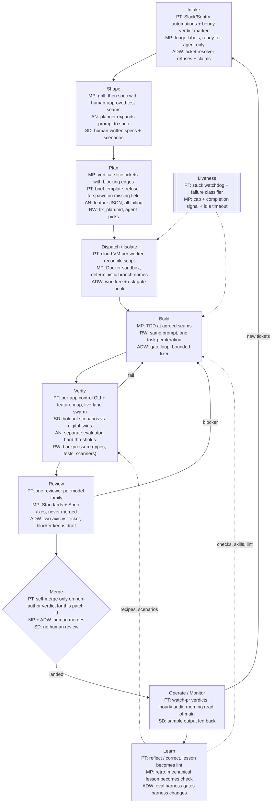

# Workflow map: six autonomous development workflows, stage by stage

**Date:** 2026-10-24
**Purpose:** The top-level map. It puts six workflows on one grid so you can see how each works, where they make opposite choices, and which pieces ADW should borrow for Java Spring, Rust and Node projects. Detailed dissections come later; section 6 lists them.
**Method:** Synthesis of the input docs below only. No new sources were fetched. Where an input doc does not cover a cell, the cell says "—" (the workflow has no such stage) or "not documented" (it may exist, but the inputs don't describe it).

**Citation keys** (paths relative to this file; `§` = section in that file):

| Key | File |
|---|---|
| C | `concepts/software-factory-concept.md` |
| PM | `workflows/poteto/pstack-mechanics.md` |
| PW | `workflows/poteto/public-workflow.md` |
| CN | `workflows/poteto/cursor-native-pieces.md` |
| RE | `workflows/poteto/repos-and-evolution.md` |
| MP | `workflows/matt-pocock/overview.md` |
| ADW | `workflows/adw/overview.md` |
| VS | `verification/skills-comparison.md` |
| DG | `decisions-to-grill.md` |

**Columns:**
- **Poteto** = Lauren Tan's pstack plus the Cursor-native pieces (benny, orchestrate plugin, Automations, Projects, Grok Bot routines).
- **Pocock** = Matt Pocock's skills plus Ralph-as-`sandcastle`.
- **StrongDM** = the StrongDM AI Software Factory.
- **Ralph** = Geoffrey Huntley's original loop (Cursor's `ralph-loop` port is noted where it adds mechanism).
- **Anthropic** = Anthropic's two long-running harness posts (Nov 2025 initializer + coding agent; Mar 2026 planner / generator / evaluator).
- **ADW** = this repo's pipeline as it is today.

Coverage is uneven. Poteto, Pocock and ADW are documented from source code. StrongDM, Ralph and Anthropic are documented only from the summary rows in C §3, §4 and §7, so their columns are thinner, and more of their cells say "not documented".

---

## 1. How to read the map

**Pipeline stages**

| Stage | One-line definition |
|---|---|
| Intake | How work enters the system: trigger, source and eligibility check. |
| Shape | Turning raw intent into a spec with acceptance criteria. Decides *what*. |
| Plan | Breaking the spec into units and ordering them. Decides *how* and *in what order*. |
| Dispatch/Isolate | Assigning units to agents and giving each one its own workspace. |
| Build | The agent writing code, plus its inner feedback loop. |
| Verify | Checking that the code does what was asked, by running something. |
| Review | Judging the diff or the decisions by reading, not by running. |
| Merge | Who or what lets code into trunk, and on what evidence. |
| Operate/Monitor | Watching runs and production, and turning signals into new work. |
| Learn | Turning failures into changes to the harness, skills, checks or code. |

**Cross-cutting rows**

| Row | One-line definition |
|---|---|
| Memory | Where state and knowledge persist between iterations, sessions and runs. |
| Human gates | Where a human must act, or can veto. |
| Models | Which model plays which role, and whether families differ. |
| Cost | Spend figures and budget controls. |
| Liveness | Stop conditions, stuck detection, crash recovery. |

---

## 2. Master matrix

### 2a. Pipeline stages

| Stage | Poteto (pstack + Cursor) | Pocock (skills + sandcastle) | StrongDM | Ralph (Huntley) | Anthropic harness | ADW (today) |
|---|---|---|---|---|---|---|
| **Intake** | Automations and Grok Bot routines watch Slack, X, Linear and Sentry, then route to a Project coordinator (PW "while sleeping" 1). benny-triage posts one `[benny:bug\|performance\|other]` marker from a fixed identity (CN §3.2). Overnight work comes in as one prompt with goal + done predicate + grants + escape hatch (PM §3.1). | `/triage` label state machine; a bug claim must be reproduced first; writes an agent brief (MP §2.11). Only `ready-for-agent` issues enter the loop. Sandcastle prompts pull live `gh issue list` (MP §4.1, §4.5). | A "seed": a few sentences, a screenshot, or an existing codebase (C §4.1). | Specs in `specs/`, one per topic, plus `fix_plan.md` as the queue (C §4.1–4.2). | A short prompt (C §4.1). | travis: `ticket_resolver` refuses anything not Ready, already In progress, cross-repo, or Blocked, then adds `in-progress`. factory: LLM router, no Ready checks. Triggers broken (ADW §3.1, §3.2, §3.14). |
| **Shape** | Triage traces the cause with `how`/`why`, dedupes, and creates a ticket only if 7 conditions hold (CN §3.2). Empirical forks are settled by prototype, not by asking (PM §3.3). `figure-it-out` writes the phase list as the reviewable artifact (PM §3.1). | `/grill-with-docs` (design-tree frontier, GLOSSARY + ADRs), `/prototype` via `/handoff`, then `/to-spec` with human-approved test seams; all in one context window (MP §2.2–2.4). | Humans write specs and scenarios (C §3). | Spec written through a long human conversation (C §3). | Planner expands a short prompt into a full spec (C §4.1). Initializer writes a 200+ item feature JSON, all failing (C §3). | Human only, by design: grill, Spec and Tickets with Pocock skills (ADW §3.0, ADR-0001). |
| **Plan** | Playbook steps copied verbatim into a todo list (PM §4.1). `multi-phase-plan` fixed per-PR skeleton, linted by `check-plan.mjs` (PM §4.8). `architect` = arena on type sketches (PM §4.14). Orchestrate brief GOAL…STANDING; a missing field means refuse to spawn (PM §4.7). orchestrate plugin `plan.json` with `pathsAllowed`, `acceptance`, `verify`, `dependsOn` (CN §4.2). | `/to-tickets`: tracer-bullet vertical slices sized to one context, with blocking edges; human approves (MP §2.5). Sandcastle planner emits `<plan>` JSON of unblocked issues; overlapping files count as blocked (MP §4.2). | not documented | `fix_plan.md`; the agent picks the next item; a human edits the file to steer (C §3; MP §4.1). | Feature list JSON; agents may only flip `passes` (C §3). | Plan agent writes a disposable Plan to `specs/`; planner is swappable; optional spec-review gate (human pause or LLM critic) (ADW §3.3, §3.4). |
| **Dispatch/Isolate** | Cursor cloud agents (one VM each), preferred over worktrees (PW tooling table). Orchestrate rolling window of about 10 (PM §4.7). Reconcile script spawns `pending` tasks whose dependencies are `handed-off` (CN §4.3). One writer per branch (PM §2.3). | Docker / Podman / Vercel microVM; branch strategy `head` / `merge-to-head` / `branch`; deterministic `sandcastle/issue-{id}` branches; `MAX_PARALLEL = 4` (MP §4.1–4.3). | not documented | One loop, no isolation documented (C §3). | not documented | One run per CLI call. `--worktree` (always on in factory); fanout/multirepo over explicit lists; risk-gate deny hook. No Frontier scheduler, no container (ADW §3.10, §3.13). |
| **Build** | `poteto-agent` delegates read the mode skill first (PM §4.2). "Smallest change the evidence justifies"; revert "might help" changes (PM §3.2). `/deslop` and `/no-comments` before commit (PM §4.9). `tdd` when the test is cheap (CN §3.3). | `/implement` drives `/tdd` red-green at agreed seams (MP §2.6–2.7). Priority: bugs, infra, tracer bullets, polish. `RALPH:` commits. When blocked, comment and move on (MP §4.2). | Agents only, "no hand-coded software" (C §3). | Same prompt every iteration, one task per iteration (C §3). | Coding agent works one feature at a time; smoke test at session start (C §4.4). | `/implement`, best-of-N (tests + LLM judge pick), or slim `build_loop` with gates and a bounded `/fix_gate` (×3). Zero-turn and no-op builds fail closed (ADW §3.5). |
| **Verify** | Per-app verification skill (control CLI + feature map), generated and maintained (RE §4; VS §1). Swarm of fresh verifiers with a mandatory live lane (PM §4.6, §4.12). benny: repro twice through the real UI, plus a media reviewer (CN §3.3). Ledger `live-ui-verified`…`verifier-failed`; script re-runs worker `measurements[]` (CN §4.5). | Deterministic checks: types, tests, pre-commit hook blocks commits (MP §3). No run-the-app verifier; human QA fills that role (MP §3, §6). | Holdout scenarios kept outside the repo; Digital Twin Universe; probabilistic satisfaction score (C §3, §4.5). | "Backpressure": tests, type checker, static analysis, security scanners (C §3). | Puppeteer/Playwright e2e on the running app; separate evaluator with hard per-criterion thresholds (C §3, §4.5). | slim: deterministic gates from `adw_gates.json`. travis: `/validate` and `/test` agents, non-blocking. `verify` + guarded `verifier` exists only interactively (ADW §3.6, §3.17). |
| **Review** | `interrogate`: one read-only reviewer per model, Act on / Consider / Noted / Dismissed (PM §4.15). Bugbot triage `fix`/`dismiss`/`ask` (PM §4.4). Cross-family trail review (PM §4.11). | `/code-review`: two parallel fresh agents, Standards and Spec, never merged (MP §2.8). Sandcastle per-branch reviewer, often a different model (MP §4.2). | Humans may not review. The satisfaction score is itself an AI judge (C §3, §6). | — | The evaluator is the reviewer; a human calibrates it by reading its logs (C §3). | Ticket runs: two-axis vs Ticket + Spec; a blocker keeps the PR draft. Same model family, not tool-scoped. Slim: advisory only (ADW §3.7). |
| **Merge** | Autopilot-full owners self-merge under a grant: a non-author verdict on this `git patch-id`, contiguous verified run, bottom-up, read back (PM §3.6). Babysit never merges. Autopilot-stack leaves landing to the human (PM §3.7). | Human, after team review. Agents are told "Do not push / close / label" (MP §4.5). `/implement-spec` merger agent targets an integration branch only (MP §2.6). | Converges "without human review" (C §1). | not documented | not documented | Draft PR up front, flipped to ready on success. Never auto-merges; human merges (ADW §3.9). |
| **Operate/Monitor** | `watch-pr` typed verdicts with exit codes (PM §4.4). Hourly audit tick (PM §3.8). Production reports feed benny. Morning review of main: revert, or add a lint rule (PW step 8). | not documented. QA output becomes new tickets (MP §3). | "A sample of the output is fed back into the inputs" (C §4.8). | — | — | `pipe_incident.py` replay-mode evidence collection only (ADW §3.15). |
| **Learn** | `/reflect` (3 lenses, human-approved), `/correct` (architecture > types/lint > tests > docs), `/automate-me`, eval playbook with blinded judges (PM §6). Daily `maintain-verification-skill` (PW tooling). | `/retro`: a mechanical lesson becomes a deterministic check; a judgment call goes to `CODING_STANDARDS.md` (MP §2.10). `/improve-codebase-architecture` every few days (MP §3). | Output sampling fed back (C §4.8); nothing else documented. | Human edits `fix_plan.md` and the stdlib to steer (C §3). | Human evaluator calibration; few-shot calibration of the design evaluator (C §3, §8). | Opt-in dreaming into `ai_docs/memory/`; auto-capture to `tests/regression/` (empty so far); `/capture_eval_task`; A/B evals gate harness changes (ADW §3.11, §3.16). |

### 2b. Cross-cutting rows

| Row | Poteto | Pocock | StrongDM | Ralph | Anthropic | ADW |
|---|---|---|---|---|---|---|
| **Memory** | Codebase as memory; feature maps; skills. Brain vault dropped (RE §2.4). `decisions.tsv`; orch store files with a single writer each (PM §4.7, §4.11). | `progress.txt` per sprint, deleted after it; GLOSSARY + ADRs; ticket as the brief; smart-zone context discipline (MP §2.12, §4.1). | Filesystem as memory (C §4.4). | Disk: specs, `fix_plan.md`, git. "The prompt never changes. The code does" (CN §6). | Progress file + git log + feature JSON (C §4.4). | `ai_docs/memory/` whole-store injection capped at 6K chars (travis only); run state in `agents/<id>/` (ADW §3.11). |
| **Human gates** | Contract prompt; irreversible writes pause; `gates.md` with a "default on no answer"; benny 10-min rejection window; morning audit (PM §3.3; CN §3.3). | Day shift: grill, seams, ticket approval. HITL `ralph-once` first. After the run: QA + diff review + merge (MP §4.5). | Spec, scenarios, harness, twins. No code, no review (C §3). | Specs and steering edits (C §3). | Prompt; evaluator calibration (C §3). | Shape, Ready label, optional spec-review pause, `travis_patch` launch, merge, clearing `in-progress` (ADW §4). |
| **Models** | Role map: cheap fast model for code and verification lanes, Opus for judgment; cross-family verifiers, panels and trail review (PM §5). Collapses to Claude-only in Claude Code (PM §7). orchestrate: workers GPT, verifiers Opus (CN §4.7). | Sonnet implements, Opus reviews (talk); dogfood uses Opus for every role (MP §4.2). | not documented | not documented | not documented | Default sonnet; opus for `/implement` and `/patch` via map; reviewer fixed at sonnet; no cross-family (ADW §4). |
| **Cost** | "Unlimited tokens"; 10 verifiers → 1 offered as a tuning knob (PW). Stop spawning at about 70% of budget; no token or dollar budgets (PM §3.7, §8). | Iteration caps double as a cost guard (MP §4.4). Plan price is self-reported (MP gaps). | ≥ $1,000 of tokens per engineer per day (C §7). | $50K contract for $297 (anecdote) (C §7). | Full harness 6 h / $200 vs solo 20 min / $9 (C §7). | Cost recorded per agent, about $1.0–1.5 per eval trial; no ceiling enforced (ADW §4). |
| **Liveness** | `/loop` wake via watcher or heartbeat; hourly audit probes side effects; "assume the VM dies" (PM §3.8). orchestrate: 10 s sweep, 5 min idle / 30 min stuck watchdog, failure classifier, exit 100 checkpoint restart (CN §4.3–4.4). | Hard iteration cap; `<promise>COMPLETE</promise>`; empty-frontier exit; `idleTimeoutSeconds`; 60 s post-signal grace (MP §4.4). | not documented | Infinite loop. The Cursor port adds `max_iterations` + promise tag; the promise is unchecked (CN §6). | Session-start smoke test; "context anxiety" named as a failure (C §7). | Heartbeat log; kill after result-but-no-exit; gate timeouts; `--resume`. No turn or wall-clock cap, no stuck detection (ADW §3.12). |

---

## 3. The generic loop, annotated

Each stage node lists the most distinctive mechanism per workflow. Key: PT = Poteto, MP = Pocock, SD = StrongDM, RW = Ralph, AN = Anthropic, ADW = ours.

---

## 4. Conflicts: where the workflows make opposite choices

### 4.1 Human at merge vs self-merge

- **Human merges:** Pocock, ADW. AFK "defers all of [review] to the end"; a codebase nobody reads is a "dark factory" failure mode (MP §4.5). ADW: "approval is the human's" (ADW §3.9).
- **Agent merges:** Poteto under Autopilot-full; StrongDM always. Merge authority comes from a non-author verdict on the exact patch (PM §3.6). Poteto reviews main afterwards and reverts (PW step 8).
- **Reasoning.** Human merge keeps someone familiar with the code and avoids the HumanLayer maintenance cliff (C §7). Self-merge removes the human as the throughput limit; poteto's view is that "a wrong decision usually costs less than blocking" for reversible changes (PM §3.3).
- **What favors which.** Self-merge needs a verifier you trust more than your own skim of the diff (C §5), reversible changes, and cheap revert. Human merge fits one-way doors (auth, billing, migrations, deploys), thin test suites, and shared team codebases. Everyone ends up deciding **per risk tier** (C §7, "Risk tiering"; DG Tier 1).

### 4.2 TDD required vs not

- **Required:** Pocock's skills and sandcastle prompts ("RGR... write a failing test first") (MP §2.7, §3).
- **Optional or replaced:** Pocock's own Sep 2026 interview (moved away from requiring it; MP §3). Poteto uses `tdd` "when the test target is cheap" and proves behavior by driving the app (CN §3.3). StrongDM moves the oracle *out* of the repo because agents "could rewrite tests to match code" (C §4.5).
- **Reasoning.** Test-first at human-agreed seams gives a check the implementer did not shape (MP §2.7). Against it: in-repo tests are editable by the author, and green tests can hide a missing DB table (MP §3).
- **What favors which.** TDD pays where seams are clean and tests are fast (Rust `cargo test`, Node Vitest). Where the risk is wiring or startup (Spring DI, a missing migration), a run-the-app verifier catches more (C §8). Either way, protect the tests from the author (VS improvement 6).

### 4.3 Memory: a vault vs codebase-as-memory

- **Vault / notes store:** noodle `brain/`, brainmaxxing (RE §1–2), `continual-learning` AGENTS.md bullets (CN §7), ADW `ai_docs/memory/` with dreaming (ADW §3.11).
- **Codebase as memory:** Poteto today. "Your codebase is the ultimate form of memory"; the feature map is "materialized memory" (RE §2.4). Lessons become lint rules, types and skills (PM §6.2).
- **Reasoning.** A vault is cheap and catches gotchas that have no structural home. But it is private, unreviewed, and can "silently degrade" (RE §2.1, plan 119). Code, lints and feature maps are shared, reviewed and enforced.
- **What favors which.** A solo developer on one repo can get value from a small capped vault. Teams, and many parallel agents, favor structure. Either way, check whether a note could be a check first (RE §6.3).

### 4.4 Personas / rubric axes vs model diversity

- **Personas:** noodle `adversarial-review` (Skeptic, Architect, Minimalist) (RE §1.3).
- **Rubric axes:** Pocock `code-review` Standards vs Spec (MP §2.8); thermos's two rubrics (CN §9); ADW two-axis review (ADW §3.7).
- **Model diversity:** pstack `interrogate`, "The adversarial signal comes from model diversity, not assigned personas" (PM §4.15). orchestrate defaults workers and verifiers to different families (CN §4.7).
- **Reasoning.** One family shares one set of blind spots, so agreement across families is evidence (PM §5.3). Axes stop one concern from masking another (MP §2.8). Personas on one model mostly re-voice the same priors, which is why pstack dropped them.
- **What favors which.** Axes and diversity are orthogonal, so use both. In Claude Code, diversity collapses to Opus vs Sonnet unless you bridge to another vendor (PM §7; VS Q6). Axes are free; model diversity costs plumbing.

### 4.5 Self-declared completion vs an independent verifier

- **Self-declared:** Ralph and Cursor's `ralph-loop` (`<promise>` tag, "nothing verifies the promise"; CN §6). Sandcastle's completion signal is also a prompt convention (MP §4.4).
- **Independent:** pstack (a predicate re-checked every iteration, verdicts from non-authors; PM §3.2, §3.6), Anthropic's separate evaluator ("agents reliably skew positive"; C §3), StrongDM holdouts.
- **Reasoning.** The promise is cheap, and backpressure (types, tests) catches most errors in a greenfield compiler. Independent verifiers exist because self-grading is measurably lenient (C §6) and agents reward-hack (C §7).
- **What favors which.** A promise is fine when a human reviews everything afterwards (Pocock) or when the compiler is the oracle (Rust greenfield). Once no human reads the diff, the done signal must come from something the author cannot write.

### 4.6 Resolve ambiguity before the run vs during it

- **Before:** Pocock grills until the frontier is empty; the AFK failure mode is "coherent about the wrong thing" (MP §5).
- **During:** pstack settles empirical forks by prototype, decides preference calls under the grant and reports them, and parks the rest in `gates.md` with a default (PM §3.3).
- **What favors which.** Product intent and taste favor before. Questions that "an experiment can settle" (perf, layout, behavior) favor during. ADW's ADR-0001 already picks "before" for Shape.

### 4.7 Who picks the next task

- **The agent:** Ralph ("the agent chooses the task, not you"; MP §4.1).
- **A planner agent:** sandcastle parallel-planner (MP §4.2); noodle's scheduler agent (RE §1.1).
- **A script over a dependency graph:** orchestrate plugin (CN §4.3); pstack Orchestrate `frontier.json` (PM §4.7).
- **A human:** ADW today (ADW §3.13).
- **What favors which.** Agent choice suits one linear backlog. A deterministic frontier (Ready, Blockers closed, not In progress) suits parallel work and is what ADW's `CONTEXT.md` already defines.

### 4.8 Worktrees vs sandboxes vs cloud VMs

- **Worktrees:** ADW, pstack in Claude Code.
- **Containers:** Pocock ("essential for overnight AFK runs"; MP §4.3).
- **Cloud VMs:** Poteto, who recommends against worktrees beyond about 10 local agents (PW tooling table).
- **What favors which.** Worktrees are cheapest but share the host, credentials and network (ADW §3.10). Containers add a credential and egress boundary. VMs survive a closed laptop. For Spring and Rust, N parallel builds make disk and caches the bottleneck (C §8).

### 4.9 Draft PRs vs ready PRs

- **Draft:** ADW opens a draft up front (ADW §3.9); benny may only open a draft (CN §3.3).
- **Ready:** pstack "PRs opened ready (never draft)" (PM §4.9).
- **What favors which.** Draft is a structural "not yet trusted" flag that suits human-merge setups. Ready-plus-verdict suits verifier-gated merge, where readiness is carried by the verdict rather than the PR state.

### 4.10 Learning edits auto-applied vs human-approved

- **Auto-applied:** brainmaxxing `meditate` ("The user reviews the diff"); `continual-learning`; ADW dreaming.
- **Human-approved:** pstack `/reflect`, "Skill changes affect every future agent in the org. Do not auto-apply" (PM §6.1); Pocock `/retro` proposes changes.
- **What favors which.** Auto-apply is acceptable for capped, private, easily reverted notes. Anything that changes future agents' behavior (skills, gates, prompts) needs approval, or an eval that measures the change (ADW's eval harness; pstack eval playbook).

---

## 5. Convergences: what every serious workflow agrees on

1. **The writer never grades itself.** Fresh-context reviewers (Pocock, ADW), non-author verifiers (pstack), a separate evaluator (Anthropic), holdouts (StrongDM). Ralph is the exception, and its successors added review (MP §4.2).
2. **Verification is the bottleneck, not generation.** Poteto calls it "the limiting step" (PW §2). Pocock says "the rate of feedback is your speed limit" (MP §3). C §1 says the hard problem is verification.
3. **Run the real thing.** E2E on the running app (Anthropic), live lanes (pstack), twins (StrongDM). Pocock reaches the same point through human QA after his green-tests demo failure (MP §3).
4. **State lives on disk and in git, not in the chat.** `fix_plan.md`, `progress.txt`, feature JSON, orch store, `plan.json`/`state.json`, `agents/<id>/` (C §4.4; CN §4.2; ADW §3.12).
5. **One unit of work per fresh context.** One task per Ralph iteration; tickets sized to one context window (MP §2.5); one owner per PR (PM §3.7).
6. **Deterministic work goes in code; judgment goes to the model.** noodle's Go/LLM split, `watch-pr`, `orch`, `check-plan.mjs` (RE §7). ADW's "code checks and agents fix" (ADW §1).
7. **Encode lessons as structure.** "The instruction is the symptom" (RE §6.3). Pocock: a mechanical lesson "gets a deterministic check, full stop" (MP §2.10).
8. **Hard stops exist.** Iteration caps, done predicates, escape hatches, Andon (MP §4.4; PM §3.1; CN §4.6). "A duration is not a finish condition" (PM §3.1).
9. **Irreversible actions stay human.** Force-push, deploys, data deletion, external messages (PM §3.3). Factory.ai routes auth, billing, deploy and migrations to humans (C §7).
10. **Earn trust before scaling out.** Poteto's rule 5 and the noodle switch to `supervised` (PW §1; RE §6.3); Pocock's HITL-first `ralph-once` (MP §4.5).
11. **Humans keep the spec and the risk policy.** Even StrongDM's humans write specs, scenarios and twins (C §4.9).

---

## 6. Dissection backlog

Each item is a candidate for a deep dive. ★ marks the five to dissect first.

| # | Component | Source | Stage | Why it matters | Dissection file |
|---|---|---|---|---|---|
| 1 ★ | `create-` / `maintain-verification-skill` (control CLI, feature map, doctor, proof bar) | Poteto | Verify, Learn | The trust foundation for everything else. It fixes ADW's "no recipe" and "author holds the oracle" gaps (VS §4). Needs a Spring / Rust / Node recipe shape. | `dissections/poteto/verification-skill-generator.md` |
| 2 ★ | Shipping playbook: non-author verdict, `git patch-id` binding, contiguous verified run, read-back | Poteto | Merge | This is the mechanism that replaces per-PR human review. ADW's ship surface has no verdict binding (VS §5 #1). | `dissections/poteto/shipping-merge-authority.md` |
| 3 ★ | Overnight contract: `autonomous-run` + `show-me-your-work` + `ketchup` morning brief | Poteto | Human gates, Review, Memory | Defines done, the escape hatch, the decision log and the morning audit. It covers ADW missing items 1–3, 11–12 (ADW §5). | `dissections/poteto/overnight-contract.md` |
| 4 ★ | orchestrate plugin reconcile loop and liveness (watchdog, failure classifier, exit-100 restart, handoffs, measurement re-run) | Poteto (co-maintained) | Dispatch, Liveness | The most complete portable queue + liveness design. ADW has no queue driver, no stuck detection and no caps (ADW §3.12, §5). Only the spawn adapter is Cursor-specific (CN §4.10). | `dissections/poteto/orchestrate-reconcile-loop.md` |
| 5 ★ | Risk-tiered merge policy (Cursor agentic codeowners, Factory CODEOWNERS routing, OpenAI P0–P2 + release smoke) | StrongDM-adjacent (C §3, §7) | Merge, Human gates | Answers *which* PRs can skip you. Without it, items 1–4 force an all-or-nothing choice. It is DG Tier 1. Sources are vendor and secondary, so the dissection needs fresh primary reading. | `dissections/industry/risk-tiered-merge.md` |
| 6 | StrongDM holdout scenarios + satisfaction score + digital twins | StrongDM | Verify | The strongest answer to "author edits the oracle". Twins matter for Spring services with third-party APIs (C §8). | `dissections/strongdm/holdout-scenarios.md` |
| 7 | benny triage → repro → draft fix (marker contract, twice-repro, verify mode, single poster) | Poteto | Intake, Verify | A template for ADW's broken triggers and an incident pipeline that stops the line at every stage (CN §3.5). | `dissections/poteto/benny-triage-repro.md` |
| 8 | sandcastle loop and templates (stopping semantics, branch strategy, parallel planner, per-branch reviewer) | Pocock | Dispatch, Build, Liveness | The shortest path to a Pocock-style first unattended night for ADW (ADW §5 "shortest path"). | `dissections/matt-pocock/sandcastle-loop.md` |
| 9 | `/to-tickets` + `/triage` agent brief (vertical slices, blocking edges, AFK/HITL labels) | Pocock | Shape, Plan | ADW already uses these by hand. Its Frontier depends on their blocking edges, and acceptance criteria become verify claims (MP §6). | `dissections/matt-pocock/tickets-and-agent-brief.md` |
| 10 | `/code-review` two-axis + `/pr` evidence and merge-danger shape | Pocock | Review | ADW's ticket review copies the axes. The PR evidence section is missing from ADW and ship-gate (VS §3). | `dissections/matt-pocock/code-review-and-pr.md` |
| 11 | `/retro` and pstack `/correct` (lesson → enforcer ladder, rule-to-enforcer table) | Pocock, Poteto | Learn | ADW's learning is notes and evals. These turn misses into lints and checks (PM §6.2; MP §2.10). | `dissections/poteto/correct-and-retro.md` |
| 12 | `watch-pr` typed verdicts + Babysit CI flake classification | Poteto | Operate/Monitor, Merge | One-retry flake policy and stale-base detection. ADW has no CI to watch yet, but needs this before self-merge (PM §3.4, §4.4). | `dissections/poteto/watch-pr-babysit.md` |
| 13 | `swarm` + verification ladder + Orchestrate ledger | Poteto | Verify | How many verifiers, which lanes, and how a gap is recorded ("a gap does not count as a pass") (PM §4.12; CN §4.5). | `dissections/poteto/swarm-and-ledger.md` |
| 14 | `interrogate` + `arena` model-diverse panels | Poteto | Review, Models | Tests whether Opus-vs-Sonnet diversity is worth anything in Claude Code (PM §7; VS Q6). | `dissections/poteto/interrogate-arena.md` |
| 15 | Anthropic planner / generator / evaluator with hard thresholds | Anthropic | Shape, Verify | Evaluator calibration and per-criterion thresholds are the documented fix for lenient self-grading (C §3). | `dissections/anthropic/planner-generator-evaluator.md` |
| 16 | Anthropic initializer + feature-list JSON + progress file | Anthropic | Plan, Memory | "Agents may only flip `passes`" is a simple executable done predicate for an ADW Ticket (ADW §5 item 2). | `dissections/anthropic/initializer-feature-list.md` |
| 17 | Huntley Ralph loop and backpressure tuning | Ralph | Build, Verify | The baseline everyone reacts to; the backpressure-vs-compile-speed trade-off for Rust and Spring (C §8). | `dissections/ralph/ralph-loop.md` |
| 18 | noodle trust dial + serialized merge queue + heartbeats | Poteto | Merge, Liveness | A config-level autonomy dial (`auto`/`supervised`/`manual`) maps directly onto ADW CLI flags, and a precedent exists for why the default moved to `supervised` (RE §1.1). | `dissections/poteto/noodle-trust-dial.md` |
| 19 | Stop-hook primitives: `ralph-loop`, `advisor`, `continual-learning` | Cursor plugins | Liveness, Review, Learn | Each is one Claude Code `Stop` hook. These are cheap guards ADW's interactive layer could use (CN §13). | `dissections/cursor/stop-hook-primitives.md` |
| 20 | ADW verifier guard + `verify` protocol (as the base to extend) | ADW | Verify | The only mechanically enforced read-only oracle in the set (VS bottom line). Needs wiring into pipelines. | `dissections/adw/verify-protocol.md` |
| 21 | ADW ticket resolver + Frontier (what a queue driver needs) | ADW | Intake, Dispatch | The seam a Frontier scheduler would extend; `factory.py` bypasses it today (ADW §3.1). | `dissections/adw/resolver-and-frontier.md` |
| 22 | Formal verification skill pair (property must fail on a broken variant) | Poteto | Verify | Rust's best tool fit (Kani, loom). Suits state machines that driving the app rarely reaches (VS §4, #14). | `dissections/poteto/formal-verification-skills.md` |

**Why these five first, for "autonomous development without reviewing every PR":**

- **#1 (verification skill generator).** You cannot stop reading PRs until something you trust reads the running app for you. Poteto's own build order puts this first (RE §7).
- **#2 (Shipping / patch-id).** This is the rule that lets a verdict, instead of you, authorize a merge, and keeps the verdict tied to the code that actually lands.
- **#3 (overnight contract).** It replaces per-PR review with a morning audit of decisions. Without it, unattended runs are unauditable.
- **#4 (orchestrate loop / liveness).** ADW cannot run overnight at all today: no queue, no caps, no stuck detection. This is the most portable design for those parts.
- **#5 (risk tiers).** "Without reviewing every PR" means reviewing *some*. This decides which ones, and it is DG Tier 1, which everything else depends on.

---

## 7. Borrow sheet for ADW

Each row names the gap (from ADW §4–5 and VS §5) and the mechanism to adopt.

| Stage | ADW gap | Borrow | From | Notes |
|---|---|---|---|---|
| Intake | Triggers broken; `factory.py --issue` skips Ready, claim and Blocker checks (ADW §3.1, §3.14). | Point cron/webhook at a resolver-gated entry. Copy benny's fail-closed preflight and one-machine-readable-verdict contract, using a GitHub label in place of the Slack marker. | Poteto benny (CN §3.2, §3.7) | Route `factory.py --issue` through `ticket_resolver`. |
| Shape | None (human by design). | Keep Pocock's grill → spec → tickets. Require `triage/AGENT-BRIEF.md`-style testable acceptance criteria before `ready-for-agent`. | Pocock (MP §2.11, §6) | Those criteria become verify claims (VS #2). |
| Plan | Plan path extracted by regex; no executable done predicate (ADW §3.3, §5). | JSON plan envelope with per-unit `acceptance` + `verify` command (orchestrate `plan.json`). Feature-list "only flip `passes`" as the done predicate. | orchestrate plugin (CN §4.2); Anthropic (C §3) | Pairs with eval-task `acceptance:` blocks ADW already has. |
| Dispatch/Isolate | No Frontier scheduler; risk gate off in factory; host execution (ADW §3.10, §3.13). | Reconcile loop over the Frontier (spawn when Blockers are `handed-off`). Worktree + risk gate on by default. Deterministic `adw/<ticket>` branches so re-runs resume. Container sandbox later. | orchestrate (CN §4.3); sandcastle (MP §4.2–4.3) | Start serial (one Ticket at a time), as noodle's "One Plan at a Time" did (RE §1.1). |
| Build | travis `/test` failure can still yield a ready PR (ADW §3.6). | Move travis onto the slim gate engine. Add pstack's "revert 'might help' changes" rule to the fixer prompt. | ADW slim (ADW §3.5); pstack (PM §3.2) | Mostly internal consolidation. |
| Verify | `verify` + guarded `verifier` not wired into pipelines; no recipe; author writes claims (ADW §3.17; VS "Bottom line"). | Pipeline verify phase: claims from Ticket acceptance criteria, guarded verifier, report bound to patch-id. Generate a per-repo `verify-<app>` recipe + feature map. Add parent-SHA "must fail" for bug fixes. | pstack generator (VS §4); Shipping "parent against head" (PM §3.6) | Keep ADW's guard and report schema as the protocol layer (VS §4). |
| Review | Same family, not tool-scoped, slim review advisory (ADW §3.7). | `disallowed_tools` on the reviewer (or the verifier-style guard). Opus-vs-Sonnet split from the builder. Keep the two axes, never merged. | Pocock (MP §2.8); pstack `interrogate` (PM §4.15) | Cheap; VS #8. |
| Merge | Human merges all; no verdict binding; no CI (ADW §3.9). | Stage 1: keep human merge, but require a VERIFIED verdict for HEAD's patch-id before "ready". Stage 2, per risk tier: Shipping-style self-merge with read-back for low-risk classes only. | pstack Shipping (PM §3.6); risk tiers (C §7) | Stage 2 waits on DG Tier 1. |
| Operate/Monitor | Incident pipeline is replay-only; nothing watches PRs (ADW §3.15). | `watch-pr`-style typed verdicts and the one-retry flake rule once CI exists. Morning read of main / merged PRs. | pstack Babysit (PM §3.4, §4.4) | Add CI first (ADW §5 item 10). |
| Learn | Dreaming auto-applies; regression capture never fed (ADW §3.11). | `/retro`/`/correct` ladder: a miss becomes a gate in `adw_gates.json` or a lint before it becomes a memory note. Keep A/B evals as the gate for harness and skill edits. | Pocock (MP §2.10); pstack (PM §6.2) | ADW's eval harness is already stronger than either source's skill eval. |
| *Memory* | Unreadable trail; nothing records *why* (ADW §5). | Append-only `decisions.tsv` (`ts, phase, decision, why, evidence, result`) per run, rendered into the PR body. | `show-me-your-work` (PM §4.11) | VS #13. |
| *Human gates* | Gates exist but no parking: a question stalls or the run fails. | `gates.md` entries with "default on no answer", plus an explicit irreversible-action list on top of the risk-gate hook. | pstack Orchestrate (PM §3.3) | — |
| *Models* | Single knob; no cross-family. | Role map in config (builder, reviewer, verifier on different models), recorded in the report. | pstack `setup-pstack` (PM §5.1) | The user's `pstack-models.md` already sets `opus xhigh, sonnet xhigh` for panels. |
| *Cost* | Recorded, never capped (ADW §4). | Per-run and per-night ceiling; stop spawning at about 70% of budget; record cost in `report.json`. | pstack Orchestrate (PM §3.7); VS #12 | — |
| *Liveness* | No turn or wall-clock cap; no stuck detection (ADW §3.12). | Idle watchdog (no new JSONL lines for N min means kill + synthetic postmortem), iteration cap, empty-frontier exit, failure classifier for retry-vs-abandon, abort after 2 consecutive failures. | orchestrate (CN §4.4); sandcastle (MP §4.4) | The eval runner's 2-infra-error abort is reusable (ADW §5). |

**Order of adoption.** The shortest path to a Pocock-style night is ADW §5 items 1, 3, 4, 7, 13, 14, 15: Frontier driver, stop rule, default isolation, test-blocks-ready, working triggers, caps, cost ceiling. That means the Intake, Dispatch, Build, Cost and Liveness rows above. Verify-in-pipeline and verdict-bound "ready" come next. Self-merge per risk tier comes last, and only after DG Tier 1 is decided. This follows poteto's order: verification instrument, then depth-first loop, then triggers, then self-merge (RE §7).

---

## Gaps

- The StrongDM, Ralph and Anthropic columns come only from the summary rows in C. No primary pages were re-read for this map, so "not documented" there often means "not in our inputs", not "absent from the system".
- The risk-tiering mechanisms (backlog #5) rest on vendor and secondary sources (C §3, §7). The OpenAI primary post was never fetched (C §9).
- Poteto's self-merge track record, StrongDM's satisfaction scores, and Pocock's own use of cron-triggered runs are all unpublished or unverified (PW numbers table; C §9; MP gaps).
