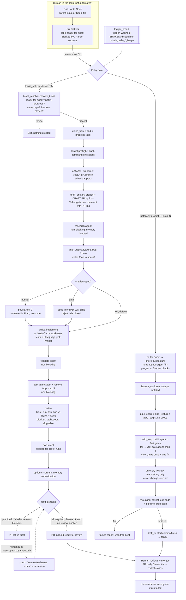

# ADW (this repo): pipeline, gates, and what is missing for unattended runs

**Date:** 2026-10-24
**Question:** What is this repo's own agentic developer workflow (ADW), stage by stage, so it can sit on one map next to Lauren Tan's pstack and Matt Pocock's workflow? What works today, and what is only planned?
**Method:** I read the code under `adws/` (entry points, `travis/`, `pipelines/`, `adw_modules/`, `adw_triggers/`), `adw_gates.json`, `.claude/{skills,agents,hooks}/`, `skills/`, `evals/`, the root `CONTEXT.md`, `docs/adr/0001-ticket-driven-runs.md`, and the plan and result docs (`docs/slim-pipelines-plan.md`, `docs/sdlc-agent-map.md`, `docs/spec-review-gate-plan.md`, `docs/m0`–`m5-*.md`). I also checked `git log`. I did not run the pipeline. The only commands I ran were read-only: `uv run adws/pipelines/gates.py --print-gates` and the `factory.py` usage text.
**Status labels:** **Works** means code exists, has unit tests in the `adw_gates.json` list, and/or has a recorded live smoke. **Partial** means it exists with a known gap. **Broken** means the code path cannot run as written. **Planned** means it exists only in a doc.
**Companions:** `../poteto/pstack-mechanics.md`, `../matt-pocock/overview.md`.

---

## 1. Summary

ADW is a Python harness (`uv run` PEP 723 scripts under `adws/`) that drives the Claude Code CLI through a fixed SDLC. Its unit of input is a **Ticket**: a `ready-for-agent` GitHub issue, cut by a human from a Spec. Its output is a **draft PR that a human merges**. Grilling, writing the Spec and cutting Tickets stay human (ADR-0001). There are two orchestrators. The flagship `adws/travis/travis_sdlc.py` (1,561 lines) runs research → plan → [optional spec-review gate] → build (optionally best-of-N) → validate → test → review → document. It has ticket intake, the `in-progress` claim, review against the Ticket instead of the Plan, worktree isolation, a draft PR updated per phase, a risk-gate hook, project memory, and resume. The newer slim pipelines plus `adws/pipelines/factory.py` route a prompt or issue to a chore, bug or feature pipeline. In those pipelines **code checks and agents fix**: deterministic gates from `adw_gates.json` loop failures back to a fixer agent, with bounded retries. The repo's biggest asset is an **eval harness** (`evals/`): 14 frozen tasks, code graders plus an LLM judge, pass@k / pass^k, and A/B scorecards. The harness is measured against it. M4 recorded slim vs travis at parity on pass rate with about 33% lower cost. The interactive Claude Code layer used to develop the repo itself (`verify` with a write-guarded `verifier` subagent, `validate-work`, `ship-gate`) is **not wired into the `adws/` pipelines**. What ADW does not have yet is the overnight machinery: no live trigger (both triggers dispatch to scripts that don't exist), no CI, no loop or queue over the Ticket frontier, no independent verifier in the pipeline, no decision log, no budget ceiling, and no stuck-run detection beyond a hang-after-result kill. ADW sits nearest Pocock on the spectrum: a human approves intent and merges every PR. Its automation stops one PR per invocation, launched by hand.

---

## 2. Pipeline diagram (ticket to merged PR)

---

## 3. Phases and components

Each entry gives what it does, the mechanism, any human gate, and the verification it performs.

### 3.0 Shaping (human, outside the harness)

- **Does.** Turns an idea into a Spec and then into Tickets. The vocabulary is fixed in `CONTEXT.md`: Spec, Ticket, Epic, Ready, Blocker, In progress, Frontier, Plan, Review oracle.
- **Mechanism.** No ADW code. The repo uses Matt Pocock's skills for this step (`CLAUDE.md` "Agent skills" block; `docs/agents/issue-tracker.md`, `triage-labels.md`, `domain.md`). ADR-0001 says "only the unattended half of the work is automated".
- **Human gate.** All of it. A human applies `ready-for-agent`.
- **Verification.** None mechanical. Ticket acceptance criteria later become the Review oracle.

### 3.1 Intake: Ticket resolver and claim (Works, travis only)

- **Does.** Turns a Ticket reference (URL, `owner/repo#N`, `N`, `#N`) into a runnable Ticket or a refusal. Refusal costs nothing: no worktree, state, agent call or PR exists yet.
- **Mechanism.** `adws/adw_modules/ticket_resolver.py` (`resolve_ticket`, `claim_ticket`, `resolve_spec`, `post_run_comment`), called from `adws/travis/travis_sdlc.py` (around lines 680–690). It refuses: a Ticket in another repo, one without `ready-for-agent`, one already `in-progress` on a fresh run, and one with an open Blocker. Blockers are GitHub native dependencies plus a `## Blocked by` section. A Blocker it cannot fetch counts as open, so it fails closed. On accept it adds `in-progress`, the only label a run ever writes. `resolve_spec` finds the parent Spec: sub-issue parent, then `## Parent` / `Part of #N`, then a `Spec:` file line. A missing Spec only warns. Plan type comes from the Ticket's bug/chore/feature label, then keywords.
- **Target preflight.** The run is refused (`target_not_installed`) if the target lacks a slash command the run will call (`travis_sdlc.py` docstring; `test_target_preflight.py`).
- **Human gate.** Removing `in-progress` after a failed run is human-only.
- **Verification.** Unit-tested: `test_ticket_resolver.py`, `test_ticket_run.py`, plus fixture tickets in `adws/adw_tests/fixtures/tickets/`.
- **Gap.** `factory.py --issue N` does **not** use the resolver. It calls `github.fetch_issue` directly (`factory.py:95-111`) and skips the Ready, In progress and Blocker checks.

### 3.2 Intake: Router (Works, factory only)

- **Does.** Classifies a ticket or prompt into `chore | bug | feature`. Hotfix is deferred to M6, so hotfix-shaped tickets go to `bug`.
- **Mechanism.** `adws/pipelines/router.py`: an in-process LLM call that returns `RouteVerdict{route, confidence, reason}`. It fails closed and retries once. Confidence below 0.5 only prints a warning (`factory.py:195-197`). `--route` overrides it.
- **Verification.** A fixture eval at `evals/agents/router/` (15 labeled cases, with a per-category accuracy floor). Both sonnet and haiku scored 15/15, so the suite is saturated and only works as a smoke test now (`docs/m5-results.md`).

### 3.3 Research and Plan (Works)

- **Does.** Research is non-blocking codebase analysis. Plan writes the agent's own disposable "how" to `specs/<type>-<id>-<name>.md`. For a Ticket run, the planner reads the Ticket's title and body plus a pointer to the Spec.
- **Mechanism.** `adws/travis/travis_research.py`, `travis_plan.py`, with templates in `template_claude/commands/{research,feature,bug,chore}.md`. The planner is swappable through `adws/travis/planners.py` (travis or OpenSpec; see `PLANNER_CONTRACT.md`). Slim pipelines call `/feature` or `/bug` directly (`pipe_feature.py`).
- **Verification.** The plan path must exist. Path extraction is still regex over prose; `sdlc-agent-map.md` §1 flags this as the root cause of brittleness, and JSON envelopes are planned.

### 3.4 Spec-review gate (Works, opt-in, off by default)

- **Does.** A checkpoint between plan and build.
- **Mechanism.** `--review-spec[=human|auto]` or `ADW_REVIEW_SPEC`. In `human` mode the run pauses (`agents/<id>/spec_review.json` holds a `--resume` command). In `auto` mode `adws/adw_modules/spec_reviewer.py` runs an LLM critic: approve or revise continues, and reject or a parse error fails closed. For Ticket runs the critic sees the Ticket's acceptance criteria. Design: `docs/spec-review-gate-plan.md` (status: shipped).
- **Human gate.** Yes, in `human` mode. Headless stays the default (`docs/DEVELOPMENT_WORKFLOW.md` §5.2).
- **Verification.** Spec-defect eval task `evals/tasks/14-specdefect-rename-guard.yaml`. Known weakness: a claimed "revise" edit is trusted without diff verification (`sdlc-agent-map.md` row 4).

### 3.5 Build (Works)

- **travis.** `adws/travis/travis_build.py` runs `/implement` against the Plan. A no-op guard (`test_build_noop_guard.py`) fails a build that changed nothing. `agent.py` fails closed when the CLI returns zero turns, which is how an unknown slash command used to show up as success (`docs/m5-results.md`).
- **Best-of-N.** `--attempts N` uses `adws/adw_modules/bestof.py`. It runs N build trajectories in worktrees `trees/<id>-c<k>/` and scores each with a hybrid verifier: `--test-command` plus an LLM judge on the diff vs the Plan. The winner's diff is applied.
- **Slim pipelines.** `adws/pipelines/core.py::build_loop`. The build agent runs (`/build` for chore, `/implement` after a plan for feature and bug). Then the fast gates run in config order, and a failure sends its output tail to a `/fix_gate` agent, up to `--max-iters` (default 3). Slow gates run once, get one fix and one rerun, and have hard timeouts: 300 s by default, 1800 s for slow gates (`core.py`, `gates.py`). Gates come from the target's `adw_gates.json` or are auto-detected (fast gates only). `pipe_bug.py` requires a fast test gate.
- **Memory.** Injected into research, plan and build in travis only (§3.11).

### 3.6 Validate and Test (travis: Partial; slim: Works)

- **travis.** `travis_validate.py` is an agent that applies architectural rules and fails closed on unparseable output. `travis_test.py` is an **agent** that runs `/test` and a `/resolve_failed_test` loop (max 3). Its parse failure now fails closed (M0 T1). **Both phases are non-blocking.** A failure sets `failed_phase` but leaves `all_success` alone (`travis_sdlc.py` around lines 1416–1448). `pr_ready_after_run` (`travis_sdlc.py:404`) checks only `all_success` and the review result. So, reading the code, **a run with failing tests can still flip the PR to ready**, and the process exits 0 with a "completed with test failures" banner.
- **slim.** Tests are a deterministic gate, not an agent. `sdlc-agent-map.md` row 6 says so: "running tests is not an agent job". A failure fails the pipeline.

### 3.7 Review (Works; not tool-scoped)

- **Ticket runs.** `adws/adw_modules/ticket_review.py` runs an inline two-axis review in the style of Pocock's `/code-review`. The Spec axis checks the diff against the Ticket's acceptance criteria, then the parent Spec. The Standards axis checks the repo's standards file or baseline smells. Findings map to `blocker` (missing_requirement, implemented_wrongly), `tech_debt` (scope_creep, repo_standard) and `skippable`. It **never reviews against the Plan**, per ADR-0001: the Plan is the builder's own homework. A blocker keeps the PR in draft.
- **Legacy `specs/` runs.** `/review` against the Plan (`travis_review.py`).
- **Slim pipelines.** One advisory `/review` pass that never changes the verdict (`pipe_feature.py:105-115`). `factory.py` marks the PR ready on gate success alone.
- **Independence.** The reviewer is a fresh process with a fresh context, but it runs on the **same model family** (`REVIEW_MODEL = "sonnet"`). It is **not tool-scoped** either: `run_ticket_review` passes no `disallowed_tools` (`ticket_review.py:231-238`). The only `disallowed_tools` caller in `adws/` is the PR-description agent (`draft_pr.py:200`). A read-only reviewer is planned (`sdlc-agent-map.md` row 8).
- **Fix loop.** `adws/travis/travis_patch.py <adw_id>` plans a patch from the review issues, applies it, runs tests and re-reviews. A **human launches it**; `travis_sdlc` never calls it.

### 3.8 Document (being retired)

`travis_document.py` writes `app_docs/` and `conditional_docs.md`. It is skipped for Ticket runs and marked for removal. ADR-0001 explains why: it is "an unversioned third store of spec-like prose".

### 3.9 Ship surface: draft PR (Works)

- **Mechanism.** `adws/adw_modules/draft_pr.py`. `start()` creates branch `adw/<id>`, an empty commit and a **draft** PR up front. `commit_phase()` commits and pushes after each phase and updates a checklist in the PR body. `finish()` marks the PR ready only on success. With no remote or `gh`, it degrades to a local branch. For Ticket runs the PR is implied, takes the Ticket's title, closes the Ticket, and posts one comment on it.
- **Merge.** **Never automated.** Every doc and code path says "approval is the human's".
- **Known gap.** `_commit_all` uses `git add -A`, so harness artifacts can leak into a target PR. There is now an exclusion list, but a target without a `.gitignore` still leaks `__pycache__` / `uv.lock` (`docs/m5-results.md` "Known gaps").

### 3.10 Isolation and safety (Works, opt-in in travis)

- **Worktree.** `--worktree` (`adws/adw_modules/feature_worktree.py`, `worktree_ops.py`) gives a run its own branch, a tree under `trees/<id>/`, and ports from a 15-slot range. State stays in `agents/<id>/`. `factory.py` always creates one.
- **Risk gate.** `adws/adw_modules/risk_gate.py` is a PreToolUse deny-list (force push, remote deletes, system `rm`, sudo, credential stores, publishing) injected via `--settings`. It binds even under `--dangerously-skip-permissions` and logs to `agents/<id>/risk.log`. It is on for `--risk-gate`, `ADW_RISK_GATE=1`, or a trigger. **`factory.py` does not set it.**
- **No container or VM sandbox**, and no network egress control. Agents run on the host with `--dangerously-skip-permissions`.

### 3.11 Memory and learning (Works, travis only)

- **Project memory.** Markdown in the target's `ai_docs/memory/`. Recall is whole-store injection, capped at 6,000 characters, via `--append-system-prompt-file` (`adws/adw_modules/memory.py`, `adws/travis/MEMORY_CONTRACT.md`).
- **Dreaming.** `--dream` or `adws/travis/travis_dream.py`. One LLM call consolidates a run's artifacts into entries. It fires only after a successful build. It now uses explicit add/update/delete/keep actions, but still applies "full-regenerate semantics", so absent entries are removed (`travis_dream.py:308-345`). Scheduled dreaming is listed as remaining in the README roadmap.
- **Capture loops.** `--auto-capture` turns a failure into a `tests/regression/` fixture. `/capture_eval_task` turns a real failure into a new benchmark task. `sdlc-agent-map.md` notes that `tests/regression/` is empty, so the loop exists but has not been fed.
- **Skill-level learning.** `.claude/skills/validate-work/LESSONS.md`.

### 3.12 Liveness and observability (Partial)

- `agents/<id>/` holds raw JSONL transcripts, parsed output, state and logs. `agents/latest-progress.log` has one-liners per tool call and a heartbeat after 30 s of silence (`adws/adw_modules/progress.py`). `--tui` adds a phase view.
- `agent.py` kills a `claude -p` process that wrote its result but never exited, after 30 s of grace (`agent.py:226`, around lines 636–700). There is **no wall-clock or turn cap on an agent that is still working**.
- Slim gates have hard timeouts. `factory.py` and `child_run.py` use two signals: the exit code shows liveness and the state file holds the verdict, and the failure report says when they disagree.
- `--resume` restores a travis run from `travis_state.json`, including its env and Ticket refs.

### 3.13 Scale-out (Works)

- `adws/travis/travis_fanout.py` runs N features in parallel against one repo, each in its own worktree, up to 15 at once.
- `adws/travis/travis_multirepo.py` runs one ticket across a `repos.json` manifest, in parallel or with `--serialize`.
- Both are given explicit lists. **Nothing computes the Frontier** (defined in `CONTEXT.md`); no code references it.

### 3.14 Triggers (Broken)

`adws/adw_triggers/trigger_cron.py:101` calls `adw_plan_build_iso.py`. `trigger_webhook.py` builds `adws/<workflow>.py` for `adw_*_iso` names (lines 44–48 and around 201). None of those scripts exist (`ls adws/*iso*` finds nothing). `sdlc-agent-map.md` §4.6 records this: "both triggers currently non-functional". Wiring the factory into triggers is M6, still planned (`slim-pipelines-plan.md` §11). The triggers do set `ADW_RISK_GATE=1` and `ADW_DRAFT_PR=1`.

### 3.15 Incident pipeline (Partial, first slice)

`adws/pipelines/pipe_incident.py` takes a payload, computes a ±2 h window, looks up the service map and runs **replay-mode** collectors (`pipelines/collectors/`: Datadog logs and metrics, deploy correlation, config) to produce `evidence/` and `index.json`. The analysis lenses, the verdict synthesis and `--live` are not built. Smoke fixture: `evals/incidents/synthetic-smoke/`.

### 3.16 Eval harness, the measuring layer (Works)

- **Pieces.** `evals/run_eval.py`, `graders.py`, `compare.py`, `sweep.py`, `run_multirepo_eval.py`. There are 14 tasks over frozen targets (`target_app`, `target_backend` at about 69K LOC, plus `target_cli`, `target_frontend`, `target_java`), baselines in `evals/baselines/`, and an audit checklist in `evals/AUDIT.md`. Code graders measure tests pass, acceptance, cost, diff size and wall time. A memoized LLM judge scores spec quality and fidelity. Results are reported as pass@k and pass^k, with infrastructure errors counted separately.
- **Purpose.** It decides whether a **harness change** is good. It does not verify individual runs. `DEVELOPMENT_WORKFLOW.md` §5.1 says "the full eval suite is NOT a break-detector".
- **Results.** M4: slim and travis both 18/18 and pass^3 on tasks 01–06; pooled cost −32.8% ($1.50 → $1.01 per trial) (`docs/m4-results.md`).

### 3.17 Interactive developer layer for this repo (Works, not used by `adws/`)

These are Claude Code skills and agents for a human-driven session on this repo. They are not part of a pipeline run.

- **`verify`** (`.claude/skills/verify/SKILL.md`, `PROBES.md`). Claims are fixed before the app boots. A fresh `verifier` subagent (`.claude/agents/verifier.md`) runs the app and writes `.verify/<sha>/report.json`. A PreToolUse guard (`.claude/hooks/verify_guard.py`, `onFailure: block`) blocks writes outside `.verify/`, so the oracle is read-only by mechanism. Guard tests are in the unit gate (`test_verify_guard.py`). These are the two most recent commits (#2, #3).
- **`validate-work`.** Execute, never just read, and record misses in `LESSONS.md`.
- **`ship-gate`.** `adws/pipelines/ship_gate.py` checks that the branch is not the default and the tree is clean, runs every `adw_gates.json` gate, and makes zero network calls. Then a read-only review, then push and `gh pr create`. A human merges. Per `docs/research/software-factory/README.md`, ship-gate **does not read the verify verdict**.
- **`task-brief`, `install-agentic-stack`, and `skills/progress-log`.** Auxiliary skills.
- **CI.** There is no `.github/` directory, so no CI. The repo's own merge backstop is the local gate plus the human PR review (`DEVELOPMENT_WORKFLOW.md` §4, §8).

---

## 4. Stage table (shared taxonomy)

| Stage | What ADW does today | Status |
|---|---|---|
| **Intake** | travis: Ticket resolver refuses anything not Ready, In progress, cross-repo or Blocked, then claims with `in-progress` (`ticket_resolver.py`). factory: raw prompt or `--issue N` plus the LLM router (`router.py`), with no Ready or claim checks. Triggers are broken. | Works (manual launch) |
| **Shape** | Nothing in code. Humans grill, write the Spec and cut Tickets with Pocock skills. Vocabulary in `CONTEXT.md`, decision in ADR-0001. | Human only, by design |
| **Plan** | Plan agent writes a disposable Plan to `specs/`. Planner is swappable (travis or OpenSpec). Optional spec-review gate (human pause or LLM critic). | Works |
| **Dispatch/Isolate** | One run per CLI invocation. `--worktree` (always on in factory) gives a branch, tree and ports. `travis_fanout` / `travis_multirepo` take explicit lists. Risk-gate deny hook. No Frontier scheduler, no container or VM, no egress control. | Partial |
| **Build** | `/implement` (travis), best-of-N with a hybrid tests+judge selector, or slim `build_loop` with deterministic gates and a bounded `/fix_gate` loop (fast ×3, slow once plus one fix). Zero-turn and no-op builds fail closed. | Works |
| **Verify** | slim: deterministic gates from `adw_gates.json`. travis: `/validate` and `/test` **agents**, both non-blocking (failing tests can still produce a ready PR). No independent run-the-app verifier in the pipeline. `verify` + `verifier` exists only interactively. | Partial |
| **Review** | Ticket runs: two-axis (Spec vs Ticket+Spec, Standards) with blockers keeping the PR draft, never against the Plan. Slim: advisory only. Reviewer is fresh-context but same model family and not tool-scoped. Patch loop (`travis_patch.py`) is launched by hand. | Works, with gaps |
| **Merge** | Draft PR up front, per-phase commits, ready flip on success. **Never auto-merges.** Human merges. `Closes #N` closes the Ticket. No CI on this repo. | Works (human merge) |
| **Operate/Monitor** | `pipe_incident.py` replay-mode evidence collection only. Lenses, verdict and live mode not built. | Partial (first slice) |
| **Learn** | Dreaming into `ai_docs/memory/` (opt-in, after a successful build). Auto-capture to `tests/regression/` (empty so far). `/capture_eval_task` grows the benchmark. A/B evals gate harness changes. `validate-work/LESSONS.md`. Scheduled dreaming and feeding review findings into templates are not done. | Partial |
| *Memory* | Per-project markdown store, whole-store injection capped at 6,000 characters. travis only (non-goal for slim pipelines). Run state in `agents/<id>/`. Knowledge lives in the PR, the archived Spec, ADRs and `CONTEXT.md` (ADR-0001). | Works |
| *Human gates* | Shape (all), Ready label, optional spec-review pause, `travis_patch` launch, PR merge, clearing `in-progress` after failure. | Works |
| *Models* | Default sonnet. `--model sonnet\|opus\|haiku` and `--effort` per run. Router and reviewer fixed at sonnet by default. `SLASH_COMMAND_MODEL_MAP` base/heavy (opus for `/implement`, `/patch`) in `agent.py:237`. `evals/sweep.py` maps model × effort to cost and pass rate. No cross-family verification. | Works (single knob) |
| *Cost* | Per-agent `total_cost_usd` recorded. Eval graders itemize SUT vs judge cost. Measured about $1.0–1.5 per eval trial, about $0.2 per factory chore smoke. **No per-run or per-day budget ceiling** enforced anywhere. | Measured, not capped |
| *Liveness* | Heartbeat progress log, hang-after-result kill (30 s grace), gate timeouts, two-signal child collect, `--resume`, eval runner aborts after 2 consecutive infrastructure errors. No turn or wall-clock cap on a working agent, no stuck detection, no watcher or wake loop. | Partial |

---

## 5. What unattended overnight runs would need, measured against pstack's contract

pstack's overnight contract (`../poteto/pstack-mechanics.md` §1, §3) has a checkable done predicate, an isolated workspace, verification by an agent that did not write the code, an append-only decision log, a liveness tick, and a guarded merge policy. Below is how ADW measures against each, and the concrete missing piece.

| Contract element | pstack | ADW today | Missing pieces |
|---|---|---|---|
| **Done condition** | Human states a predicate. The loop re-checks it every iteration, never relaxes it, and has an escape hatch. | Per Ticket, "done" means the phases pass plus review finds no blocker. The predicate is the Ticket's acceptance criteria, but only an LLM reviewer grades it. **No outer loop**: one invocation is one Ticket and one PR, then it exits. | (1) A queue driver that computes the **Frontier** (Ready, Blockers closed, not In progress) and launches runs until it is empty or a cap is hit. Today only `CONTEXT.md` defines Frontier. (2) Executable acceptance checks per Ticket, like an eval-task `acceptance:` block, so done is a command and not a judge. (3) A stop rule: max runs, max failures in a row (the eval runner has a 2-infra-error abort to reuse), and a written "stuck" report. |
| **Isolation** | Fresh worktree or cloud VM per owner. "Assume the VM dies": push after every unit. | `--worktree` (opt-in in travis, always on in factory) with a branch, tree and ports. The draft PR pushes after every phase. Risk-gate deny hook. | (4) Make worktree and risk gate the default for unattended runs. `factory.py` sets no risk gate today. (5) A process sandbox (container) and network egress policy. Agents now run on the host with `--dangerously-skip-permissions`. (6) Fix the `git add -A` artifact leak in `draft_pr._commit_all`. |
| **Independent verification** | Fresh verifiers that never wrote the code, often a different model family, run the change on the real surface. Only a verdict on the exact patch (`git patch-id`) authorizes a merge. | Slim pipelines have deterministic gates. Ticket review is fresh-context but same-family, not tool-scoped, and reads the diff without running the app. travis `/test` is an agent and non-blocking, so a failing-test PR can be marked ready. The `verify` + guarded `verifier` exists only in interactive sessions. | (7) Make test or validate failure clear PR readiness in travis, or move travis onto the deterministic gate engine. (8) Wire a pipeline-level verify phase: claims derived from the Ticket, the guarded `verifier`, a report bound to HEAD or patch-id. (9) A read-only reviewer (`disallowed_tools=["Edit","Write",...]`) and optionally a different model. (10) CI on the target repos. |
| **Decision log** | Append-only `decisions.tsv` / orch store, one row per iteration. Cross-model trail review gives the morning Attention section (`show-me-your-work`, `ketchup`). | Raw JSONL transcripts, `travis_state.json` / `pipeline_state.json`, the progress log, a PR-body checklist, and one Ticket comment. Complete but unreadable as a morning brief. Nothing records *why* an agent made a call. | (11) A per-run decisions file the build, fix and review agents append to, rendered into the PR body. (12) A morning summary across the night's runs: PRs ready, PRs left draft with blockers, refusals, failures with their state file, and calls parked for the human. |
| **Liveness** | Watcher subagents or an hourly audit tick that probes side effects, replaces stuck agents, and re-reads the playbook from trunk. | Heartbeat lines, a hang-after-result kill, gate timeouts, two-signal collect, `--resume`. **No cap on a still-running agent.** Triggers are broken, so there is no scheduler at all. | (13) Working triggers: point cron or webhook at `factory.py` or `travis_sdlc.py` (M6) instead of the missing `adw_*_iso.py`. (14) Per-agent wall-clock and turn limits, and a stuck rule (no new JSONL lines for N minutes means kill and record). (15) A per-run and per-night **cost ceiling**. Cost is recorded today but never enforced. (16) Auto-resume or a clean-fail policy for usage-limit interruptions, which M4 hit mid-sweep. |
| **Merge policy** | Owner merges only what the root verified, bottom-up, a contiguous verified run, read back after merge. Babysitters never merge. Irreversible actions stay human. | Human merges every PR. Ready means "phases passed and no review blocker". There is no stacking and no CI. | (17) Nothing is required for a Pocock-style night: draft or ready PRs waiting for a human is already the contract. For a pstack-style night: a written per-risk-tier merge grant, a verdict bound to patch-id, CI green, and a merge step with read-back. All of this is undecided (`../../decisions-to-grill.md` Tier 1). (18) A rule for dependent Tickets: today a Blocker must be *closed*, which means *merged*, before its dependents can start, so a night can only work one layer of the dependency graph unless stacking is added. |

**Shortest path to a first unattended night (Pocock-style, human merges in the morning).** Items 1, 3, 4, 7, 13, 14 and 15, plus a minimal 12. These reuse existing seams: the resolver already enforces Ready, claim and Blockers; `child_run.py` already collects two signals; the eval runner already has the infrastructure-abort rule; `draft_pr.py` already guarantees nothing merges. Everything in the pstack column beyond that (cross-model verifiers, patch-id-bound merge authority, stacks) is a separate decision about where on the spectrum to sit.

---

## Gaps and unverified claims

- I did not run any pipeline. Behavior claims come from code reading and from the recorded results in `docs/m4-results.md` and `docs/m5-results.md`. The test-failure-still-ready path (§3.6) is from reading `travis_sdlc.py` control flow. I did not observe it in a run.
- `git log` shows only five commits. The history before the import is squashed into `6e996de`, so the M0–M5 dates come from the docs, not from commits.
- I did not check whether `SLASH_COMMAND_MODEL_MAP`'s `heavy` model set is ever selected in a live path, or whether it is vestigial.
- M4 left criterion 3 (no `adw_tests` regressions) unevaluated, and the slim fix-loop edge had zero activations across 18 trials. The only evidence that it fires is the M2 planted-failure smoke. It is ticked done in `docs/m2-tasks.md` (T2), but I found no results write-up for it.
