# How Lauren Tan (poteto) develops: an end-to-end walkthrough

**Date:** 2026-10-24
**Question:** If you follow one piece of her work from arrival to the next morning, which skill, playbook, automation or script fires at each step, and why?
**Built from:** the four research docs in this folder, read in full. Specific mechanisms were re-checked against primary files:
- [public-workflow.md](public-workflow.md): her talks, posts and claims.
- [pstack-mechanics.md](pstack-mechanics.md): pstack 0.15.28 internals.
- [cursor-native-pieces.md](cursor-native-pieces.md): benny, orchestrate and cursor-team-kit.
- [repos-and-evolution.md](repos-and-evolution.md): noodle and brainmaxxing, and how they became pstack.

**Primary files re-checked for this doc:**
- `pstack/...` means the installed plugin at `~/.claude/plugins/cache/cursor-plugins/pstack/0.15.28/`. Files re-read: `skills/poteto-mode/SKILL.md`, `playbooks/{bug-fix,feature,autopilot-full}.md`, `skills/figure-it-out/SKILL.md`, `skills/maintain-verification-skill/SKILL.md`, `skills/{correct,reflect}/SKILL.md`, `docs/guide/07-overnight.md`.
- `benny/...` means the clone at `~/code/plugins/pstack/automations/benny/`. Files re-read: `FOR_AGENTS.md`, `README.md`, `templates/configuration.example.yaml`, `skills/reproduce-and-fix-issues/SKILL.md`, `skills/triage-issue-reports/SKILL.md`.

No code from the clone was run.

**Labels:**
- **[P]** is her own words or her own file.
- **[F]** is a file-level mechanism that may not match how she runs it internally. The public pstack is a port of an internal tip (`b047069`, [repos-and-evolution.md §8](repos-and-evolution.md)).
- **[I]** is this doc's inference, where the sources leave a gap.

The walkthroughs join her public descriptions to the public files. Where they disagree, the file is quoted and the disagreement goes in §8.

---

## 1. The system on one page

The system has three layers:
1. An **outer loop** that finds work. These are Grok Bot routines and bots, and Cursor Automations such as benny.
2. An **inner loop** that coordinates the work. These are Cursor Projects: a coordinator agent that "doesn't write code itself but directs other agents".
3. A **per-task discipline**. This is `/poteto-mode`, which routes each task to a playbook.

Three things sit under all of it:
- **Verification.** A per-app control skill plus a feature map.
- **A restrictive codebase.** Dune, lint rules and a "single paved path".
- **A learning loop.** It turns morning findings into structure.

```mermaid
flowchart LR
  subgraph INTAKE["Intake (outer loop)"]
    SL[Slack feedback channel]
    XM[X mentions / email / Linear / Sentry]
    GB["Grok Bot routines + bots<br/>chief of staff → eng lead → engineer bots"]
    BT["benny-triage automation<br/>benny/skills/triage-issue-reports"]
  end
  subgraph SHAPE["Shape"]
    RP["benny-reproduce automation<br/>repro ×2 + media review<br/>benny/skills/reproduce-and-fix-issues"]
    VETO{{"Human veto window<br/>rejection_window_minutes: 10"}}
  end
  subgraph PLAN["Plan / Dispatch (inner loop)"]
    PJ["Cursor Project coordinator<br/>never writes code"]
    PM["/poteto-mode router<br/>pstack/skills/poteto-mode/SKILL.md"]
    FIO["figure-it-out / Autonomous run<br/>Autopilot-full / -stack / Orchestrate"]
  end
  subgraph BUILD["Dispatch/Isolate + Build"]
    CA["Cloud agents / worktrees<br/>poteto-agent delegates (fast code model)"]
    OPR["Opening a PR<br/>deslop → no-comments → interrogate"]
  end
  subgraph VERIFY["Verify + Review"]
    VS[("Verification skill<br/>control CLI + feature map")]
    SW["swarm verifiers<br/>never the author, live lane required"]
    BB["Babysit + watch-pr<br/>Bugbot triage, CI classify"]
  end
  subgraph MERGE["Merge"]
    SH["Shipping / Autopilot-full step 5<br/>patch-id verdict, bottom-up"]
    MAIN[(main)]
  end
  subgraph OPERATE["Operate/Monitor (Liveness)"]
    LOOP["/loop 1h audit tick<br/>probe by side effects"]
  end
  subgraph LEARN["Learn (Memory)"]
    SMYW["show-me-your-work decisions.tsv<br/>cross-model Attention section"]
    KET["/ketchup brief"]
    HUM(("Lauren, morning:<br/>reads main + trail"))
    COR["/correct → lint / types / arch"]
    REF["/reflect → skill edits (approved)"]
    MVS["/maintain-verification-skill (daily)"]
    BAN["banned-pattern agent → queue doc"]
  end

  SL --> BT
  XM --> GB --> PJ
  BT -->|"[benny:bug] marker"| RP --> VETO -->|no rejection| RP
  RP -->|"draft PR + evidence"| PJ
  PJ --> PM --> FIO --> CA --> OPR --> BB --> SW
  VS -. drives .-> RP
  VS -. drives .-> SW
  SW -->|FAIL: one fix-forward| CA
  SW -->|PASS on this patch-id| SH --> MAIN
  LOOP -. re-checks .-> FIO
  CA & SW & SH --> SMYW --> KET --> HUM
  MAIN --> HUM
  HUM --> COR & REF
  BAN --> HUM
  COR -->|"constrains next agents"| CA
  REF -->|"edits playbooks/skills"| PM
  MVS -->|"keeps map honest"| VS
```



Cross-cutting concerns, and the part of the system that owns each one:

| Concern | Owned by | Source |
|---|---|---|
| **Memory** | The codebase itself, the feature map ("materialized memory"), skills and lint rules. There is no private vault. Benny's config, feature map and routing live in user-owned files outside the pack. | [P, pstack guide Pt 1](https://x.com/poteto/status/2094457600259842065); [repos-and-evolution.md §2.4](repos-and-evolution.md) |
| **Human gates** | The benny veto window. The "Always pause" list: force-push to shared branches, deploys, data deletion, customer messages. Orchestrate `gates.md` entries with a "default on no answer". Autopilot-stack, where she lands the stack herself. | `pstack/skills/poteto-mode/SKILL.md` Autonomy; `benny/templates/configuration.example.yaml` |
| **Models** | Volume (code delegates, verification lanes, explorers) goes to a fast cheap model. Judgment, synthesis and the hardest changes go to Opus. Panels and trail review use a different model family. | `pstack/skills/setup-pstack/SKILL.md`; [pstack-mechanics.md §5](pstack-mechanics.md) |
| **Cost** | "Unlimited tokens". Swarm size is the main dial ("instead of like 10 verifier agents you might do like one"). Benny time budgets. Orchestrate stops spawning at about 70% of its budget. | [P, Maven 51:23](https://www.youtube.com/watch?v=ONeM6YDmvqA&t=3083s); [P, stream 52:41](https://www.youtube.com/watch?v=MN9dGgmLyso&t=3161s) |
| **Liveness** | The `/loop` wake (a watcher event or heartbeat). The hourly audit that probes agents "by side effects". "Assume the VM dies." The orchestrate watchdog (stuck at 30 min). Benny's poll interval and timeouts. | `pstack/skills/poteto-mode/playbooks/autopilot-full.md` step 6; [cursor-native-pieces.md §4.4](cursor-native-pieces.md) |

Each role has an ownership line, and these lines carry the design. Writers and judges are kept apart at every level:
- "You own the verdicts, never the PRs" (Autopilot-full).
- "You own the program, never the code" (Orchestrate).
- "You own what lands" (Shipping).
- "The coordinator is the only Slack poster" (benny).

---

## 2. Walkthrough A: a Slack bug report overnight, through to the morning audit

**Setting.** It is 01:10. A teammate posts a top-level message in the app's feedback Slack channel: "Sidebar collapses when I switch workspaces, video attached." Lauren is asleep.

**Coverage.** Steps A1 to A5 are fully defined by the benny pack [F], and they match her Loops article [P]. Benny itself stops at a *draft* PR. Steps A6 to A9, where the draft PR is verified and self-merged, are her stated Aug 2026 behavior ("agents merge their own PRs"; "a bunch of verifier agents for every pull request"). In the public files, that behavior lives in pstack's Autopilot-full and Shipping playbooks, not in benny. The handoff between the two is [I]; see §8.

### A1. Intake: the automation fires

| Field | Value |
|---|---|
| Actor | The Cursor Automation `benny-triage`, on the `models.triage` slug from config |
| Defined in | `benny/skills/triage-issue-reports/SKILL.md`. The live prompt is a thin shim, `benny/templates/triage-automation-prompt.md`: "Read and follow `.cursor/automations/benny/skills/...`". |
| Input | A new top-level message in `slack.source_channel_id` |
| Output / state | `SOURCE_CHANNEL_ID` and `SOURCE_THREAD_TS` frozen as immutable values. A 👀 status emoji. |
| Gate | Fail closed. A missing config, adapter, feature map, coordinates or tracker access means the run stops with no writes. |
| Failure prevented | Posting into the wrong thread. Running on half a configuration. |

### A2. Triage: classify, trace, dedupe, then post one verdict

| Field | Value |
|---|---|
| Actor | `benny-triage`, the coordinator. Read-only children may help, but they are banned from every Slack write. |
| Defined in | `benny/skills/triage-issue-reports/SKILL.md`, plus the user-owned `.cursor/benny/routing.md` |
| Input | The whole thread, every attachment (downloaded), and the tracker. pstack `how`/`why` trace the cause before routing, because "A visible symptom alone is not enough". |
| Output / state | Possibly a tracker ticket (only if seven conditions hold), and **exactly one** thread reply ending in a marker line: `[benny:bug] tracker=<url>`, `[benny:performance]` or `[benny:other]`. If the post fails after a ticket was created, the ticket is cancelled through the tracker's compensate action. |
| Gate | **Stop the line.** `[benny:other]` (a feature request, a question, or a reroute) ends the chain. A confident duplicate gets a recurrence note instead of a new ticket. |
| Failure prevented | A free-text verdict that a chatty human or another bot could trigger. Duplicate tickets. Root-channel spam. |

Her description: triage "leaves behind a ticket and a handoff", or stops if the report is not a bug ([P, Loops](https://x.com/poteto/status/2069824386283319343)).

### A3. Repro ×2: prove the bug on the real UI

| Field | Value |
|---|---|
| Actor | The Cursor Automation `benny-reproduce` on `models.reproduce`, a coordinator with read-only workers. A read-only media reviewer runs on `models.media_review`. |
| Defined in | `benny/skills/reproduce-and-fix-issues/SKILL.md`; `references/control-adapter.md` (seven required capabilities: bring up, drive UI, drive mapped states, read-only inspect, screenshot, record, cleanup); the user-owned `.cursor/benny/feature-map.md` |
| Input | The same top-level report. It **polls** the thread every 45 s for up to 45 min, waiting for a marker from `slack.triage_identity_user_id`. |
| Output / state | Screenshots and video in `/tmp/benny-artifacts` (24 h retention). One concise "reproduced" reply. Status 🔎, then ✅ or ⚪. |
| Gates | (1) Proceed only on `bug` or `performance`. "Stop silently for `other`, a missing verdict, an untrusted author, conflicting markers, or a timeout." (2) Stop if a person claims the fix or "asks another agent to implement". (3) An existing PR or merged commit switches the run to **verify mode** (`references/verify-existing-fix.md`), which never authors over the fix. (4) "The exact discriminating symptom must appear twice through real UI interaction", with a state reset between attempts. State inspection "must not inject or force" the symptom. (5) The media reviewer answers one question: "does the evidence visibly show the discriminating broken state?" |
| Failure prevented | "Reproduced" claimed from reading code or from one flaky observation. Racing a human. Duplicate PRs. Sometimes it finds the bug is "already fixed on main", which saves an hour of human checking ([P, Maven 28:20](https://www.youtube.com/watch?v=ONeM6YDmvqA&t=1700s)). |

### A4. Veto window: humans can reject the repro

| Field | Value |
|---|---|
| Actor | Any human in the thread. At 01:10 nobody is awake, so the window simply expires. |
| Defined in | `benny/skills/reproduce-and-fix-issues/SKILL.md` ("Wait for the configured rejection window ... Do not start the fix phase until the window closes without a valid rejection"); `budgets.rejection_window_minutes: 10` |
| Input | The "reproduced" reply, with media |
| Output / state | Either a corrected repro (once), or the window closes and the run moves to the fix phase |
| Gate | A valid human rejection |
| Failure prevented | Fixing the wrong interpretation of the report. In her words: "Before the fix starts, the thread stays open for humans to correct or reject the repro" ([P, Loops](https://x.com/poteto/status/2069824386283319343)). |

This is review-after-the-fact, not approval-before-the-fact. Silence counts as consent, which is the "Never block on the human" principle (`pstack/skills/principle-never-block-on-the-human/SKILL.md`).

### A5. Fix: the smallest change the proof supports, as a draft PR

| Field | Value |
|---|---|
| Actor | `benny-reproduce` on `models.code`. A code-editing child is allowed only when tool isolation provably removes its Slack credentials. Otherwise the coordinator edits. |
| Defined in | `benny/skills/reproduce-and-fix-issues/SKILL.md` §§11–14; pstack `tdd`; `unslop` for every outbound text |
| Input | "the warm build and all the evidence" ([P, Loops](https://x.com/poteto/status/2069824386283319343)) |
| Output / state | A failing test first, when a cheap test target exists. "Fix the root cause with the smallest justified change." The patched build passes the same real-UI path twice. A blast-radius smoke runs. Then **a draft pull request only**, with repro steps, root cause, test result, before-and-after evidence and blast-radius checks. Status 🛠️, then 🔗. |
| Gates | The fix is attempted only after all of these hold: a confirmed repro, media confirmation, no existing artifact, no human claim during the window, "Runtime evidence identifies the root cause", a fix that fits `fix_minutes: 90`, and an adapter that can run baseline and patched builds. "If any condition fails, keep the repro report and stop without a pull request." It also stops if the change outgrows its budget, or "if a regression remains". |
| Failure prevented | Speculative fixes. "Belt-and-suspenders that might help." Scope creep. Benny merging anything: `draft_only: true`, "Never merge or deploy from this workflow". |

### A6. Coordinate: related reports reach one coordinator [I]

| Field | Value |
|---|---|
| Actor | A Cursor Project coordinator for the app area, prompted with `/poteto-mode`. Or a Grok Bot routine that forwards to it. |
| Defined in | Not in any public file. Her description: "watch for issues with bugs in the Grok Bot desktop app ... and whenever you find that send it to my cursor project" ([P, stream 42:19](https://www.youtube.com/watch?v=MN9dGgmLyso&t=2539s)). The pattern is in `pstack/docs/guide/07-overnight.md`, "Run many projects in parallel". |
| Input | The draft PR, its evidence, and other reports routed to the same Project |
| Output / state | A decision about where the real fault sits: "When I looked at this one report, I thought the bug was here, but actually when I see the other multitude of bugs it's actually up here" ([P, stream 44:23](https://www.youtube.com/watch?v=MN9dGgmLyso&t=2663s)) |
| Gate | The coordinator's judgment. It may replace the narrow draft fix with a fix at the shared cause. |
| Failure prevented | Patching each symptom one agent at a time, when the bugs share an upstream cause |

### A7. Verify: a swarm that never wrote the code

| Field | Value |
|---|---|
| Actor | The root of `/poteto-mode` Autopilot-full (or the Shipping playbook) spawns N fresh verifiers per the `swarm` skill, on the `swarm workers` model (default `grok-4.7-xhigh-fast`). The PR's owner agent is a separate cloud agent. |
| Defined in | `pstack/skills/poteto-mode/playbooks/autopilot-full.md` step 4; `pstack/skills/swarm/SKILL.md`; the per-app verification skill (`.cursor/skills/verify-*/`, shaped like [verification-skill-example](https://github.com/poteto/verification-skill-example)); `control-ui`/`control-cli` from `cursor-team-kit` |
| Input | The **code-ready head**: after `/deslop` and `/no-comments`, rebased on current trunk |
| Output / state | Each lane returns `PASS`, `ISSUES` or `BLOCKED`, listing "every issue it can prove, not only the first". Proven findings go back to the owner "in one fix-forward, with a red test across every site with the same defect". |
| Gates | "The verdict is not clean without the live lane." "No lane trusts a claim it has not checked." A missing lane result is "a gap", and "a gap does not count as a pass". The root "never push[es] a fix yourself, because each branch has one writer". |
| Failure prevented | Self-grading. "Green means safe." Reports that only show "look, it opens". |

Her description of this step: "it will spawn a bunch of verifier agents for every pull request and it will fuzz ... click around ... look for regressions ... then it will fix it itself" ([P, stream 52:41](https://www.youtube.com/watch?v=MN9dGgmLyso&t=3161s)).

### A8. Review and babysit: get the PR to green without asking

| Field | Value |
|---|---|
| Actor | The PR's owner agent, running the Babysit playbook. The `watch-pr` CLI provides the wakeups. |
| Defined in | `pstack/skills/poteto-mode/playbooks/babysit.md`; `pstack/skills/poteto-mode/scripts/watch-pr/`; `pstack/skills/poteto-mode/references/bugbot-triage.md` |
| Input | Conflicts, review threads, Bugbot comments, CI |
| Output / state | Blockers handled in order (conflicts, then threads, then CI), with "every known fix" batched into one push. Bugbot comments triaged into fix, dismiss or ask. `watch-pr` verdicts: `READY`, `BLOCKER` with exit codes 2/3/4/6/7, or `TIMEOUT` (5). |
| Gates | "Babysitting never authorizes merging." A flake gets one fresh build, and "An identical second failure means it was never flake". Security, auth, billing, data and migration comments always escalate. |
| Failure prevented | Retry storms. Churning code to quiet a bot. Prompt injection through comment text, which is "untrusted data". |

### A9. Self-merge: only the verified patch lands

| Field | Value |
|---|---|
| Actor | The owner agent merges. The root countersigns anything that loosens a gate. |
| Defined in | `pstack/skills/poteto-mode/playbooks/autopilot-full.md` step 5; `playbooks/shipping.md` steps 2–5 |
| Input | A swarm PASS, green CI on the current head, and a fresh trunk fetch |
| Output / state | A merge, read back from the forge ("a merge command can report success when a merge queue only queued the PR"). A row in the decision trail. |
| Gates | "Green CI alone never authorizes a merge." `git patch-id` at the verdict SHA must match the head. Rebase only when the code that would land was never tested. Hold after a third forced rebase. Gate-loosening needs "a verifier's proof and then your fresh countersign". "Never give or bypass an approval the forge enforces." |
| Failure prevented | Trusting a stale verdict after a rebase. Mistaking a queued merge for a merge. An owner relaxing its own gate. |

### A10. Liveness all night, then the morning audit

- **Hourly audit tick.** `/loop 1h` (`autopilot-full.md` step 6). Each tick re-reads the playbook from trunk and probes every agent "by its side effects". It replaces stuck agents at once, and stays quiet when nothing changed.
- **Morning, step 1.** Lauren reads main, not the PRs: "I'll review it in the morning by looking at my commit history and if I see problems, I go and course correct ... revert or modify, add new lint rules" ([P, stream 53:44](https://www.youtube.com/watch?v=MN9dGgmLyso&t=3224s)).
- **Morning, step 2.** She reads the trail where it exists. `/show-me-your-work catch me up on what you did last night` returns a reply whose Attention section was written by a reviewer from a different model family. Or `/ketchup` returns the calls that wait on her, each with a pick, evidence and risk (`pstack/skills/{show-me-your-work,ketchup}/SKILL.md`).
- **Morning, step 3.** She also checks the Slack thread. It holds the evidence chain: the marker, the two repro videos and the before-and-after proof. So "a human can then check that the agent fixed the right thing before reading a line of code" (`pstack/docs/guide/07-overnight.md`).

---

## 3. Walkthrough B: "I'm going to bed, land this"

### B1. The prompt contract (about 22:30)

Here is the guide's canonical form, adapted to a feature and a stack (`pstack/docs/guide/07-overnight.md`):

```text
/poteto-mode im going to bed. build <feature> in a fresh worktree off main, as a stack of small PRs.
done means <falsifiable predicate: e.g. the new flow passes the feature-map sweep for X, all existing fixtures pass, old path deleted>.
keep a decision log. don't ask me before committing.
/loop until done. if you're truly stuck after a few hours, stop and write up why.
```

What each clause triggers:

| Clause | What it does | Source |
|---|---|---|
| "im going to bed" | A session override, so the agent keeps going. It also stops Pause safely from firing. | `poteto-mode/SKILL.md` Autonomy; `playbooks/pause-safely.md` |
| "done means ..." | The predicate checked on every iteration. "a duration is not a finish condition." | `07-overnight.md` |
| "fresh worktree off main" | Isolation. In her own setup this is usually a cloud agent instead. | `07-overnight.md`; [P, guide Pt 1](https://x.com/poteto/status/2094457600259842065) |
| "keep a decision log" | `show-me-your-work`. This is also auto-triggered for any "going to bed" task. | `poteto-mode/SKILL.md` Non-negotiables |
| "don't ask me before committing" | Pre-answers the permission the agent would block on | `07-overnight.md` |
| `/loop until done` | Cursor's built-in wake | `playbooks/autonomous-run.md` |
| Escape hatch | A written stop beats "eight hours of creative goal reinterpretation" | `07-overnight.md` |
| Landing choice | Pick the playbook by who lands the work. "stack them, don't ship" routes to **Autopilot-stack** ("You own the stack, never the landing"), and she lands it in the morning. "i want them merged by morning" on independent items routes to **Autopilot-full**. A multi-day program routes to **Orchestrate** ("i'll check in twice a day"). | `07-overnight.md`; `poteto-mode/SKILL.md` Playbooks |

### B2. Routing to figure-it-out

The router reads: "work the user steps away from to trust later, routes to the **figure-it-out** skill even when a narrower playbook like Feature fits" (`poteto-mode/SKILL.md`, Playbooks). Before writing any code, figure-it-out (`pstack/skills/figure-it-out/SKILL.md`) runs its first two phases.

**Phase A, Frame.** The agent must be able to state three things before it starts:
- the predicate, falsifiable
- scope, quantified
- a rigor level, "biased high"

"a multi-hour run earns one checkpoint". At bedtime, the framing is posted and the run proceeds.

**Phase B, Design.**
- Decompose into "atomic, independently-landable units", riskiest unknown first.
- "Build the verification harness before the work, with the baseline captured from the pre-change state".
- Use `architect` (which runs `arena`) only for one-way-door design decisions.
- Give each worker its own worktree or branch.
- "Write the designed phase list down. That list is what the human reviews."

### B3. The run (all night)

- **The loop (Phase C, and `autonomous-run.md` steps 3–6).** Each unit is a hypothesis:
  1. Make the smallest change.
  2. Measure it on the real artifact.
  3. Commit it if it advanced the predicate, and revert it if not.

  Verdicts are `VERIFIED`, `NOT VERIFIED` or `INCONCLUSIVE`. "Inconclusive is not a pass." "When something passes too easily, suspect the observation method before the system."
- **Delegates.** Each code-writing child is a `poteto-agent` (`pstack/agents/poteto-agent.md`) on the feature model, and must read the full mode skill first. "Pair delegated work with a judge. If a worker games the gate, reset and harden the contract."
- **Questions don't reach her.** A "which approach" fork whose answer is observable becomes a Prototype. A call that only the operator can make gets a default applied and explained. "Never give a shorthand token to type back."
- **Mid-run breakage.** If a skill or tool breaks mid-run, the agent fixes it "in its own PR. Don't block. Don't silently work around it."
- **One decision-log row per iteration.** The log is `decisions.tsv`, with columns `ts, phase, decision, why, evidence, result`. Rows are appended through `scripts/log.sh`.

### B4. Opening PRs and babysitting

- **Opening a PR** (`playbooks/opening-a-pr.md`): `/deslop` before commit, `/no-comments` before review, then `interrogate` (one reviewer per configured model). PRs open ready, never draft, with a briefing body: Why, What changed, Scope, Tradeoffs, Blast Radius, Verification. "Prefer five narrow PRs to one large PR."
- **No babysit per PR.** "Opening a PR does not start a babysit." The owner works only the frontier: "The lowest unmerged PR is the only one that matters until it merges." Only the root of the stack rebases or retargets, "because two writers on one chain undo each other" (`autopilot-stack.md` step 2).

### B5. Shipping (Autopilot-full only)

The merge rules are the ones in A9, applied bottom-up over the stack:
- A **contiguous verified run** lands: "A verified PR above an unverified one waits."
- Each merge is read back from the forge.
- The child is retargeted to trunk and pushed with `--force-with-lease`.
- `watch-pr --queued-stack` runs until `COMPLETE` (`playbooks/shipping.md`).

Under Autopilot-stack none of this runs. She wakes to "one linear stack with a verifier's verdict on every link" and lands it herself.

### B6. The hourly audit

`/loop 1h` runs the following each tick (`autopilot-full.md` step 6; `multi-phase-plan.md` hard-codes `git show origin/main:<playbook>`):
1. Re-read the playbook from trunk.
2. Probe every agent "down to the leaf lanes" by side effects: pushes and trail rows, not status text.
3. Replace a stuck agent at once.

An agent counts as stuck when it shows nothing new past its stuck-after runtime, or is an owner that "has neither pushed nor written a trail row by the first tick". A tick that changed nothing "stays quiet".

### B7. The morning decision-log review (about 08:00)

1. **Read the Attention section first.** `/show-me-your-work catch me up on what you did last night`. Then read the log rows it points at. "You're auditing decisions, not re-reading the whole night." The self-audit has already run: "Correct the log, not the story."
2. **Run `/ketchup`.** It lists the waiting calls (merge this stack, approve a countersign, pick an option), each with a pick, evidence and risk.
3. **Read main**, as in A10. A problem gets a revert or a modification, and then goes into the learning loop in §5.

---

## 4. Walkthrough C: daytime interactive work with `/poteto-mode` (Bug fix playbook)

**Setting.** About 14:00. A performance-adjacent bug that benny could not reproduce, or that she wants to own herself. She types `/poteto-mode the sidebar flickers when ...`. In Cursor she keeps the mode pinned with a Custom Mode (option+enter), so every turn re-reads it ([pstack-mechanics.md §7](pstack-mechanics.md)).

The router matches **Bug fix** and copies its steps verbatim into a todo list. "A step you choose not to do stays in the list with a one-line `skip: <reason>`" (`poteto-mode/SKILL.md`). The steps, from `pstack/skills/poteto-mode/playbooks/bug-fix.md`, with role line "You own this task. Plan, review, verify":

| # | Step (abridged quote) | Actor | Where she intervenes |
|---|---|---|---|
| 1 | "Reproduce it yourself on the matching surface via the control skill ... Ask the user only with a stated, specific reason the control surface cannot reach the target." | The lead chat, driving the per-app verify skill or `control-ui` | Only if the agent names a specific reason the surface can't reach the state, for example a hardware or account condition. Being the "meat proxy" is exactly what she built the tools to stop doing. |
| 2 | "Binary-search the cause ... Seed them with `how` ... and the **why** skill for regression history ... Don't guess." Use `/loop` for a stubborn hunt. | `how` explorers (fast model) and explainer (Opus). `why` investigators. Instrumentation. | She watches, and steers with principle names, for example "attack the premise" after two failed fixes on one premise (`pstack/docs/guide/08-principles.md`). |
| 3 | "Plan the fix. If it crosses a function boundary, `architect` first. Delegate implementation to a subagent using your configured bug-fix model." | `architect` runs `arena` on type sketches. A `poteto-agent` writes the code. | A design that is genuinely contested goes to `interrogate`. A product call no experiment settles comes to her. |
| 4 | "Verify on the same surface. The original repro now passes. 'Inconclusive' or wrong-surface is not a pass." | The lead, or a fresh verifier | She samples the evidence, a video or before-and-after capture, not the diff line by line |
| 5 | "Stage the commits so the failing repro lands before the fix in git history." (`tdd` when a cheap test exists) | The delegate, reviewed by the lead | None |
| 6 | "Run **Opening a PR**." Then `deslop`, `no-comments`, `interrogate`, the PR body | The lead and a reviewer panel | She may say "babysit this" (Babysit `drive`) or "ship it" (Shipping). Or, once self-merge is trusted for this class of PR, nothing at all. |

**The reply contract.** "what was broken, root cause, fix, how you verified. Paste failing-then-passing repro output verbatim." The reply must also name each principle that "shaped a decision and the specific choice it changed", citing only leaves read this session.

**For a Feature instead of a bug** (`playbooks/feature.md`, role line "You own the design"):
1. `how`
2. `architect`
3. a four-item throughput checkpoint
4. delegation through `arena` when several shapes are valid ("Mandatory: no skip-with-reason escape")
5. verification on the matching surface
6. small ordered commits
7. `interrogate` if the design is contested
8. Opening a PR

In daytime mode her interventions are:
- **Steering by principle name.**
- **Answering real product or preference calls.**
- **"No is an acceptable answer".** The agent is told to push back.
- **Ending the session with `/reflect`.** In her words: "observe the bot or agent doing the work and then you course correct it. But then at the end of the conversation, you turn that into a skill" ([P, Peter Yang 39:48](https://www.youtube.com/watch?v=xZ5TEaleUdg&t=2388s)).

---

## 5. The learning loop: from a morning mistake to structure

The rule she repeats in every repo since February: **"The instruction IS the symptom — if you're writing 'don't do X' in a prompt, ask whether you can make X impossible instead"** (noodle `brain/principles/encode-lessons-in-structure.md`, now `pstack/skills/principle-encode-lessons-in-structure/SKILL.md`).

**Worked example [I].** In the morning she sees that three overnight PRs each added a `try/catch` that swallows an IPC error, with a comment explaining the workaround.

1. **Sample, then generalize.** "When several agents take the same shortcut, that's a sign that you should go off and think about how to amend your kitchen ... not that single agent" ([P, stream 49:34](https://www.youtube.com/watch?v=MN9dGgmLyso&t=2974s)). The immediate fix is a revert or a fix-forward on main.
2. **`/correct` makes the mistake class impossible** (`pstack/skills/correct/SKILL.md`).
   - It reads "recent commits, reverts, review comments, agent instruction files, and comments that explain workarounds".
   - "A class counts once it has happened twice."
   - Fix at the highest level that works: architecture first; then types, or a lint "whose error names the fix" ("fail only when a change adds more" if the pattern is already common); then tests. "Write docs or agent rules last ... Nothing fails when an agent skips them."
   - "Prove each new check fails on a real past mistake." The output is one commit per class, plus a rule-to-enforcer table.
   - Her talk gives the same order: make it impossible in code or architecture, then static analysis, then rules, Bugbot and skills, then a human style guide as the last resort. Comments were banned in Dune for this exact reason: agents used them "as justification for why it wasn't going to solve the actual problem" ([P, Compile 23:22](https://www.youtube.com/watch?v=NjoZoUm85x0&t=1402s)).
3. **`/reflect` fixes the process that allowed it** (`pstack/skills/reflect/SKILL.md`). If a playbook or skill let the shortcut through:
   - Three reviewers run in parallel: Judgment (Opus), Tooling (fast model) and Divergent (Opus).
   - A synthesizer sorts their findings into Accepted, Rejected and Backlog.
   - "Move any Accepted item that a lint rule, script, metadata flag, or runtime check would enforce more reliably to Backlog."
   - "Skill changes affect every future agent in the org. Do not auto-apply." **She approves row by row.**
   - Backlog items are filed without waiting.
4. **Eval before promoting a skill edit** (`playbooks/eval.md`). Candidates run on different models in directories "cleverly named to not let the sub agent know that it's being evaluated". A judge from a different family grades them from the transcripts, not from the candidates' claims ([P, Maven 20:29](https://www.youtube.com/watch?v=ONeM6YDmvqA&t=1229s)).
5. **A buffered gardening queue.** A standing agent "constantly looking for banned patterns" appends findings to a document instead of fixing them. "every couple of days I look at it", because a queue "forces you to think about the big picture" ([P, stream 47:27](https://www.youtube.com/watch?v=MN9dGgmLyso&t=2847s)). No public file defines this agent [I: an Automation or Grok Bot routine].
6. **In-run encoding.** Orchestrate appends repeated instructions to `preferences.md` "before you act". Babysit offers recurring Bugbot dismissal patterns to the shared rubric "in their own PR. Never keep it only in private memory."

**Daily verification-skill maintenance.** She runs `/maintain-verification-skill` daily, and an automation maintains the feature map ([P, Compile 11:25](https://www.youtube.com/watch?v=NjoZoUm85x0&t=685s)). Every Cursor and SpaceXAI app's verify skill is "automaintained" ([P, stream 19:09](https://www.youtube.com/watch?v=MN9dGgmLyso&t=1149s)). The skill file (`pstack/skills/maintain-verification-skill/SKILL.md`, `disable-model-invocation: true`) defines one pass:

- **Its premise:** "A feature map rots the moment the app changes."
- **Outcomes:** exactly one of `clean` (no PR), `changed` ("one PR ships proven doc, harness, or map corrections") or `blocked`.
- **Steps:**
  1. Index hygiene.
  2. A **source wave**: one read-only subagent per feature file explains the feature from source and flags drift with citations.
  3. Reconcile, plus a sweep of recent churn for user-facing surfaces missing from the map.
  4. A **live pass**, "Required even when source looks clean". The coordinator drives every feature at least once. It runs doctor before the first drive and after any failed drive.
  5. Triage into doc drift (fix the map), harness gap (fix the harness) or product gap (report it, kept out of the PR).
- **Edit scope:** "Never edit product code during a run."

The file defines no schedule. The daily cadence must come from a Cursor Automation or routine [I].

---

## 6. What she does as the human, and when

This is a reconstructed day. She gives no clock times; they are illustrative [I]. The activities and their quotes are [P].

| When | What she does | What fires |
|---|---|---|
| Morning | Reads **main's commit history**, not PRs ("i do code review by looking at what they landed on main when i was away or asleep", [P, X 2026-08-11](https://x.com/poteto/status/2087244771849089270)). Reads the `/show-me-your-work` Attention section and `/ketchup` calls. Lands any Autopilot-stack stacks. Reverts or modifies bad merges. | `show-me-your-work`, `ketchup`, Shipping (for stacks she lands) |
| Morning | Turns repeated mistakes into enforcers | `/correct`, lint rules, Dune constraints |
| Daily | Verification-skill upkeep | `/maintain-verification-skill` (an automation) |
| Daytime | Depth-first interactive work on the hardest task, under `/poteto-mode`, steering by principle names. Prompts Project coordinators with plans "backed by data", answering prototypes before questions. | Feature / Bug fix / Perf playbooks, `architect`, `interrogate`, `swarm` |
| Daytime, as it happens | Can veto benny repros in Slack threads (as can teammates). Answers `gates.md` items and real product calls. | Benny rejection window; Orchestrate gates |
| End of a session | Turns course corrections into skill edits and approves them | `/reflect`, Eval playbook |
| Every couple of days | Reads the banned-pattern queue and decides on big-picture cleanup | Gardening agent's document |
| Ongoing | The "gardener" role: keeps quality high while the team lands "hundreds of PRs a day". Designs and audits bots (Dr. Eggbot runs a routine for audits). | Grok Bot routines, bot hierarchy |
| Bedtime | Writes the overnight contract (goal, predicate, grants, escape hatch) and picks who lands the work | `/poteto-mode` → figure-it-out / Autopilot-full / -stack / Orchestrate |

**What she explicitly does NOT do:**
- **Review every PR before merge.** Review happens on main after the fact. "you cannot be tasting every single dish ... it becomes more about sampling" ([P, stream 49:34](https://www.youtube.com/watch?v=MN9dGgmLyso&t=2974s)).
- **Answer the mechanical questions.** These never reach her: "frontier nudges, rebase mechanics, retries, CI flake triage, review-thread triage, format fixes ... and 'should I keep going'" (`playbooks/orchestrate.md`).
- **Act as the agent's eyes.** She no longer reproduces bugs for the agent or relays DevTools output. Bug fix step 1 forbids asking her except for a named reason.
- **Fan out wide before she trusts the output.** "you can't ... spawn 100 agents when you don't even trust the output of one agent" ([P, Maven 4:48](https://www.youtube.com/watch?v=ONeM6YDmvqA&t=288s)).
- **Fix one-off symptoms in prompts.** No "don't do X" reminders. Repeated mistakes become lint rules, architecture or skills.
- **Keep a private memory vault.** She dropped brainmaxxing's Obsidian vault for "the codebase is the ultimate form of memory" and feature maps.
- **Rely on local worktrees for parallelism.** "I would recommend against [worktrees]". She uses cloud agents.
- **Do big-bang migrations.** After a failed ~400K-line PR, the StyleX automation migrates "one leaf component ... at a time".
- **Let anything irreversible run unattended.** Force-push to shared branches, deploys, data deletion and customer messages always pause.

---

## 7. Preconditions, and which the user should build first

Her preconditions, in her order:

| # | Precondition | Her words / file | Notes |
|---|---|---|---|
| 1 | **The trust curve.** Do it by hand first, give agents your tools, make every stage able to stop the line, read transcripts and turn failures into tools. "Make loops autonomous only after it earns your trust." | [P, Loops](https://x.com/poteto/status/2069824386283319343); `07-overnight.md` "Earn the trust before the loop" | The 1–5 agent babysitting phase "is actually the hardest to get out of". Her first self-merge day "was very scary ... it took a lot of bravery". |
| 2 | **A verification skill as critical infrastructure.** A CLI over the real app (CDP or Playwright, tmux for CLIs) with `doctor`, isolation per checkout, a proof bar, and a feature map. Maintained daily. | [P, guide Pt 1](https://x.com/poteto/status/2094457600259842065) ("put an oncall rotation on it"); `create-/maintain-verification-skill`; [verification-skill-example](https://github.com/poteto/verification-skill-example) | "the single most important skill that should be in your toolkit is verification". Noodle failed for lack of exactly this. |
| 3 | **A restrictive codebase.** A single paved path, tech debt deleted, comments banned, import-graph boundaries, and a lint rule for every bad pattern. | [P, Compile 15:34–29:06](https://www.youtube.com/watch?v=NjoZoUm85x0&t=934s) | "agents absorb all of that annoyance". Dune is closed source. |
| 4 | **Tokens.** Swarms of verifiers per PR, multi-model panels, cloud VMs. | [P, Maven 51:23](https://www.youtube.com/watch?v=ONeM6YDmvqA&t=3083s) "unlimited tokens" | The swarm size dial is the main cost lever. |
| 5 | **Event plumbing and laptop-independent compute.** Automations, Projects, cloud agents. | [cursor-native-pieces.md §12](cursor-native-pieces.md) | This is the hardest part to reproduce in Claude Code, along with cross-family verifiers. |

**What the user would need to build first, in order [I]** (the build order from [repos-and-evolution.md §7](repos-and-evolution.md)):

1. **A verification skill for one real app, with a feature map.** This repo already has the separate-verifier half: `.claude/skills/verify/` with the read-only `.claude/agents/verifier.md` behind a PreToolUse guard (commits `d3677c2`, `56b4c35`), plus `validate-work`. Still missing:
   - a per-app control CLI with `doctor` and `--checkout`-style isolation
   - a `references/features/` map
   - a maintenance pass modeled on `maintain-verification-skill`
2. **The structural learning loop.** Without it, more agents spread more anti-patterns. That means `/correct`-style enforcers and a reflect step routed to skill or lint edits under human approval.
3. **Depth-first playbooks with explicit done predicates and a decision log.** The pstack text ports as-is. The user's `~/.claude/rules/pstack-models.md` already configures roles, but every panel resolves to Claude-only (Opus and Sonnet), so "different family" verification is weaker than hers.
4. **Wakes and liveness.** The adapter has no `/loop` row. In this environment, Claude Code's `loop` and `schedule` skills are the candidate stand-ins (a local observation, not from her sources).
5. **Event intake** (a benny equivalent). The [cursor-native-pieces.md §3.7](cursor-native-pieces.md) mapping: a Slack or webhook trigger to a headless run, GitHub issue labels in place of thread markers (this repo already uses triage labels), and deny hooks for subagent Slack writes.
6. **Self-merge last.** Only for PR classes where (1) and (2) have a track record. Until then, keep the Autopilot-stack shape (`ship-gate` already ends at "push + PR for a human to merge").

---

## 8. Discrepancies between sources, and remaining unknowns

### Discrepancies

| Topic | Source A | Source B | Reading |
|---|---|---|---|
| Who merges the overnight bug fix | Benny: "draft pull requests only. do not merge or deploy" (`benny/FOR_AGENTS.md`, `draft_only: true`). Loops (June): the fixer "opened a *draft* PR". | Aug 11: agents "merge their own PRs". Stream: verifier agents per PR, then "get the PR to a state where it can land". | Benny is the June design. Self-merge came later, through pstack Autopilot-full/Shipping or internal tooling. How a benny draft becomes an autopilot-owned PR is **not public** [I]. |
| PR count | Sep 21 post: 2,500 "last month" | Talk audio and Aug 31 guide: 2,000 | Probably different windows. Unaudited either way. |
| Verifier count | Earlier secondary sources: she "cut from ten verifiers to one" | Transcript: offered as a tuning option ("you might do like one") | It is a dial, not her setting. |
| Veto window length | Config: `rejection_window_minutes: 10` | Loops: "the thread stays open for humans to correct or reject" | 10 min is the shipped example default. Her internal value is unknown. Overnight it is effectively silent consent. |
| Verifier family vs worker family | Orchestrate: "Run a unit's verifier on a different model family from its worker" | `setup-pstack` defaults: code delegates and swarm workers are both `grok-4.7-xhigh-fast` | Not reconciled in the files ([pstack-mechanics.md §8.7](pstack-mechanics.md)). The orchestrate plugin's catalog does split them (gpt workers, Opus verifiers). |
| Models she actually uses | "I love Opus 5.5". Picks per task. | pstack defaults put code on Grok fast and judgment on Opus | No public statement says which model writes most of her PRs. |
| Daily verification maintenance | Talk: she runs `/maintain-verification-skill` daily | Skill file: no schedule, and `disable-model-invocation: true` | The cadence lives in an automation or routine outside the public files [I]. |
| "Orchestrate" | `cursor/plugins/orchestrate`: a Cursor SDK tree, authored by "Cursor", 3 of 7 commits hers | pstack `playbooks/orchestrate.md`: the Task-tool subagent version with its own `orch` CLI | Two systems sharing vocabulary. Her stated inner loop is Cursor Projects, which matches the playbook shape, not the plugin. |
| Automations timing | Loops: "Cursor launched automations in March" | Benny pack published 2026-06-24 | The date her own Slack chain went live is unknown. |
| Shipping vs Autopilot-full verification | Shipping: one fresh verifier per PR | Autopilot-full: a full swarm once at the code-ready head, then single verifiers for rebases and minor fixes | Both are current. The playbook choice decides which applies. |
| Wake mechanism in Claude Code | pstack adapter: no `/loop` row; Automations and routines "Skip with the line" (`docs/harness/claude-code.md`) | This environment lists `loop` and `schedule` skills | A local observation. Untested against pstack's watcher/heartbeat semantics. |

### Remaining unknowns

- **The exact self-merge gate.** Required CI, verifier count, PR classes exempt from self-merge, and whether Bugbot must pass. Beyond "a bunch of verifier agents for every pull request", nothing is public.
- **How intake fans into Projects.** The Grok Bot routine prompts, the chief-of-staff → eng-lead → engineer-bot handoffs, and how a benny draft reaches a coordinator.
- **The banned-pattern agent and Dr. Eggbot.** No files.
- **Dune's actual lint rules and registry.** It is closed source.
- **Track record.** No defect, revert or rollback rates for self-merged PRs. No per-PR token or dollar cost.
- **Her real schedule.** When she reviews, how many PRs she samples per morning, and when she stops a run mid-way. The timeline in §6 is reconstructed.
- **Long-night context.** How a single Autonomous run stays coherent across many `/loop` wakes, beyond the decision log ([pstack-mechanics.md §8.2](pstack-mechanics.md)).
- **Stuck-after runtimes on a first run.** Autopilot-full needs them "from past runs of its kind", and no file says where they come from.
- **pstack guide Part 2.** Not found. It may cover the overnight and self-merge parts in her own words.
