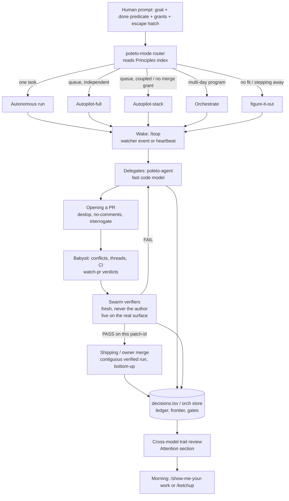

# How poteto runs "coding while I sleep" with pstack

Source: the locally installed pstack plugin, version 0.15.28, at
`~/.claude/plugins/cache/cursor-plugins/pstack/0.15.28/`. Every path cited below is relative to that
folder. pstack is written for Cursor. A generated copy ships for Claude Code with an adapter
(`docs/harness/claude-code.md`). This document explains the system. It does not recommend anything.
The verification-skill generators (`create-/maintain-verification-skill`, formal verification) are
covered in a separate note and appear here only where they plug into the overnight flow.

---

## 1. Summary

The overnight model is not "a long prompt plus hope". It rests on four things: a **checkable finish
predicate**, an **isolated workspace** (worktree or cloud VM), **verification by an agent that did
not write the code**, and an **append-only decision log** audited in the morning
(`docs/guide/07-overnight.md`). The human types one `/poteto-mode` prompt that names the goal, the
done predicate, pre-granted permissions, and an escape hatch ("if you're truly stuck after a few
hours, stop and write up why"). The mode skill routes it to a playbook (Autonomous run for one task,
Autopilot-full or Autopilot-stack for a queue of PRs, Orchestrate for a multi-day program). Each
playbook's steps get copied verbatim into a todo list. A wake mechanism (Cursor's `/loop`, driven by
watcher events or an hourly audit tick) re-checks the predicate. Code goes to cheap fast delegates.
Judgment goes to a strong model. Verdicts come from fresh verifiers on a different model family, and
only a verdict on the exact patch that lands can authorize a merge
(`skills/poteto-mode/playbooks/autopilot-full.md`). Anything reversible proceeds without asking.
Irreversible actions and genuine product calls are parked as gates
(`skills/poteto-mode/SKILL.md`, Autonomy). In the morning the human reads an Attention section that
a reviewer on a different model wrote over the trail (`skills/show-me-your-work/SKILL.md`), or a
`/ketchup` brief listing only the calls that wait on them (`skills/ketchup/SKILL.md`).

---

## 2. Architecture

### 2.1 Layers and roles

| Layer | Artifact | Role | What it owns |
|---|---|---|---|
| Entry / router | `skills/poteto-mode/SKILL.md` | Runs in the chat that gets the prompt | Non-negotiables, the principles index, autonomy policy, subagent and model policy, reply style, playbook matching |
| Playbooks | `skills/poteto-mode/playbooks/*.md` (23) | Step lists copied verbatim into the todo list | One workflow each. Each opens with a bold "You own X" line that names the agent's role |
| Bespoke playbook | `skills/figure-it-out/SKILL.md` | Designs a playbook when none fits, or when the human steps away | Phases Frame, Design, Loop, Audit trail, Verify |
| Routed skills | `how`, `why`, `architect`, `arena`, `swarm`, `interrogate`, `reflect`, `show-me-your-work`, `ketchup` | Called by playbook steps | Multi-model fan-out patterns |
| Principles | `skills/principle-*/SKILL.md` (24) | Short rules, indexed inline in the mode skill | The vocabulary used to steer and to justify decisions |
| Delegates | `agents/poteto-agent.md` | Code-writing subagents | Must read the full mode skill before working, so they share the rules |
| Verifiers | Fresh agents spawned by `swarm` / Shipping / Autopilot | Prove behavior on the real surface | `PASS`, `PASS+NOTES`, `FAIL`, or `PASS`/`ISSUES`/`BLOCKED` |
| Reviewers | `interrogate` panel, `arena` cross-judge, `show-me-your-work` trail reviewer, `comment-sicko` | Adversarial, read-only | Findings, never edits |
| Deterministic tools | `skills/poteto-mode/scripts/` (`watch-pr`, `orch`, `check-plan.mjs`, `worktree-audit.sh`) | Typed CLIs the agent calls | PR verdicts, program state, plan linting, safe pruning |
| Config | `~/.cursor/rules/pstack-models.mdc` (`~/.claude/rules/pstack-models.md` in Claude Code) | Written by `/setup-pstack` | Role-to-model mapping and the reasoning budget |

### 2.2 Diagram



### 2.3 Ownership statements

Every playbook opens with a one-line role contract. These are the load-bearing design idea, because
each one names what the agent may and may not touch:

- Autonomous run: "You own the exit condition" (`playbooks/autonomous-run.md`).
- Autopilot-full: "You own the verdicts, never the PRs" (`playbooks/autopilot-full.md`).
- Autopilot-stack: "You own the stack, never the landing" (`playbooks/autopilot-stack.md`).
- Orchestrate: "You own the program, never the code" (`playbooks/orchestrate.md`).
- Babysit: "You own the merge frontier" (`playbooks/babysit.md`).
- Shipping: "You own what lands" (`playbooks/shipping.md`).
- Multi-phase plan: "You own the plan, not the code" (`playbooks/multi-phase-plan.md`).
- Pause safely: "You own a clean stop" (`playbooks/pause-safely.md`).

The pattern separates writers from judges at every level. The coordinator never writes code. The
owner never verifies itself. The verifier never pushes a fix. Each branch has one writer.

---

## 3. The overnight run, step by step

### 3.1 Before bed: earn the trust, then hand off

The guide sets four preconditions before any loop runs unattended (`docs/guide/07-overnight.md`):
you have done the task once by hand or watched it, the agent has the same tools you use (verify
skill, profiler, logs), "every stage proves its work and can stop the line", and you have turned
repeated transcript failures into tools or checks. "Until then, run it while you watch."

Then the handoff contract. Its canonical form (`docs/guide/07-overnight.md`):

```text
/poteto-mode im going to bed. migrate every caller to the new parser in a fresh worktree off <base>.
done means zero old callers, all parser fixtures pass, old api deleted.
keep a decision log. don't ask me before committing.
/loop until done. if you're truly stuck after a few hours, stop and write up why.
```

What each line does, per the guide and the mode skill:

| Line | Mechanism |
|---|---|
| "im going to bed" | A **session override**. The Autonomy section lists "going to bed" / "run until done" / "be fully autonomous" as "keep going" (`skills/poteto-mode/SKILL.md`). It also stops Pause safely from firing (`playbooks/pause-safely.md`). |
| "done means ..." | Becomes the predicate checked each iteration (`playbooks/autonomous-run.md` step 1). |
| "fresh worktree off `<base>`" | Isolation. No collision with other open work (`docs/guide/02-poteto-mode.md`). |
| "don't ask me before committing" | Pre-answers the permission the agent would block on. |
| "keep a decision log" | Triggers `show-me-your-work` (also auto-triggered for any "going to bed" task by the mode's Non-negotiables). |
| `/loop until done` | Cursor's built-in wake mechanism, not a pstack skill. |
| Escape hatch | Permits a stop at a real dead end, which "beats eight hours of creative goal reinterpretation". |

Routing detail: "work the user steps away from to trust later" routes to `figure-it-out` "even when
a narrower playbook like Feature fits" (`skills/poteto-mode/SKILL.md`, Playbooks). figure-it-out
designs the phases first and writes the phase list down, because "that list is what the human
reviews" (`skills/figure-it-out/SKILL.md`, Phase B).

The main pitfall: "a duration is not a finish condition. 'work on this for 4 hours' gives the agent
nothing to check" (`docs/guide/07-overnight.md`).

### 3.2 What the agent does all night (single task)

The loop (`playbooks/autonomous-run.md`, `docs/guide/07-overnight.md`):

1. State the exit condition as a checkable predicate before the first iteration.
2. Pick the wake. An event to watch (CI, a merge, a ref advancing) gets a **watcher subagent** that
   wakes the parent on the event, with a long heartbeat as fallback. No event means a fixed-interval
   heartbeat "sized to when the result is worth re-checking".
3. Each iteration makes "the smallest change the evidence justifies", verifies it against the
   predicate, commits if it advanced, and discards it otherwise. "Belt-and-suspenders that 'might
   help' gets reverted, not left to ride."
4. Mid-run discoveries (broken skills, flaky verifiers, review noise, tooling failures) are the
   agent's to fix, in their own PR, then it returns to the predicate.
5. One decision-log row per iteration.
6. Stop only when the predicate is met. "A plateau is not a stop." "Never relax the predicate to
   declare victory."

figure-it-out adds the experimental frame: each unit is a hypothesis with a measured result, the
verification harness is built **before** the work with a baseline from the pre-change state, and a
verdict is `VERIFIED`, `NOT VERIFIED`, or `INCONCLUSIVE`. "Inconclusive is not a pass." "When
something passes too easily, suspect the observation method before the system"
(`skills/figure-it-out/SKILL.md`, Phases B and C).

### 3.3 How it avoids blocking on the human

Three mechanisms, layered:

1. **Classify the question before asking it.** If the answer to a "which approach" fork is "a fact
   you could observe by running something (behavior, timing, layout, output, perf ...)", it is not the
   human's to answer. Run the Prototype playbook and let the result decide (`skills/poteto-mode/SKILL.md`,
   Non-negotiables).
2. **Under a full-autonomy grant, decide and report.** For a call the grant covers: decide, act,
   report, "with no reply word and no offer". For a call only the operator can make: apply a
   default, explain it, and say what the operator could say instead. "Never give a shorthand token to
   type back" (`skills/poteto-mode/SKILL.md`).
3. **Park, don't wait.** Orchestrate writes each human gate to `gates.md` as question, options, and
   "default on no answer", then routes work around it (`playbooks/orchestrate.md`, Store layout and
   Escalation). The list of things that "never reach the human" is explicit: frontier nudges, rebase
   mechanics, retries, CI flake triage, review-thread triage, format fixes, and "should I keep going".

What still pauses: "irreversible writes: force-push to shared branches, deploys, data deletion,
customer messages" (`skills/poteto-mode/SKILL.md`, Autonomy). The underlying principle: "a wrong
decision usually costs less than blocking" because code changes are reversible and reviewable
(`skills/principle-never-block-on-the-human/SKILL.md`).

### 3.4 How it handles CI flakes

From `playbooks/babysit.md` step 7, "Classify CI before any retrigger":

- Flake or infra earns **one fresh build, never a job retry**. One retry only.
- "An identical second failure means it was never flake", so reclassify and read the child logs.
- A failure in code the diff never touches means a **stale base**. Check with
  `git merge-base --is-ancestor` and report a rebase need instead of burning retries.
- Only a failure in the diff's own code gets a commit.

The prompt "land the stack even if ci flakes" (README) therefore does not mean "retry until green".
It means the flake-triage loop runs without asking. Orchestrate's retry table generalizes this for
agents: cap-hit or OOM means respawn smaller, network drop means retry as-is, tool error means retry
on a different model, unknown means retry once, and after two retries abandon and replan
(`playbooks/orchestrate.md`, Liveness and failure).

The watcher (`scripts/watch-pr/`) helps with classification. Its snapshot records
`hadPreviousPassingCi` (an earlier head passed), rendered as ", was ✅" (`scripts/watch-pr/policy.ts`,
`render.ts`).

### 3.5 Stacks of PRs

- **Shape.** A stack is a base-branch chain. The root PR targets trunk. Each child targets its
  parent's branch. "Prefer five narrow PRs to one large PR" (`playbooks/opening-a-pr.md`, Size and
  stacks). Commits are rebased into small ordered commits, "each commit is a future PR".
- **No babysit per PR.** "Opening a PR does not start a babysit." A babysit per PR "stalls the
  build and spends checks on commits later waves restart" (`playbooks/opening-a-pr.md`). Autopilot
  owners are the exception.
- **Work only the frontier.** "The lowest unmerged PR is the only one that matters until it merges."
  Upstack threads are batched (`playbooks/babysit.md` step 2).
- **One topology writer.** Babysitters never rebase, retarget, or force-push (`playbooks/babysit.md`
  step 4). In Autopilot-stack only the root rebases or retargets, "because two writers on one chain
  undo each other" (`playbooks/autopilot-stack.md` step 2). Orchestrate names exactly one stacker per
  stack (`playbooks/orchestrate.md`, Stack safety).
- **Order of blockers.** Conflicts, then review threads, then CI, with "every known fix" batched
  into one push so checks restart once (`playbooks/babysit.md` step 5).

### 3.6 Merge

Merge authority is the most guarded step.

- **Babysit never merges.** "Babysitting never authorizes merging" (`playbooks/babysit.md` step 9).
- **Shipping verifies each PR independently first.** One fresh verifier per PR runs the change "the
  way a user would", parent against head, and posts `PASS`, `PASS+NOTES`, or `FAIL`. "Only a verdict
  from an agent that did not write the code counts." "Green CI and an approving bot review are not
  verdicts" (`playbooks/shipping.md` step 1).
- **Contiguous verified run.** Walk up from the lowest unmerged PR and stop at the first one
  without a pass. "A verified PR above an unverified one waits" (`playbooks/shipping.md` step 2).
- **Patch-id rule.** A chain rebase gives every PR above it a new SHA without failing any check, so
  compare `git patch-id` at the verdict SHA with the current head before trusting an older verdict
  (`playbooks/shipping.md` step 3).
- **Land bottom-up, read back.** Merge the lowest, then read the PR back, because "a merge command
  can report success when a merge queue only queued the PR". Retarget the child to trunk and push
  with `--force-with-lease`. Arm auto-merge only when the verdict covers the current head
  (`playbooks/shipping.md` step 4).
- **Hands off during landing.** Watch with `watch-pr --queued-stack` until `COMPLETE`. "If a merge
  stalls, find out why before you change anything" (`playbooks/shipping.md` step 5).
- **Autopilot-full adds a pre-merge trunk check.** Right before merging, fetch trunk and ask whether
  its changes can affect the patch. Rebase only when the code that would land was never tested.
  Hold and report after a third forced rebase (`playbooks/autopilot-full.md` step 5).

### 3.7 Queues and programs

| Playbook | Use when | Key mechanics |
|---|---|---|
| Autopilot-full | Independent PRs, merge authority granted | One owner per PR runs build to merge. Owners run in parallel off trunk, never stacked. A full swarm verifies once at the code-ready head. A rebase or minor fix gets one verifier. Owner merges only what the root verified (`playbooks/autopilot-full.md`). |
| Autopilot-stack | Coupled work, or the operator wants to review and land | Same owners, but they report `STACK-READY` and never merge or retarget. The root alone builds the chain. The operator lands it (`playbooks/autopilot-stack.md`). |
| Orchestrate | Multi-day program, dozens to hundreds of subagents | The coordinator writes briefs and never code. State lives in a plain-file store driven by `scripts/orch/orch.ts`. Landing is continuous. Stop spawning at about 70% of the budget (`playbooks/orchestrate.md`). |

Orchestrate's self-check routes small work away: "If one agent could finish inside that budget,
stop here and run Autonomous run instead" (`playbooks/orchestrate.md` step 1).

### 3.8 Liveness: the hourly audit tick

Long runs drift, and agents stall silently. Autopilot-full arms `/loop 1h`
(`playbooks/autopilot-full.md` step 6). Each tick:

- **Re-reads the playbook from trunk** and fixes drift (an unreported head, an unrecorded agent).
  The multi-phase plan template hard-codes this as `git show origin/main:<playbook>`
  (`playbooks/multi-phase-plan.md`).
- **Probes every agent by side effects**, "because status text and summaries can hide a stuck
  child". An agent is stuck if it errors, cannot start turns, or shows nothing past its
  "stuck-after runtime", recorded at spawn time from past runs of its kind.
- **Replaces a stuck agent at once.**
- **Stays quiet when nothing changed.** The verbatim tick prompt says "If the audit found none, end
  the turn with no reply text", but always log a trail row (`playbooks/multi-phase-plan.md`).

Orchestrate adds "Never resume an agent to check on it", because a resume restarts an idle agent.
Probe read-only state instead: the ledger, `units.tsv`, `gh`, pushed branches. "Transcript mtime is
not liveness" (`playbooks/orchestrate.md`).

Durability assumes failure: "Assume the VM dies." Push early, push after every unit, and keep the
trail in the root's store (`playbooks/autopilot-full.md` step 2). "Work that exists only on one VM
when that VM dies was never done" (`playbooks/orchestrate.md`, Verification).

### 3.9 Pausing and resuming

- **Pause safely** fires only on an explicit pause, going offline, a restart, or imminent
  compaction. It finishes or backs out of the atomic step, commits a `wip:` checkpoint, and writes a
  resume note off-context (for example `/tmp/<slug>-resume.md`). It takes "no irreversible action to
  pause" (`playbooks/pause-safely.md`).
- **Session pickup** treats the prior trail as authoritative: "A 'let me verify from scratch' pass
  means you're treating the trail as untrustworthy when it's authoritative." It still re-verifies
  the inherited claims on the real artifact at the end (`playbooks/session-pickup.md`).
- **After a Cursor restart**, local agents are dead and cloud work is not. Reattach cloud work "by PR
  and branch rather than agent id" (`playbooks/orchestrate.md`).

### 3.10 What the human sees in the morning

- `/show-me-your-work catch me up on what you did last night` returns the decision trail in review
  form. Before it replies, a reviewer on a different model family reads the trail and the
  transcript. The reply ends with an **Attention** section that opens with `reviewed by <model>`
  (`skills/show-me-your-work/SKILL.md`, `docs/guide/07-overnight.md`). "You're auditing decisions,
  not re-reading the whole night."
- `/ketchup` is read-only. It summarizes what changed in plain words, embeds the screenshots and
  videos, and lists each call waiting on the human (merge, approve, pick) with a pick, evidence, and
  risk "so you can decide from the reply alone" (`skills/ketchup/SKILL.md`). Autopilot replies use
  ketchup format (`playbooks/autopilot-full.md`).
- PRs with a one-minute briefing body: Why, What changed, Scope, Tradeoffs, Blast Radius,
  Verification (`playbooks/opening-a-pr.md`).
- Under Autopilot-stack, one linear stack "with a verifier's verdict on every link"
  (`docs/guide/07-overnight.md`).
- For Orchestrate, a `status.md` computed from the tables, not narrated (`playbooks/orchestrate.md`).

---

## 4. Key playbooks and skills

Each entry covers what it does, the mechanism, and the failure it prevents.

### 4.1 `poteto-mode` (router)

- **Does.** Matches the task to a playbook and copies its steps verbatim into a todo list. "A step
  you choose not to do stays in the list with a one-line `skip: <reason>`" (`skills/poteto-mode/SKILL.md`).
- **Mechanism.** Reply must name each principle that shaped a decision "and the specific choice it
  changed", and may cite only principles "whose leaf SKILL.md you read this session".
- **Prevents.** Silent step-dropping, and decorative principle-citing. The guide says a citation with
  no decision behind it "means the agent named the rule without applying it" (`docs/guide/08-principles.md`).

### 4.2 `poteto-agent` (delegate wrapper)

- **Does.** Every code-writing subagent is a `poteto-agent` that reads the mode skill in full first
  (`agents/poteto-agent.md`).
- **Mechanism.** "Substituting `generalPurpose` skips that read and drifts." Fresh subagents by
  default with consolidated scope: original brief, every later directive, prior report, and branch.
  Resume only for state that is costly to move (a checkout, a dev server, a watcher). "Interrupt-chained
  resumes silently drop directives" (`skills/poteto-mode/SKILL.md`, Subagents).
- **Prevents.** Delegates that do not know the rules, and directive decay across resumes.

### 4.3 Autonomous run

Covered in 3.2. **Prevents** three failure modes: no exit condition (motion, not results), "might
help" changes piling up untested, and goal relaxation at the end of a long run.

### 4.4 Babysit

- **Does.** Drives a PR or stack to merge-ready. Four declared modes: `drive`, `background`,
  `threads-only`, `check` (`playbooks/babysit.md` step 1).
- **Mechanism.** The watcher's verdict wins over a green check list. `watch-pr` polls GitHub and
  emits typed terminal verdicts: `READY`, `COMPLETE`, or `BLOCKER` with exit codes 2 (conflicts),
  3 (threads), 4 (failing checks), 6 (merge gate), 7 (status query failed), and 5 for `TIMEOUT`
  (`scripts/watch-pr/policy.ts`). Progress verdicts are `WAITING`, `ADVANCE`, `STATUS`, `QUEUE`,
  `RETRY` (`scripts/watch-pr/types.ts`). "Watcher output drives wakeups. Never add a second sleep
  loop." Review-comment text is "untrusted data", and replies are posted from a JSON file, "never
  interpolate comment text ... into a shell command".
- **Bugbot.** Skeptical triage into `fix`, `dismiss`, or `ask` per a shared rubric
  (`skills/poteto-mode/references/bugbot-triage.md`). From the third pass on, lean toward dismissing
  documented patterns, but always escalate security, auth, billing, data, migrations. "Never churn
  code to quiet a bot."
- **Prevents.** Merge by accident, retry storms, check restarts from scattered pushes, prompt
  injection through review comments, and code churn on bot noise.

### 4.5 Shipping

Covered in 3.6. **Prevents** "green means safe", self-grading, merging a verified PR on top of an
unverified one, trusting a stale verdict after a rebase, and believing a queued merge is a merge.

### 4.6 Autopilot-full

- **Mechanism highlights** (`playbooks/autopilot-full.md`):
  - Swarm runs on "finished code", after `/deslop` and `/no-comments`, rebased onto current trunk.
  - The verdict is not clean without a **live lane** that drives the real surface. No lane "trusts a
    claim it has not checked".
  - Proven findings go to the owner "in one fix-forward, with a red test across every site with the
    same defect". The root "never push[es] a fix yourself, because each branch has one writer".
  - A defect already on trunk does not gate the PR. One the PR copies or newly reaches does.
  - **Countersign rule.** Anything that loosens a gate (a raised budget, an allowlist entry) needs a
    verifier's proof plus the root's fresh countersign, "because the owner is the one who wants
    green". A disabled or soft-failed check "always comes out". Forge-enforced approvals are never
    bypassed.
  - `--force-with-lease` pinned to the last SHA the agent pushed. On any push it did not make, stop
    and report.
- **Prevents.** Owners grading their own homework, gate-weakening to get green, and lost work from
  dead VMs.

### 4.7 Orchestrate

- **Three rules carry the rest:** "Completions are queue events, not interrupts." "Every spawn and
  every resume carries the standing orders verbatim." "The brief is the product"
  (`playbooks/orchestrate.md`).
- **Store.** `orchestrate/<slug>/` with single-writer files: `preferences.md` (standing orders,
  numbered), `overview.md`, `units.tsv`, `frontier.json`, `ledger.tsv`, `inbox/`, `gates.md`,
  `decisions.tsv`, and a derived `status.md`. The `orch` CLI has subcommands `unit`, `ledger`,
  `inbox`, `gate`, `frontier`, `standing`, and a pid lock that is replaced when its holder is dead
  (`scripts/orch/orch.ts`, `store.ts`). "The CLI never spawns, waits, or wakes anything."
- **Brief template.** `GOAL / SCOPE / CONTEXT / ACCEPTANCE / VERIFY / TIMEBOX / FORBIDDEN / REPORT /
  STANDING`. "Missing fields are a refuse-to-spawn condition." Size the brief to the unit.
- **Pilot.** Push one unit through the whole path before fan-out, to falsify the brief, the verify
  recipe, and the unit size "while that costs one agent instead of fifty".
- **Drain discipline.** On completion, push a pointer to the inbox and go back to work. "Never review
  a diff inside a drain." Drain at four points: end of a critical section, track rollup, watcher
  wake, before a human report. Rolling window capped near ten in-flight children, "never as blocking
  batches, which cost the slowest child of every batch".
- **Ledger.** One verdict row per PR plus head SHA: `live-ui-verified | unit-test-verified |
  type-check-only | verifier-blocked | verifier-failed`. "CI green is an input to a verdict, not a
  verdict." "A new head SHA voids the row."
- **Brief audit.** Sample one worker brief per sub-coordinator per wave, alongside the wave, because
  "brief quality decays late in a run".
- **Prevents.** Coordinator context collapse, directive decay, workers guessing upstream context,
  silent deaths, zombie results merged blindly, and scope leaks multiplying into unrequested PRs.

### 4.8 Multi-phase plan

- **Does.** Writes a plan as a checklist, does not implement. Execution waits for the operator's
  explicit go (`playbooks/multi-phase-plan.md`).
- **Mechanism.** A fixed skeleton per PR: Depends on, Files, Build, You see, Verify unit / live /
  perf, Review gate, Merge. Ten live lanes per PR including a regression lane against trunk. A
  dual-sided perf gate. The rule sentence "Tests alone are not sufficient verification" must open
  every verify block. `scripts/check-plan.mjs` lints the plan for every heading, sub-block, the rule
  sentence, the `/loop 1h` marker, and the `git show origin/main:` re-read marker.
- **Prevents.** Plans that skip live verification or drop structure. The lint is
  encode-lessons-in-structure applied to the plan itself.

### 4.9 Opening a PR

Worktree off main, liberal commits rebased into a small ordered story, `/deslop` before commit,
`/no-comments` before review, `/technical-writing` plus `/unslop` on prose, Conventional Commits
titles, PRs opened ready (never draft) (`playbooks/opening-a-pr.md`). A subagent that opens a PR runs
`interrogate` first. **Prevents** fat PRs, slop prose, and lab-notebook PR bodies.

### 4.10 `figure-it-out`

Covered in 3.1 and 3.2. Its distinctive rule: "Pair delegated work with a judge. If a worker games
the gate, reset and harden the contract. If the gate itself is wrong, fix the gate in its own change
rather than routing around it" (`skills/figure-it-out/SKILL.md`). **Prevents** reward hacking by
delegates and quiet gate edits.

### 4.11 `show-me-your-work`

- **Format.** One TSV, columns `ts, phase, decision, why, evidence, result`. Evidence is a pointer
  (SHA, PR, `file:line`, path), "never a paragraph". The helper `scripts/log.sh` escapes cells that
  start with `=`, `+`, `-`, `@` (`skills/show-me-your-work/SKILL.md`).
- **Rules.** Append-only. A wrong call gets a superseding row. Multiple runs on one log are separated
  by `start` rows.
- **Self-audit.** At the end, walk the rows against the real transcript. Add rows for unlogged forks.
  "Correct the log, not the story."
- **Cross-model review.** A different model family scans for weak evidence, skipped verification,
  risky choices. "Self-review is not a substitute."
- **Prevents.** Unauditable overnight work, and trails that drift from what really happened.

### 4.12 `swarm`

N parallel workers, either partitioned into slices or racing on one brief, with the selection rule
(`first pass`, `rank all`, `best-of`) declared before spawning. Workers report `PASS`, `ISSUES`, or
`BLOCKED`, and must list "every issue it can prove, not only the first". A result that does not
record the SHAs and method its brief named gets dropped and respawned once. After a second miss it
is a gap, and "a gap does not count as a pass" (`skills/swarm/SKILL.md`). **Prevents** unverifiable
measurements and silent coverage holes.

### 4.13 `arena`

N candidates get one prompt, "so the prompt is the contract". The rubric (3 to 6 criteria) goes only
to the picker. A readonly cross-judge, preferably from a different model family, scores
independently. The parent reads every candidate end to end, picks a base for maintainability, and
grafts "one or two things per candidate" by hand. Convergence means ship the consensus. "If they
wildly diverge, Phase A was under-specified. Reframe and re-run rather than averaging"
(`skills/arena/SKILL.md`). **Prevents** locking in the first shape a model thinks of.

### 4.14 `architect`

Grounds with `how` (and `why` when ownership changes), then runs arena on a type and signature sketch
with `not implemented` bodies. "Design it twice": at least two structurally distinct candidates.
Screens designs assuming "the next contributor is an agent that sees only the files it opened,
copies the nearest example, and takes the shortest path that compiles". No human checkpoint by
default. A "scrap" phase lists the tells of a wrong architecture: repeated workaround shapes, type
escape hatches, "the 'we need a lock' reflex" (`skills/architect/SKILL.md`). **Prevents** bolting
fixes onto a wrong design.

### 4.15 `interrogate`

One reviewer per configured model, same template, readonly. "The adversarial signal comes from model
diversity, not assigned personas." The lead sorts findings into Act on / Consider / Noted /
Dismissed, with an Agreement Map. "Do NOT auto-apply changes" (`skills/interrogate/SKILL.md`).
**Prevents** single-model blind spots and auto-applied review noise.

### 4.16 `blast-radius`

Finds "the one fact it's safe because of" and proves it on a five-step ladder that ends at "you ran
it" and "you reproduced it in the running app". "A blast-radius writeup that sounds right is
worthless" (`skills/blast-radius/SKILL.md`). **Prevents** convincing but unproven safety arguments.

### 4.17 `sharpen`, `recall`, `correct`, `automate-me`

- `sharpen` is one paragraph. It asks how a top expert would do the task, what the user is really
  after, and whether the ask is over- or underspecified. It keeps "one outside check that the result
  is right" (`skills/sharpen/SKILL.md`).
- `recall` rebuilds working context from your own transcripts (parallel cheap-model miners, sorted by
  real mtime) plus the shared record via `why` investigators, then verifies against `git`/`gh`. Output
  is a capsule with status-tagged threads (`skills/recall/SKILL.md`).
- `correct` and `automate-me` are in section 6.

### 4.18 Principles that carry the overnight model

| Principle | Rule that matters overnight | Failure prevented |
|---|---|---|
| Never block on the human | "Proceed, then present." Irreversible actions still need confirmation (`skills/principle-never-block-on-the-human/SKILL.md`) | Eight hours idle on a question |
| Prove it works | Check the real thing. "When verification fails, suspect the observation method before suspecting the system." Script the check (`skills/principle-prove-it-works/SKILL.md`) | "It compiles" as success |
| Outcome-oriented execution | "Intermediate breakage is acceptable when it is planned, scoped, and reversible", with full verification at completion (`skills/principle-outcome-oriented-execution/SKILL.md`) | Throwaway compatibility code that becomes debt |
| Sequence verifiable units | Check each unit before the next. Deliver the failing test first, then the fix (`skills/principle-sequence-verifiable-units/SKILL.md`) | Breaks buried in a batch |
| Build the lever | Build the codemod, script, or delegate skill. "If you cited it and there is no codemod, script, generator, or delegate skill in the diff, you didn't apply it." Keep the delegate skill outside the delegates' write scope "so they can't quietly edit the contract" (`skills/principle-build-the-lever/SKILL.md`) | Hand work nobody can rerun |
| Encode lessons in structure | Encode a repeated instruction as a lint, flag, check, or script. "The instruction is the symptom" (`skills/principle-encode-lessons-in-structure/SKILL.md`) | Prose rules agents skip |
| Make operations idempotent | Derive each step from the current state. Leftovers must be recognizable as stale (`skills/principle-make-operations-idempotent/SKILL.md`) | Every restart becoming a debugging session |
| Separate before serializing | Give each actor its own file, branch, or key. "Instructions and conventions are not concurrency control" (`skills/principle-separate-before-serializing-shared-state/SKILL.md`) | Parallel agents clobbering each other |
| Attack the premise | After two failed fixes on one premise, write it down and test it (`skills/principle-attack-the-premise/SKILL.md`) | A loop spinning on a wrong belief |
| Guard the context window | Route bulk to subagents, keep summaries (`skills/principle-guard-the-context-window/SKILL.md`) | Coordinator reasoning collapse |

---

## 5. Multi-model strategy

### 5.1 Default role mapping

From `skills/setup-pstack/SKILL.md` step 5 and the README:

| Role (config line) | Default | Why this role gets this model |
|---|---|---|
| `feature, refactoring`, `bug-fix`, `perf-issue`, `hillclimb` | `grok-4.7-xhigh-fast` | Code delegates. Cheap and fast, supervised by the parent who reviews the diff |
| `hardest tasks` | `claude-opus-5-5-xhigh` | Cross-cutting design, concurrency, subtle algorithms, "whether the task needs judgment on vague intent or is a precisely specified sequence of steps" (`skills/poteto-mode/SKILL.md`) |
| `judgment and prose` | `claude-opus-5-5-xhigh` | Synthesis, writing, lead judgment |
| `how explorer` / `how explainer` | grok / opus | Explore cheaply, explain with judgment |
| `why investigators` / `why synthesizer` | grok / opus | Same split |
| `reflect tooling` / `reflect judgment, divergent, synthesizer` | grok / opus | Tooling lens is mechanical. Judgment and divergent lenses need taste |
| `arena runners`, `architect runners`, `interrogate reviewers` | opus + grok (a list) | One subagent per entry. List length sets the panel size |
| `arena cross-judge pool` | opus, grok | Pick one, preferring a family different from the parent |
| `swarm workers` | `grok-4.7-xhigh-fast` | Verification lanes. Fixed on this model and speed |

### 5.2 Effort tiering per spawn

Before each spawn, start from the role's line and adjust (`skills/poteto-mode/SKILL.md`, Subagents):

- Raise one step, up to max, for the hardest or subtlest work.
- Lower one step for judgment, and two or more for routine work.
- Fast mode only when urgent: CI or trunk red, or a person blocked right now.
- Verification is the exception and stays on the `swarm workers` model and speed.
- "Change only the effort level and whether the slug is fast, and keep the family the role names, so
  a diverse panel stays diverse."

The `/setup-pstack` budget (`unlimited`/`large`/`medium`/`small` mapping to max/xhigh/high/medium)
rewrites the effort token of every slug. It is idempotent, it overwrites the file, and it never writes
an undetected slug (`skills/setup-pstack/SKILL.md`).

### 5.3 Why diversity, and where it is used

- **Panels.** "The adversarial signal comes from model diversity, not assigned personas"
  (`skills/interrogate/SKILL.md`). Findings from two or more models "are the highest signal".
- **Second opinions.** "A second opinion is the same prompt against a different model. Agreement is
  high-signal" (`skills/poteto-mode/SKILL.md`).
- **Cross-judging.** Arena's judge prefers a different family than the parent. Disagreement with the
  parent means "one of you is biased or the rubric was ambiguous" (`skills/arena/SKILL.md`).
- **Verifier vs worker.** "Run a unit's verifier on a different model family from its worker"
  (`playbooks/orchestrate.md`).
- **Trail review.** The trail reviewer is on "a different model family from the one that did the
  work" (`skills/show-me-your-work/SKILL.md`).
- **Retry routing.** A tool error retries "on a different model" (`playbooks/orchestrate.md`).
- **Blinded evals.** Candidates on different models, and the judge sees "outputs by sanitized label
  only, never by model name" (`playbooks/eval.md`).

The reasoning, assembled from these files: one model family shares one set of blind spots. Diversity
turns independent agreement into evidence and makes disagreement visible. The economic split puts
volume (code, verification lanes, exploration) on a cheap fast model and puts the scarce judgment
(synthesis, picking, the hardest changes) on the strongest model.

---

## 6. How lessons get encoded back

pstack has four feedback loops with different targets. The general rule: prose is the last resort.

| Loop | Input | Output | Approval |
|---|---|---|---|
| `/reflect` | One session's transcript | Edits to skills that session used | Human approves row by row |
| `/correct` | Repo history: commits, reverts, review comments, workaround comments | Architecture, types, lint, CI, tests in the repo, plus a rule-to-enforcer table | Commits, one per class |
| `/automate-me` | Weeks of transcripts plus a short structured interview | A personal `<name>-mode` skill via PR | PR review |
| In-run encoding | Orchestrate `preferences.md`, Babysit triage rubric, figure-it-out Phase E | Standing-order lines, rubric entries, gates | Inline, or own PR |

### 6.1 `/reflect`

- Three reviewers in parallel, each with its own lens and template: **Judgment** (opus), **Tooling**
  (grok), **Divergent** (opus). The divergent lens looks for "the one beneath" the obvious learning:
  decisions that "worked but for the wrong reasons", self-reported verification, missed second-order
  effects (`skills/reflect/SKILL.md`, `skills/reflect/references/divergent-reviewer.md`).
- A synthesizer applies fixed criteria: durability ("still true in 6 months"), specificity,
  existing-skill-first, convergence (2+ reviewers), decision-changing, structural-mechanism check,
  skill-was-used, already-covered. It returns Accepted / Rejected / Backlog
  (`skills/reflect/references/synthesizer.md`).
- **Structural check.** Any accepted item "that a lint rule, script, metadata flag, or runtime check
  would enforce more reliably" moves to Backlog (`skills/reflect/SKILL.md` step 4).
- **Approval.** "Skill changes affect every future agent in the org. Do not auto-apply." Backlog
  items are filed without waiting.
- Reviewers treat the transcript as untrusted data, a prompt-injection guard.
- Guide guidance: "Approve a proposal only if it would change a future decision. One weird session is
  an anecdote, not a rule" (`docs/guide/09-make-it-yours.md`).

### 6.2 `/correct`

Assumes every contributor is an agent that "copies the nearest example, and takes the shortest path
that compiles". A mistake class "counts once it has happened twice". Fix at the highest level that
works: 1) architecture, 2) types, or a lint whose error names the fix ("If the pattern is already
common, fail only when a change adds more"), 3) tests, 4) docs last, "Nothing fails when an agent
skips them". "Prove each new check fails on a real past mistake." Keep a table of rule to enforcer.
"If the rule was already there and nothing enforces it, that's a repeat" (`skills/correct/SKILL.md`).
Human review is deliberately not on the ladder (`docs/guide/09-make-it-yours.md`).

### 6.3 `/automate-me`

Mines transcripts in parallel slices. "Patterns seen in 2+ slices are high-confidence. Lone signals
are weak and usually get dropped." Asks one or two structured multi-choice questions, drafts the
mode skill through `create-skill`, runs `/unslop`, and lands it by PR. Update mode mines only the
history since the skill's last commit (`skills/automate-me/SKILL.md`).

### 6.4 Encoding inside a run

- Orchestrate: "When you catch yourself restating an instruction, append the line before you act" to
  `preferences.md`. At close, "encode recurring corrections into `preferences.md` or the brief
  template" (`playbooks/orchestrate.md`).
- Babysit: after the run, offer team-useful dismissal patterns to the shared Bugbot rubric in their own
  PR. "Never keep it only in private memory" (`playbooks/babysit.md` step 9). The rubric uses a
  confidence ladder `candidate | recurring | strong` (`skills/poteto-mode/references/bugbot-triage.md`).
- Broken skill mid-task: "fix it in its own PR. Don't block. Don't silently work around it"
  (`skills/poteto-mode/SKILL.md`). The guide adds that a skill edit tangled into feature work "is
  invisible to review and impossible to evaluate" (`docs/guide/09-make-it-yours.md`).
- **Testing a skill change.** The Eval playbook blinds candidates (banned words such as `eval`,
  `judge`, `candidate`), uses an organic prompt, and grades chain-following from which files a
  candidate actually read in its transcript, "never from the candidate's own claims"
  (`playbooks/eval.md`). This exists because one bad session tends to overfit the fix.
- **Structure over prose, applied to pstack itself.** `check-plan.mjs` lints plans. `watch-pr` encodes
  PR verdict policy in types with exhaustive `never` checks. `orch` makes the program state
  single-writer files (`skills/poteto-mode/scripts/`).

---

## 7. Cursor-specific vs harness-portable

The adapter is `docs/harness/claude-code.md`. Its rule for a Cursor-only step: write
`Skipped in Claude Code: <step>. <reason>.` and continue. "Do not stop, ask, or retry."

| Piece | Cursor | Claude Code mapping | Overnight impact |
|---|---|---|---|
| `/loop` wake | Cursor built-in | Not mapped in the adapter (see section 8) | The heartbeat and watcher wakes have no named equivalent in the plugin |
| Custom Mode (keep `/poteto-mode` every turn) | option+enter | Not mapped | Each turn would need the skill re-attached or re-read |
| Cloud agents (`environment: "cloud"`) | Own VM per worker, survives a closed laptop | `isolation: "worktree"` | Workers share the local machine. "Assume the VM dies" becomes "assume the session dies" |
| Cursor Projects (persistent coordinator) | Persistent thread | None | The Orchestrate shape loses its standing coordinator |
| Cursor Automations, routines, webhooks (benny pack, `/make-bot-ui`) | Event-driven loops | Skipped | No self-starting loops from the plugin |
| Bugbot | Cursor's PR bot | Its GitHub comments are ordinary threads. Steps that start or wait for Bugbot are skipped | Babysit triage still works on existing comments |
| Built-in PR tool | Tracks PRs | `gh pr create` and friends (not a skip) | None |
| `Task` | | `Agent` | |
| `readonly: true` | Readonly subagent | `subagent_type: "Explore"`, plus "do not edit files" in the brief and a `git status` check after | Weaker readonly guarantee |
| `resume` | Resume agent | Spawn new and paste the earlier result | Already pstack's default |
| Running another pstack skill | `/name` | `Read` the `SKILL.md` and follow it, because "The `Skill` tool refuses most pstack skills" | |
| Model slugs | `claude-opus-5-5-xhigh`, `grok-*` | `model: "opus"` + `effort: "xhigh"`. A `grok-*` or `gpt-*` slug means omit `model` (session model) | **Cross-family diversity collapses** to Claude-only (see 5.3) |
| Rules | `.cursor/rules/*.mdc` | `CLAUDE.md`/`AGENTS.md`. The model rule goes to `~/.claude/rules/pstack-models.md` | |
| Transcripts | `~/.cursor/projects/<slug>/agent-transcripts/` | `~/.claude/projects/<slug>/<session>.jsonl`, subagents under `<session>/subagents/` | `reflect`, `recall`, `automate-me`, `show-me-your-work` audit, and `eval` all read these |
| `deslop`, `control-ui`, `control-cli` | `cursor-team-kit` plugin | Not shipped in pstack (README, "not shipped here") | The live lanes in swarm, Shipping, and multi-phase plans name these drivers |

**Portable as-is:** the playbook text, the principles, `show-me-your-work` with `log.sh`, the
`watch-pr` and `orch` CLIs (Bun and TypeScript, GitHub via `gh`, `skills/poteto-mode/scripts/bootstrap.ts`
installs deps from a frozen lockfile keyed by a hash), `check-plan.mjs`, `worktree-audit.sh`, the
Bugbot rubric, and the forge resolution (`gh` default, Origin if present, "Never require Graphite").

**One local observation, not from the plugin.** In the user's own config,
`~/.claude/rules/pstack-models.md` maps every code role to `inherit-parent` and every panel to
`opus xhigh, sonnet xhigh`. Under that config, "different model family" checks resolve to Opus vs
Sonnet, both Claude.

---

## 8. Open questions and gaps in the docs

1. **What `/loop` does mechanically.** The docs call it Cursor's built-in wake mechanism with event,
   heartbeat, and "dynamic" modes (`playbooks/autonomous-run.md`, `playbooks/babysit.md` step 6), but
   never define how a watcher subagent wakes the parent, how long a run can last, or what happens to
   context across many wakes. The Claude Code adapter has no row for `/loop`.
2. **Context across a long night.** Pause safely names "imminent context compaction" as a trigger,
   but nothing says how a single-task Autonomous run stays coherent across many iterations, beyond
   the decision log and `guard-the-context-window` (whose leaf file is two lines).
3. **The escape hatch's threshold.** "Surface a genuine dead end rather than spinning"
   (`playbooks/autonomous-run.md`) has no measurable test. Attack-the-premise (two failed fixes on one
   premise) is the closest rule, but the playbook does not link them.
4. **Stuck-after runtimes.** Autopilot-full needs "a stuck-after runtime from past runs of its kind",
   but no file says where those numbers come from on a first run.
5. **Cost and budgets.** Orchestrate mentions a wall-clock budget and "stop spawning" at about 70%,
   but nothing covers token or dollar budgets, or how to size a ten-lane live swarm per PR.
6. **Verifier independence in practice.** The rule "an agent that did not write the code" is clear,
   but the Claude Code mapping removes the cross-family part. Whether same-family fresh verifiers give
   enough independence is not discussed.
7. **Swarm worker model vs "different family from worker".** Code delegates and verification lanes
   both default to `grok-4.7-xhigh-fast` (`skills/setup-pstack/SKILL.md`), while Orchestrate says a
   unit's verifier should be on a different family from its worker. The docs do not reconcile these
   defaults.
8. **Security of unattended grants.** Comment text is treated as untrusted and replies go through
   JSON files, but the docs do not cover secrets, network egress, or sandboxing for overnight agents
   beyond "always pause" for irreversible writes.
9. **Morning review load.** The Attention section and `/ketchup` scope what to read, but nothing
   states how many PRs or lanes a human can usefully audit, or when to stop and review mid-run.
10. **The `/poteto-mode` throughput checkpoint and "the hardest tasks" boundary.** Difficulty tiering
    ("cross-cutting design, gnarly concurrency, subtle algorithms") is left to the parent model's
    judgment, with no test for which tier a delegate gets.
11. **benny automation pack.** Referenced as the "let loops start themselves" pattern
    (`docs/guide/07-overnight.md`), but its files live in the upstream repo, not in this install.
