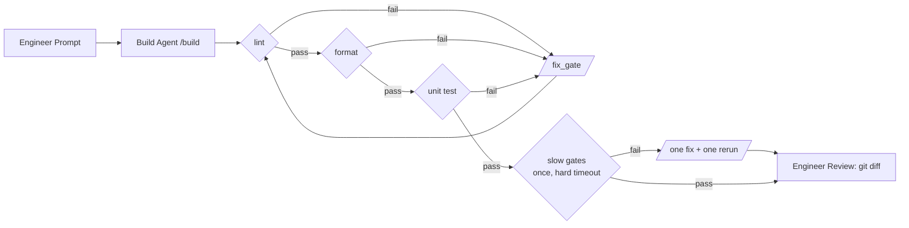
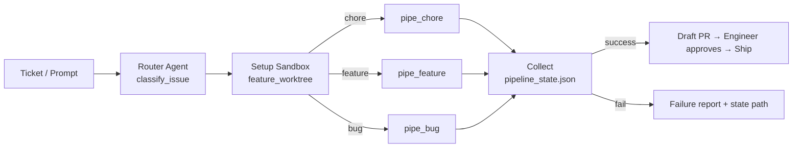

# Slim Pipelines + Factory Orchestrator — Engineering Plan

**Status:** proposed (2026-07-19)
**Prior art:** `docs/spec-review-gate-plan.md`, `adws/travis/travis_sdlc.py`, `adws/adw_modules/`
**Companion:** `docs/sdlc-agent-map.md` — the agent catalog these pipelines compose (contract standard, per-agent evals, and an **M0 defect-fix milestone that now precedes M1**)

---

## 1. Why

The flagship orchestrator has accreted every capability we've built:

| Signal | Today |
|---|---|
| `travis_sdlc.py` | 1,097 lines, 7 phases, ~25 CLI flags |
| Cross-cutting concerns woven into the phase loop | TUI, memory injection, best-of-N, worktree, draft-PR, spec-review gate, risk gate, auto-capture, resume/JSONL-recovery |
| Quality gates | `/test`, `/validate` are **agent invocations** — an LLM run just to execute a test command |

None of that is wrong — it's all opt-in and it all works — but there is no longer a
*small* thing to reach for, reason about, or teach. The target picture is:

**Slim pipeline (the §7.1 diagram below):**
`Engineer Prompt → Build Agent → [lint ✧] → [format ✧] → [test ✧] → Engineer Review`,
where every ✧ diamond is a **deterministic command** and every ✗-fail edge loops
back to the Build Agent with the failure output.

**Factory (the §9 diagram below, later):**
`Ticket → Router Agent → Sandbox → (hotfix|feature|bug|chore pipeline) → Merge → Ship`.

Key inversion vs. today: **agents build, code checks.** Gates are subprocess
commands (fast, free, deterministic); an agent is only invoked when a gate
*fails*, and it receives the failure output as its prompt. Today's `/test`
phase does the reverse — it spends an agent run to execute `npm test`.

## 2. Design principles

1. **Deterministic gates, agentic fixes.** Diamonds are `subprocess.run`; rectangles are `execute_template`. A deterministic gate costs **zero tokens** — a 20-minute testcontainers suite spends wall-clock, never budget. (Today's `/test` agent phase pays tokens *while the suite runs*; that stops.)
2. **Fail cheap first; expensive runs last and rarely.** Gates split into **fast** (compile/typecheck, lint, unit tests — seconds to a few minutes) and **slow** (Docker/testcontainers integration, e2e). The fix loop iterates on fast gates only. Slow gates run **once**, after fast gates have converged, under a hard timeout, with at most **one** fix-and-rerun. Worst case the 20-minute suite runs twice per pipeline run — and never against code that still fails a cheap check. A slow-gate failure loses minutes, not the run: the converged diff is already on disk and recorded in state.
3. **One loop-back edge, bounded.** Any gate failure returns to the build agent with the gate's output tail. `--max-iters` (default 3) bounds the fast loop; exhaustion fails the pipeline loudly.
4. **Language-agnostic by construction.** The engine only ever sees *named commands with a fast/slow flag*. Java vs Node vs Python vs Go lives entirely in gate config and a handful of auto-detect profiles — never in engine code.
5. **A pipeline is one small file.** ≤ ~150 lines, ≤ 5 flags, readable top-to-bottom. No TUI, no memory, no best-of-N, no worktree logic *inside* a pipeline.
6. **Sandboxing is the orchestrator's job.** Pipelines take `--working-dir` and stay worktree-unaware. The factory creates/destroys sandboxes — this is one of the main things that bloated `travis_sdlc`.
7. **Compose by exec.** The factory launches pipelines as subprocesses and reads their state file — the same way a human runs them. Each pipeline stays independently runnable and testable (same two-signal pattern as `adw_modules/child_run.py`).
8. **Human ships.** Pipelines end at "Engineer Review" (diff on disk / draft PR). Nothing auto-merges — consistent with `draft_pr.py` and a human-reviewed PR flow.

## 3. Non-breaking guarantees

- All new code lives in **`adws/pipelines/`** (new package) plus two new slash-command templates. Nothing in `adws/travis/`, `adw_triggers/`, `adw_modules/`, or eval defaults is edited.
- Shared modules are **imported, never modified**. If a helper needs a tweak, add a new function beside it rather than changing signatures.
- Existing entry points (`travis_sdlc.py`, `adw_prompt_plan_build_test_review.py`, fanout/multirepo, webhook/cron) keep working untouched; factory integration into triggers is additive and deferred to M6.
- Merge gate for this work itself: existing `adw_tests` pass + one `travis_sdlc` smoke run, then push the branch to origin and open a PR for human review.

## 4. What we reuse (already exists and is battle-tested)

| Diagram element | Existing code |
|---|---|
| Build/Plan/Review agents | `adw_modules/agent.py::execute_template` (retry, JSONL parsing, output dirs) |
| Slash-command prompts | `template_claude/commands/` (`feature.md`, `bug.md`, `implement.md`, `review.md`) |
| State file per run | `travis_state.py` pattern → slim `PipelineState` |
| **Factory Router Agent** | `adw_modules/workflow_ops.py::classify_issue` — already returns `/chore` \| `/bug` \| `/feature` |
| **Setup Sandbox** | `adw_modules/feature_worktree.py` + `worktree_ops.py` (branch `adw/<id>`, isolated ports) |
| Spawn + collect child runs | `adw_modules/child_run.py` two-signal pattern (exit code = liveness, state file = verdict) |
| Ticket intake | `adw_modules/github.py`, `adw_triggers/trigger_webhook.py` |
| Merge/Ship | `adw_modules/git_ops.py`, `draft_pr.py` |
| A/B validation | `evals/` harness + `compare.py` scorecard, MR02 realistic tier |

## 5. New layout

```
adws/pipelines/
  __init__.py
  core.py            # engine: Gate, GateResult, run_gates(), build_loop()   (~180 lines)
  gates.py           # gate command resolution per target repo               (~100 lines)
  pipeline_state.py  # PipelineState → agents/<id>/pipeline_state.json      (~80 lines)
  pipe_chore.py      # slim pipeline: prompt → build → gate loop                   (~120 lines)
  pipe_feature.py    # plan → implement → gate loop → advisory review        (~150 lines)
  pipe_bug.py        # bug plan (repro-first) → fix → gate loop              (~140 lines)
  factory.py         # M5: route → sandbox → run pipeline → collect → PR     (~250 lines)
  PIPELINES.md       # user-facing docs

template_claude/commands/
  build.md           # NEW: implement a raw prompt directly, minimal diff (no plan file)
  fix_gate.md        # NEW: "<gate> failed, output below — fix and stop"
```

Total new code ≈ 1,000 lines for engine + three pipelines + factory — about the
size of `travis_sdlc.py` alone, but split into seven single-purpose files.

## 6. Core engine (`core.py`, `gates.py`, `pipeline_state.py`)

### 6.1 Gate model

```python
@dataclass
class Gate:
    name: str            # "compile" | "lint" | "unit" | "integration" | ...
    command: str         # shell command; exit 0 = pass
    slow: bool = False   # slow ⇒ excluded from the fix loop; runs once at the end
    timeout_s: int = 300 # hard kill (slow gates default 1800); a hung Docker
                         # daemon fails the gate, it never wedges the pipeline

@dataclass
class GateResult:
    gate: str
    passed: bool
    timed_out: bool
    output_tail: str     # last ~200 lines, fed to the fix agent on failure
```

`run_gates(gates, cwd)` runs gates **in config order** and returns on the first
failure (cheap before expensive: compile before lint before unit tests). All
results are appended to `PipelineState` so the run history shows every
iteration. The fast/slow split is the whole cost model — there are no tiers,
priorities, or scheduling beyond one boolean. If finer grading is ever needed,
it can grow later; v1 stays binary on purpose.

### 6.2 The build loop (the heart of the slim pipeline)

```python
def build_loop(state, build_request, gates, max_iters=3) -> bool:
    fast = [g for g in gates if not g.slow]
    slow = [g for g in gates if g.slow]

    resp = execute_template(build_request)              # Build Agent
    record(state, "build", resp)
    if not resp.success:
        return False

    # Stage 1 — converge on FAST gates only (the ✗ loop-back edge)
    for i in range(1, max_iters + 1):
        failed = run_gates(fast, cwd)                   # ✧ cheap diamonds
        if failed is None:
            break                                       # fast gates green
        record(state, f"fix-{i}", run_fixer(failed, i))
    else:
        return False                                    # fast loop exhausted

    # Stage 2 — SLOW gates run ONCE, with ONE fix-and-rerun on failure
    failed = run_gates(slow, cwd)                       # 20-min suite: 1st run
    if failed is not None:
        record(state, "fix-slow", run_fixer(failed, "slow"))
        failed = run_gates(slow, cwd)                   # 2nd and final run
    return failed is None
```

Notes:
- **Cost bound is structural, not tuned:** slow gates execute at most twice per run, always after the code already compiles, lints, and passes unit tests. No flag combination can make the expensive suite run three times.
- The fixer for a slow-gate failure gets the same `/fix_gate` prompt plus the fast gates as its self-check (it can re-run unit tests itself; it does **not** re-run the slow suite — the engine does that once, deterministically).
- The **test gate** fix prompt draws on `resolve_failed_test.md` guidance inside `fix_gate.md` — one generic template, parameterized by gate name.
- Each iteration is visible in `pipeline_state.json` (`iterations: [{gate, passed, timed_out, agent}]`) so exhaustion failures are debuggable without reading JSONL. A slow-gate failure leaves the fast-converged diff intact in the working tree — the engineer inherits work, not wreckage.

### 6.3 Gate resolution (`gates.py`)

The engine never learns a language — it resolves an **ordered list of named
commands**, in priority order:

1. **Repo config**: `adw_gates.json` in the target repo root (explicit always wins). A Java service with testcontainers:
   ```json
   {
     "gates": [
       {"name": "compile", "command": "mvn -q -DskipTests compile"},
       {"name": "unit",    "command": "mvn -q test -DskipITs"},
       {"name": "integration", "command": "mvn -q verify",
        "slow": true, "timeout_s": 1800}
     ]
   }
   ```
   The same file shape covers every ecosystem — `npm run lint` / `vitest run` / `playwright test`, `ruff check` / `pytest -m "not slow"` / `pytest`, `cargo clippy` / `cargo test`, `go vet` / `go test ./...`. Scoped-vs-full test selection also lives *here*, not in the engine: point the fast gate at your unit/changed-only command and the slow gate at the full suite.
2. **Auto-detect** (best effort, ~10 lines per profile): `package.json` scripts, `pyproject.toml` (ruff/pytest), `pom.xml`/`build.gradle` (compile + unit test), `Cargo.toml`, `go.mod`. **Auto-detection only ever produces fast gates.** Slow gates (Docker, testcontainers, e2e) are opt-in via `adw_gates.json` only — guessing at a command that boots containers is exactly how a run burns 20 minutes on the wrong thing.
3. **Missing gates → skipped with a logged warning** (never silent — "0 gates configured" prints loudly, matching the no-silent-caps rule).

`gates.py` also ships `--print-gates` (dry resolution: each gate's name,
command, fast/slow, timeout) so a repo's wiring can be checked in one second
without running anything. For a templated/multi-language product, dropping an
`adw_gates.json` into the template is the entire per-language integration.

### 6.4 State (`pipeline_state.py`)

Same location convention as today (`agents/<adw_id>/pipeline_state.json`) so
logs/artifacts stay in one place per run, but a slimmer schema:

```json
{
  "adw_id": "…", "pipeline": "chore", "prompt": "…", "working_dir": "…",
  "plan_file": null,
  "iterations": [{"iter": 1, "gate": "lint", "passed": false, "fixer": "fixer-1"}],
  "phase_results": {"build": {"success": true}, "gates": {"success": true, "iters": 2}},
  "overall_success": true
}
```

Deliberately a **new file** (not `travis_state.json`) so nothing that reads
travis state (resume logic, `child_run.py`) can be confused by pipeline runs.

## 7. The three slim pipelines (M2–M3)

### 7.1 `pipe_chore.py` — the slim pipeline, literally

```
uv run adws/pipelines/pipe_chore.py "rename util X and fix call sites" [--working-dir DIR]
```



- Steps: `/build <prompt>` → `build_loop` (fast loop, then slow-once) → print `git diff --stat` + state path, exit 0/1.
- Flags (all of them): `--working-dir`, `--model`, `--max-iters`, `--gates FILE` (override the repo's `adw_gates.json`), `--adw-id`.
- No plan file, no review agent, no worktree, no memory. This is the teaching pipeline and the fastest path for small changes. A repo with no slow gates configured simply skips stage 2 — the diagram degrades to the slim pipeline exactly.

### 7.2 `pipe_feature.py` — plan first, then the same loop

```
uv run adws/pipelines/pipe_feature.py "add CSV export to reports" [--plan-type feature|bug|chore]
```

- Steps: `/feature` (or `/bug`, `/chore` via `--plan-type`) → spec file (reuse `travis_plan`'s extraction pattern) → `/implement <spec>` → `build_loop` gates → **one advisory `/review` pass** (report only, no resolution loop) → stop for engineer review.
- The plan/spec lands in `specs/` exactly as today, so the spec-review habit and existing tooling still apply.

### 7.3 `pipe_bug.py` — repro-first fix

- Steps: `/bug` plan (existing template asks for reproduction) → `/implement` → `build_loop` where a **fast test gate is mandatory** (a bug run with no resolvable unit-test gate fails fast at startup rather than "passing" untested). The slow suite is still once-at-the-end like every pipeline — the reproduction lives in a fast test, not a 20-minute integration run.
- v1 can be a thin parameterization of `pipe_feature` internals; it exists as its own file because its *contract* differs (test gate required).

Hotfix (the factory diagram's fourth sandbox) is deliberately deferred to the factory
phase — it's `pipe_bug` plus an approve/reject agent gate, and the
approve/reject pattern belongs at orchestration level.

## 8. Validation (M4) — before building the factory

Per the repo's validate-work discipline: prove the pipelines by running them,
not by reading them.

1. **Unit tests (`adw_tests/test_pipelines.py`)** — engine logic with a fake `execute_template` and fake gate commands (no LLM, no Docker): gate ordering, loop-back fires on failure, `--max-iters` exhaustion fails loudly, gate resolution priority, missing-gate warning, **slow gates excluded from the fast loop and executed at most twice**, timeout kills a hung gate and records `timed_out`.
2. **Planted-failure smoke** — against `evals/target_cli` (small vendored target): plant a lint error, run `pipe_chore`, assert the loop-back edge actually fires and converges. This is the load-bearing check that the diagram's ✗ edge works.
3. **A/B on the eval harness** — slim `pipe_feature` vs `travis_sdlc` on the existing task suite via `compare.py` (N=3): expect **parity on pass rate** (suite is saturated — that's fine, parity is the bar) with materially lower cost and wall-clock, since gates no longer cost agent runs. Run one MR02-tier task for a realistic signal.
4. **Exit criteria for M4:** parity pass-rate, ≥30% cost reduction on gate-heavy tasks, zero regressions in existing `adw_tests`.

## 9. Factory orchestrator (M5) — the factory diagram, on top of proven pipelines

```
uv run adws/pipelines/factory.py --issue 42            # GitHub issue intake
uv run adws/pipelines/factory.py "fix login redirect"  # raw prompt intake
```



1. **Intake:** `--issue N` (fetch via `github.py`) or a raw prompt.
2. **Route:** reuse `classify_issue` verbatim (it already returns `/chore|/bug|/feature`); a `ROUTES` dict maps those to pipeline scripts. Explicit `--route` overrides the agent. Hotfix route added here later (label/keyword + approve/reject agent gate before build).
3. **Sandbox:** `feature_worktree` creates `adw/<id>` worktree; the pipeline subprocess gets `--working-dir <worktree>`. Pipelines never learn about worktrees.
4. **Run + collect:** subprocess spawn, verdict from `pipeline_state.json` (`child_run.py` pattern; exit code is liveness only).
5. **Merge gate:** on success, push branch + draft PR via `draft_pr.py`; degrade to local branch with printed instructions when there's no remote. Ship stays human.
6. **Parallelism (stretch, same milestone):** `--issues 42,43,44` fans out sandboxed runs concurrently — the pattern is already proven by `travis_fanout.py`.

## 10. Explicit non-goals for slim pipelines

These stay available in `travis_sdlc` and are *not* re-implemented in pipelines
(some may later compose at the **factory** level as opt-in wrappers, never
inside a pipeline):

TUI, memory injection/dreaming, best-of-N attempts, spec-review gate,
auto-capture fixtures, risk gate hooks, research phase, documentation phase,
resume/JSONL-recovery. If a slim run needs one of these, that's the signal to
use `travis_sdlc` — both remain first-class.

## 11. Milestones

| # | Deliverable | Acceptance |
|---|---|---|
| M1 | `core.py`, `gates.py`, `pipeline_state.py` + unit tests (fake agent) | tests green (incl. slow-runs-at-most-twice + timeout kill); `--print-gates` resolves on target_cli, a JS repo, and a fixture `pom.xml` |
| M2 | `pipe_chore.py` + `build.md` + `fix_gate.md` | planted-lint-error smoke converges on target_cli; ≤5 flags; file ≤150 lines |
| M3 | `pipe_feature.py` + `pipe_bug.py` | live smoke each on target_cli/target_backend; spec lands in `specs/` |
| M4 | Validation | A/B parity + cost win recorded in `evals/`; exit criteria in §8 met |
| M5 | `factory.py` | issue → routed → sandboxed → draft PR end-to-end on a test repo; failure path reports state file |
| M6 (opt) | Trigger integration, hotfix route + approve gate, `--issues` fanout | webhook can name `factory` as a workflow; existing trigger behavior unchanged |

Sequencing rule: **M4 gates M5.** The factory is only built on pipelines that
have proven parity — that's the "few SOLID pipelines first" requirement.

## 12. Risks / open questions

- **Format gate: check-only vs autofix.** v1 is check-only (agent fixes), matching the diagram. An `autofix` command per gate (run formatter, re-check) would save an agent call — decide after M4 cost data.
- **`/build` scope creep.** A plan-free build agent may under-specify on medium tasks; mitigation: `pipe_chore` docs say "small, well-scoped changes," and the factory routes anything classified `feature` away from it.
- **Gate auto-detection wrongness.** Wrong inferred command fails loudly (gate fails, fixer flails, loop exhausts). Mitigation: auto-detect produces fast gates only, `--print-gates`, `adw_gates.json` override, and the max-iters bound caps the damage at 3 fix attempts on cheap gates.
- **Slow-gate flakiness.** A flaky testcontainers suite gets exactly one retry (via the fix-and-rerun), so flakes surface instead of being retried into silence. If that proves too strict in practice, add a per-gate `retries` field later — not in v1.
- **Fast test gate too slow in practice.** If a repo's "unit" command still takes 10 minutes, the loop economics degrade. The lever is config, not engine: point the fast gate at a scoped/changed-only command (the `test_selector.py` idea, expressed as a repo-owned script). Revisit engine-level test scoping only if M4 data demands it.
- **Two state schemas** (`travis_state.json` vs `pipeline_state.json`). Accepted cost of isolation; revisit unification only if the factory ever needs to orchestrate `travis_sdlc` runs too.
